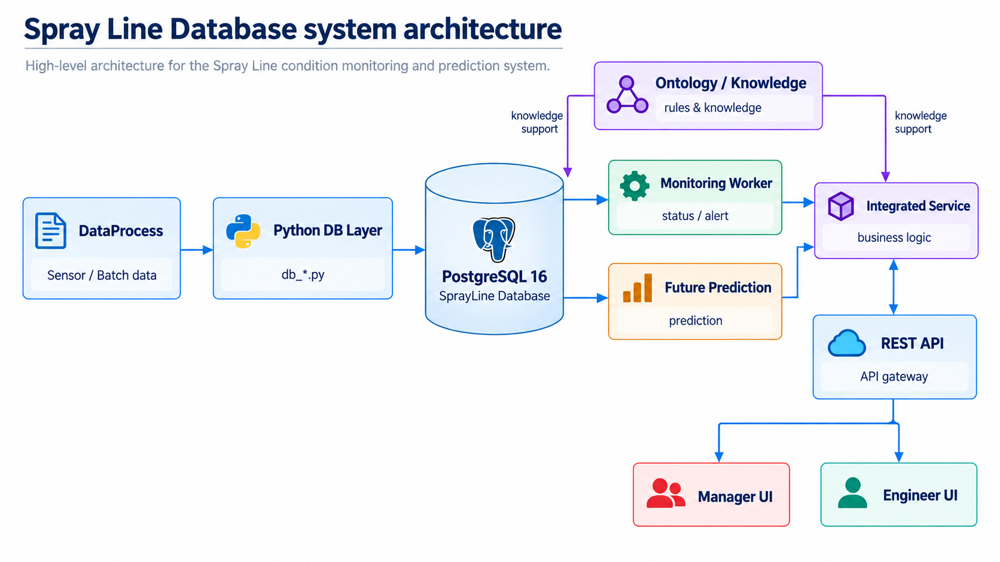
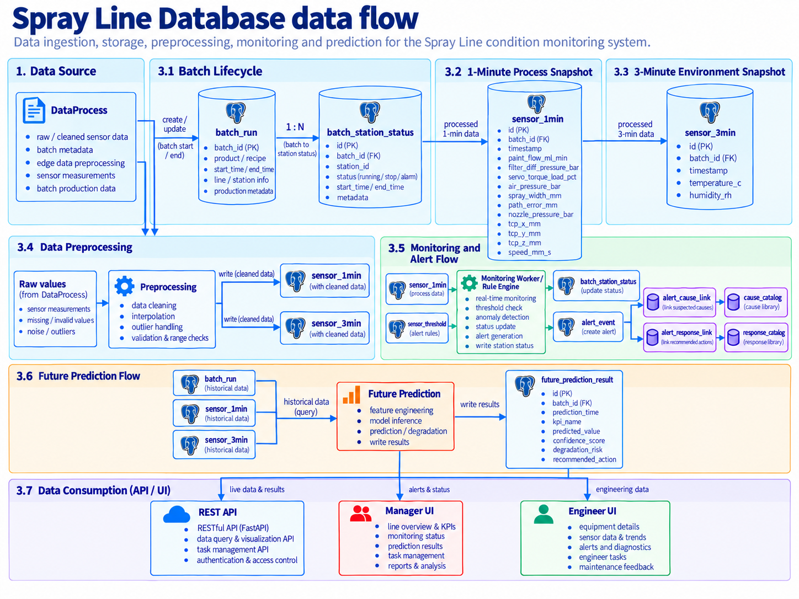
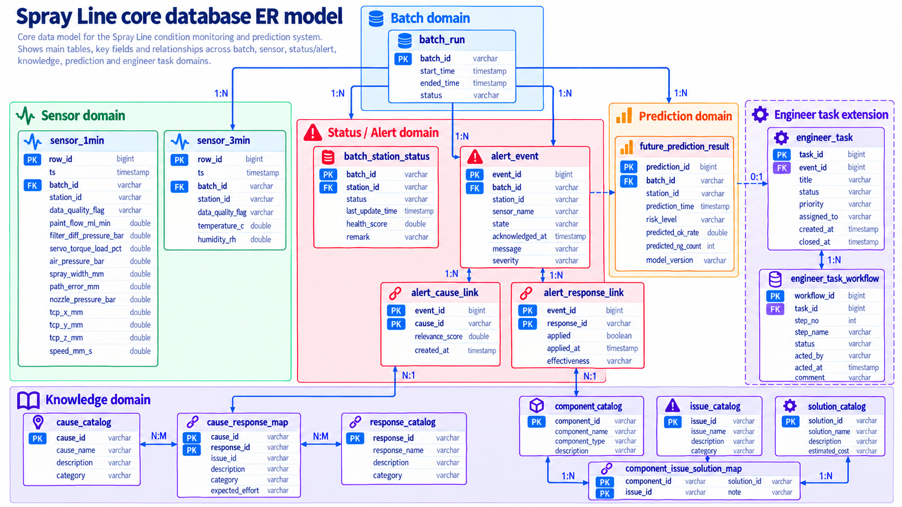

# Spray Line Database

本頁整理 Spray Line 專案目前 Database 的實際架構、資料表、Python 存取模組、DataProcess 寫入流程、Monitoring / Future 回寫流程，以及 Docker / PostgreSQL 的部署與維護方式。

本文件以 GitHub `Project-SprayLine/final_version_0718_v3` 的實際程式為主要實作依據，並依目前暫定感測資料需求整理 Database 架構、資料流與介面。

> 目前 V3 的 `dataprocess/dataprocess.py` 負責模擬資料產生、基本資料整理與 Database 寫入。未來接入台達電 / 輝創現場 Database 後，資料來源將改為 DB-to-DB 讀取，下游 Database / Monitoring / API 架構維持相同概念。

---

## 0. 感測資料需求

目前 Spray Line 暫定保留的核心感測資料如下，此清單可作為後續與台達電 / 輝創確認欄位名稱、資料型態與更新頻率的主要依據。

| 類別 | 中文名稱 | 欄位名稱 | 單位 | 暫定保存頻率 |
|---|---|---|---|---|
| 噴塗製程 | 塗料流量 | `paint_flow_ml_min` | mL/min | 1 分鐘 |
| 濾網 / PdM | 濾網壓差 | `filter_diff_pressure_bar` | bar | 1 分鐘 |
| 機械手臂 / PdM | 伺服馬達負載 | `servo_torque_load_pct` | % | 1 分鐘 |
| 噴塗製程 | 空氣壓力 | `air_pressure_bar` | bar | 1 分鐘 |
| 噴塗品質 | 噴幅寬度 | `spray_width_mm` | mm | 1 分鐘（來源待確認） |
| 機械手臂 | 軌跡誤差 | `path_error_mm` | mm | 1 分鐘 |
| 噴嘴 / 塗料供應 | 噴嘴壓力 | `nozzle_pressure_bar` | bar | 1 分鐘（現場訊號待確認） |
| 機械手臂 | TCP X | `tcp_x_mm` | mm | 待確認 |
| 機械手臂 | TCP Y | `tcp_y_mm` | mm | 待確認 |
| 機械手臂 | TCP Z | `tcp_z_mm` | mm | 待確認 |
| 機械手臂 | 移動速度 | `speed_mm_s` | mm/s | 待確認 |
| 環境 | 環境溫度 | `temperature_c` | °C | 3 分鐘 |
| 環境 | 環境濕度 | `humidity_rh` | %RH | 3 分鐘 |

> **仍需與現場確認：** `spray_width_mm` 的實際來源、`nozzle_pressure_bar` 是否有可讀取訊號、TCP XYZ 的座標系統與更新頻率，以及製程 / 設備資料是否統一每 1 分鐘保存。

## 1. Overview

Spray Line Database 使用 **PostgreSQL 16**，Database 名稱預設為：

```text
sprayline
```

Database 在整個系統中的角色是：

- 保存生產批次 (`batch_run`)
- 保存 1 分鐘製程 / 設備感測快照 (`sensor_1min`)
- 保存 3 分鐘環境感測快照 (`sensor_3min`)
- 保存站點狀態 (`batch_station_status`)
- 保存異常事件與告警關聯 (`alert_event`、`alert_cause_link`、`alert_response_link`)
- 保存 Threshold、故障原因、處置方式與知識映射
- 保存 Future / Integrated Service 的預測結果 (`future_prediction_result`)
- 提供 `db_*.py` Query / Write Function 給 DataProcess、Monitoring Worker、API 與 Service 使用

目前主要 Database 程式位於：

```text
final_version_0718_v3/
└── database/
    ├── setup_db.sql
    ├── setup_db.py
    ├── migrate_schema.py
    ├── migrate_0718_v3_backend.sql
    ├── patch_service_metrics_writeback.sql
    ├── db_connection.py
    ├── db_batch.py
    ├── db_sensor.py
    ├── db_status.py
    ├── db_alert.py
    ├── db_knowledge.py
    ├── db_future.py
    ├── db_composite.py
    ├── db_engineer_task.py
    ├── db_engineer_task_workflow.py
    ├── sprayline_db_queries.py
    └── generate_data.py
```

---

## 2. System Architecture



目前 Database 位於 DataProcess 與 API / Service / UI 之間。主要路徑如下：

```text
DataProcess
    ↓
sprayline_db_queries.py / db_*.py
    ↓
PostgreSQL 16
    ↓
Monitoring Worker / Future / Integrated Service / API
    ↓
Manager UI / Engineer UI
```

### 2.1 Active Components

**DataProcess**

```text
final_version_0718_v3/dataprocess/dataprocess.py
```

目前 Docker 的 `dataprocess` service 執行的是這一支。它會產生模擬製程資料、執行 `clean_data()`，再直接使用 Database Function 寫入 PostgreSQL。

**Database Python Layer**

```text
final_version_0718_v3/database/
```

Database 操作被拆成多個 `db_*.py` 模組，再由 `sprayline_db_queries.py` 統一 re-export。

**Monitoring Worker**

```text
final_version_0718_v3/services/monitoring_worker/
```

讀取已經進入 DB 的 `sensor_1min` / `sensor_3min`，執行 Threshold / Rule 判斷，並回寫 Alert 與 Station Status。

**API / Integration Adapter**

```text
final_version_0718_v3/api/
final_version_0718_v3/services/integration_adapter/
```

API 透過 `versionb_loader.py` 或 `database_versionb_adapter.py` 載入 Database module，提供上層 Service / UI 使用。

---

## 3. Data Flow




### 3.1 Batch Lifecycle

當新的 Batch 進入 Station_1 時，DataProcess 建立 `batch_run`：

```text
New Batch
   ↓
insert_batch_run()
   ↓
batch_run
status = running
```

目前 Batch ID 由 DataProcess 依模擬時間產生，例如：

```text
B_20260609_080000
```

當 Batch 完成 Station_3 後：

```text
Station_3 completed
   ↓
update_batch_status()
   ↓
batch_run
status = ok
ended_time = completion time
```

`batch_run.batch_id` 是 Sensor、Alert、Status 與 Future Prediction 的主要批次識別來源。

### 3.2 1-Minute Process Snapshot

**製程 / 設備 / 機械手臂** 的主要資料規劃於 `sensor_1min`。

目前核心欄位：

```text
ts
batch_id
station_id

paint_flow_ml_min
filter_diff_pressure_bar
servo_torque_load_pct
air_pressure_bar
spray_width_mm
path_error_mm
nozzle_pressure_bar

tcp_x_mm
tcp_y_mm
tcp_z_mm
speed_mm_s
```

資料分類：

| 類別 | 欄位 |
|---|---|
| Metadata | `ts`, `batch_id`, `station_id` |
| 噴塗製程 | `paint_flow_ml_min`, `air_pressure_bar`, `spray_width_mm`, `nozzle_pressure_bar` |
| 設備 / PdM | `filter_diff_pressure_bar`, `servo_torque_load_pct` |
| 機械手臂 | `path_error_mm`, `tcp_x_mm`, `tcp_y_mm`, `tcp_z_mm`, `speed_mm_s` |

目標資料流：

```text
Delta / 現場 Database
      ↓
DB-to-DB acquisition
      ↓
DataProcess / validation
      ↓
minute_readings
      ↓
insert_sensor_readings_batch()
      ↓
sensor_1min
```

### 3.3 3-Minute Environment Snapshot

環境慢變量保存於 `sensor_3min`：

```text
ts
batch_id
station_id
temperature_c
humidity_rh
```

目標資料流：

```text
Environment data
      ↓
DB-to-DB acquisition / validation
      ↓
env_readings
      ↓
insert_sensor_3min_readings_batch()
      ↓
sensor_3min
```

暫定更新頻率為 **每 3 分鐘**。

### 3.4 Data Preprocessing

DataProcess / DB-to-DB acquisition 收到資料後，先進行基本資料整理與驗證，再寫入對應的 Sensor Table。

主要處理內容：

```text
欄位格式檢查
缺值檢查
合理值範圍檢查
Outlier 檢查
時間戳與 Station / Batch 對齊
資料清洗
```

目前核心感測欄位：

```text
paint_flow_ml_min
filter_diff_pressure_bar
servo_torque_load_pct
air_pressure_bar
spray_width_mm
path_error_mm
nozzle_pressure_bar
tcp_x_mm
tcp_y_mm
tcp_z_mm
speed_mm_s
temperature_c
humidity_rh
```

資料依更新頻率分流：

```text
製程 / 設備 / Robot Data
    → sensor_1min

Environment Data
    → sensor_3min
```

### 3.5 Monitoring and Alert Flow

Monitoring Worker 讀取 DB 已存在的 Sensor Data：

```text
sensor_1min / sensor_3min
       ↓
threshold_evaluator
       ↓
warning / fault detection
       ↓
alert_event
alert_cause_link
alert_response_link
batch_station_status
```

目前 `anchored_worker.py` 可使用 DB 內最新 `MAX(ts)` 當 data anchor，並透過：

```text
runtime/monitoring_checkpoint.json
```

保存各 Station / Table 的 checkpoint，避免每次重複處理舊資料。

Duplicate Alert 預設會根據相同 Batch、Station、Sensor、State、Cause 進行抑制；Docker 設定目前使用 5 分鐘 suppression window。

### 3.6 Future Prediction Flow

Future Prediction 寫入：

```text
future_prediction_result
```

目前可保存：

```text
prediction_time
predicted_ok_rate
predicted_ng_count
quality_score
estimated_defect_rate_pct
risk_level
prediction_method
model_input_source
rule_evaluations
cause_ids
response_ids
rule_sources
```

V3 另外新增 `idempotency_key`，由 Batch、Station、Prediction Time 與 Prediction Method 建立穩定識別。`db_future.py` 使用 Upsert，避免同一個邏輯 Prediction 重複寫入。

目前程式對 `quality_score` 的語意已明確註記為：

```text
process quality score
not measured product yield
```

因此 `predicted_ok_rate` 在目前 linear-trend 相容流程中不能直接解讀為真實良率量測。

---

## 4. Core ER Model



這張 ER Model 用來說明 Spray Line Database 中各資料表的角色，以及 Batch、Sensor、Alert、Knowledge、Prediction 與 Engineer Task 之間的關係。

### 4.1 ER Model 怎麼看

圖中的：

- `PK` 代表 **Primary Key**，用來唯一識別一筆資料。
- `FK` 代表 **Foreign Key**，用來連接另一張資料表。
- `1:N` 代表 **一對多**，例如一個 Batch 可以有很多筆 Sensor Data。
- `N:M` 代表 **多對多**，例如一個 Cause 可以對應多個 Response，一個 Response 也可能對應多個 Cause。
- `0:1` 代表 **零或一筆**，例如一筆 Alert 不一定會建立 Engineer Task。

最主要的資料關係可以簡化為：

```text
batch_run
   ├─ sensor_1min
   ├─ sensor_3min
   ├─ batch_station_status
   ├─ alert_event
   └─ future_prediction_result
```

`batch_id` 是這幾個資料領域之間的重要批次識別來源。

### 4.2 Batch Domain

`batch_run` 保存每一個生產 Batch 的生命週期。

主要欄位：

```text
batch_id
start_time
ended_time
status
```

一個 Batch 在生產過程中會產生多筆 Sensor、Status、Alert 與 Prediction 紀錄，因此主要關係為：

```text
batch_run 1 ── N sensor_1min
batch_run 1 ── N sensor_3min
batch_run 1 ── N batch_station_status
batch_run 1 ── N alert_event
batch_run 1 ── N future_prediction_result
```

### 4.3 Sensor Domain

`sensor_1min` 保存每 1 分鐘的製程、設備與機械手臂資料，包括：

```text
paint_flow_ml_min
filter_diff_pressure_bar
servo_torque_load_pct
air_pressure_bar
spray_width_mm
path_error_mm
nozzle_pressure_bar
tcp_x_mm
tcp_y_mm
tcp_z_mm
speed_mm_s
```

`sensor_3min` 保存較慢變化的環境資料：

```text
temperature_c
humidity_rh
```

兩張 Sensor Table 都透過 `batch_id`、`station_id` 與 `ts` 對應到生產批次、工作站與資料時間。

### 4.4 Status / Alert Domain

`batch_station_status` 保存每一個 **Batch × Station** 的目前診斷狀態，例如 Robot Arm、Nozzle、Filter、Compressor、Spray Width 與 Quality State。

`alert_event` 保存實際發生的 Warning / Fault Event，主要記錄：

```text
event_id
batch_id
station_id
sensor_name
measured_value
state
ts
message
acknowledged_at
```

因此流程可以理解為：

```text
Sensor Data
    ↓
Monitoring Worker
    ↓
batch_station_status
    +
alert_event
```

### 4.5 Alert Cause / Response

一筆 Alert 可能有多個可能原因，也可能對應多個處置方式，因此使用 Link Table 建立關係：

```text
alert_event
   ├─ alert_cause_link ── cause_catalog
   └─ alert_response_link ── response_catalog
```

`alert_cause_link` 用來記錄 Alert 與 Cause 的關係。

`alert_response_link` 用來記錄 Alert 與 Response 的關係，也可保存 Response 是否已執行，以及執行者資訊。

### 4.6 Threshold / Knowledge Domain

`sensor_threshold` 保存 Sensor 的 Warning / Fault Threshold，供 Monitoring Worker 進行規則判斷。

Knowledge Base 分成兩組：

```text
Cause / Response Knowledge
├─ cause_catalog
├─ response_catalog
└─ cause_response_map

Troubleshooting Knowledge
├─ component_catalog
├─ issue_catalog
├─ solution_catalog
└─ component_issue_solution_map
```

`cause_response_map` 負責建立 Cause 與建議 Response 的多對多關係。

`component_issue_solution_map` 則把設備元件、問題與解決方案串在一起，例如：

```text
Filter
   ↓
Filter Clog
   ↓
Replace Filter
```

### 4.7 Prediction Domain

`future_prediction_result` 保存 Future / Ontology Runtime 的預測結果，例如：

```text
prediction_time
predicted_ok_rate
predicted_ng_count
quality_score
estimated_defect_rate_pct
risk_level
prediction_method
model_input_source
```

一個 Batch 可以產生多筆 Prediction，因此：

```text
batch_run 1 ── N future_prediction_result
```

這些結果可再提供 Manager UI、Engineer UI 或 Integrated Service 使用。

### 4.8 Engineer Task Extension

Engineer Task Extension 用來處理「Alert 發生後，由工程師接手處理」的流程。

主要資料表包含：

```text
engineer_task
station_engineer_assignment
engineer_task_assignee
engineer_task_event
notification_decision
engineer_task_report
engineer_task_attachment
```

概念流程為：

```text
alert_event
    ↓
engineer_task
    ↓
Assignee / Event / Decision
    ↓
Report / Attachment
```

不是每一筆 Alert 都一定要建立 Engineer Task，因此 Alert 與 Task 在概念上是可選擇的後續關係。

### 4.9 Core Table Summary

| Table | Primary Key | Main Purpose |
|---|---|---|
| `batch_run` | `batch_id` | 生產批次生命週期 |
| `sensor_1min` | `(row_id, ts)` | 1 分鐘製程 / 設備 / Robot 快照 |
| `sensor_3min` | `(row_id, ts)` | 3 分鐘環境快照 |
| `batch_station_status` | `(batch_id, station_id)` | 每個 Batch × Station 的診斷快照 |
| `alert_event` | `event_id` | Warning / Fault 告警事件 |
| `alert_cause_link` | `(alert_id, cause_id)` | Alert ↔ Cause 關聯 |
| `alert_response_link` | `(alert_id, response_id)` | Alert ↔ Response 關聯 |
| `sensor_threshold` | `(sensor_name, threshold_type)` | Sensor Threshold 設定 |
| `cause_catalog` | `cause_id` | 異常原因目錄 |
| `response_catalog` | `response_id` | 處置方式目錄 |
| `cause_response_map` | `(cause_id, response_id)` | Cause ↔ Response 映射 |
| `future_prediction_result` | `prediction_id` | Future / Ontology Prediction 結果 |
| `component_catalog` | `component_id` | 元件目錄 |
| `issue_catalog` | `issue_id` | 問題目錄 |
| `solution_catalog` | `solution_id` | 解決方案目錄 |
| `component_issue_solution_map` | `map_id` | Component × Issue × Solution 映射 |

## 5. Main Table Reference

### 5.1 `batch_run`

用途：保存每一個生產 Batch 的開始時間、結束時間與狀態。

主要欄位：

```text
batch_id      VARCHAR(32)  PRIMARY KEY
start_time    TIMESTAMPTZ  NOT NULL
ended_time    TIMESTAMPTZ
status        running | ok | warning | bad
```

關係：

```text
batch_run 1 ── N sensor_1min
batch_run 1 ── N sensor_3min
batch_run 1 ── N alert_event
batch_run 1 ── N future_prediction_result
batch_run 1 ── N batch_station_status
```

### 5.2 `sensor_1min`

用途：保存 Spray Line **1 分鐘製程 / 設備 / 機械手臂 Snapshot**。

核心欄位：

| Group | Columns |
|---|---|
| Identity | `row_id`, `ts`, `batch_id`, `station_id` |
| Paint / Process | `paint_flow_ml_min`, `air_pressure_bar`, `spray_width_mm`, `nozzle_pressure_bar` |
| Filter / PdM | `filter_diff_pressure_bar`, `servo_torque_load_pct` |
| Robot | `path_error_mm`, `tcp_x_mm`, `tcp_y_mm`, `tcp_z_mm`, `speed_mm_s` |

目前常用 Index：

```text
(batch_id, ts DESC)
(station_id, ts DESC)
(station_id, ts DESC) INCLUDE (filter_diff_pressure_bar, servo_torque_load_pct)
```

### 5.3 `sensor_3min`

用途：保存較慢變化的 **3 分鐘環境 Snapshot**。

核心欄位：

```text
row_id
ts
batch_id
station_id
temperature_c
humidity_rh
```

其中：

- `temperature_c`：環境溫度，單位 °C。
- `humidity_rh`：環境相對濕度，單位 %RH。
- `batch_id` 可依實際整合方式允許 `NULL`，因為環境資料可能在無生產 Batch 時仍持續存在。

### 5.4 `batch_station_status`

用途：保存一個 Batch 在某個 Station 的綜合診斷狀態。

State 欄位：

```text
robot_arm_state
nozzle_state
filter_state
compressor_state
spray_width_state
quality_state
```

合法值：

```text
ok
warning
fault
```

並保存對應 Response FK，以及 V3 Integrated Service 使用的品質指標：

```text
quality_score_pct
qc_pct
estimated_defect_rate_pct
estimated_film_thickness_um
metric_updated_at
```

`db_status.upsert_batch_station_status()` 使用 `ON CONFLICT DO UPDATE`，所以同一 `(batch_id, station_id)` 可反覆更新成最新診斷快照。

### 5.5 `alert_event`

用途：保存單筆 Warning / Fault Event。

主要欄位：

```text
event_id
batch_id
station_id
sensor_name
measured_value
state
cause
ts
message
acknowledged_at
```

`state` 只允許：

```text
warning
fault
```

`acknowledged_at IS NULL` 代表尚未確認。

### 5.6 `alert_cause_link` / `alert_response_link`

Alert 可能對應多個 Cause，也可能對應多個 Response，因此使用 Junction Table 建立 M:N 關係。

```text
alert_event
   ├── alert_cause_link ── cause_catalog
   └── alert_response_link ── response_catalog
```

`alert_cause_link.is_primary` 可標示主要原因。

`alert_response_link` 另外可以保存：

```text
executed_at
operator_id
```

用來記錄處置是否已實際執行。

### 5.7 `sensor_threshold`

用途：保存各 Sensor 的 Warning / Fault Threshold。

`threshold_type` 支援：

```text
warning
fault
warning_lo
warning_hi
fault_lo
fault_hi
```

`setup_db.sql` 目前包含的代表性 Seed Threshold：

| Sensor | Threshold | Value |
|---|---|---:|
| `filter_diff_pressure_bar` | warning | 0.30 |
| `filter_diff_pressure_bar` | fault | 0.50 |
| `servo_torque_load_pct` | warning | 60.00 |
| `servo_torque_load_pct` | fault | 80.00 |
| `air_pressure_bar` | warning_lo | 2.70 |
| `air_pressure_bar` | warning_hi | 3.80 |
| `spray_width_mm` | warning_lo | 60.00 |
| `spray_width_mm` | warning_hi | 140.00 |

Hotfix 另外補上 `air_pressure_bar` 與 `spray_width_mm` 的 `fault_lo` / `fault_hi`，使 DB Seed 與 Runtime Rule Mapping 保持相容。

### 5.8 Knowledge Tables

Knowledge Base 分成兩組。

**Cause / Response**

```text
cause_catalog
response_catalog
cause_response_map
```

用於 Alert 層級的原因與建議處置，例如：

```text
FILTER_CLOG
  → REPLACE_FILTER (priority 1)
  → BACKWASH_FILTER (priority 2)
```

**Component / Issue / Solution**

```text
component_catalog
issue_catalog
solution_catalog
component_issue_solution_map
```

用於更完整的 Troubleshooting Knowledge，例如元件問題、建議解方、優先順序與效果百分比。

### 5.9 `future_prediction_result`

用途：保存 Future / Ontology Runtime 的預測結果。

目前重要欄位包含：

```text
prediction_id
batch_id
station_id
prediction_time
predicted_ok_rate
predicted_ng_count
quality_score
estimated_defect_rate_pct
quality_score_semantics
risk_level
prediction_method
model_input_source
idempotency_key
rule_evaluations JSONB
cause_ids JSONB
response_ids JSONB
rule_sources JSONB
created_at
```

`idempotency_key` 有 Unique Index，可避免同一邏輯 Prediction 重複寫入。

### 5.10 `sensor_1hour` Compatibility Table

目前 `setup_db.sql` 仍保留：

```text
sensor_1hour
```

註解明確指出它是：

```text
0620ver_1 HOTFIX: generate_data.py requires sensor_1hour
```

因此這張表屬於舊 Data Generator 的 Compatibility Table，不應與目前核心 `sensor_1min` / `sensor_3min` Pipeline 混為一談。

---

## 6. Python Database Modules

### 6.1 Module Overview

| Module | Purpose | Main Functions |
|---|---|---|
| `db_connection.py` | PostgreSQL Connection / Query helper | `get_connection`, `_fetch`, `_fetchone` |
| `db_batch.py` | Batch Lifecycle | `get_latest_batches`, `insert_batch_run`, `update_batch_status` |
| `db_sensor.py` | Sensor read / write | `get_latest_sensor_1min`, `get_sensor_1min_series`, `insert_sensor_readings_batch`, `insert_sensor_3min_readings_batch` |
| `db_status.py` | Batch × Station status | `get_batch_station_status`, `get_latest_station_status`, `upsert_batch_station_status` |
| `db_alert.py` | Alert query / write / acknowledge | `get_unacknowledged_alerts`, `get_alert_detail`, `insert_alert_event`, `link_alert_cause`, `link_alert_response` |
| `db_knowledge.py` | Threshold / Knowledge query | `get_sensor_thresholds`, `get_solutions_for_issue`, `get_cause_info`, `get_all_components` |
| `db_future.py` | Future prediction persistence | `insert_future_prediction_result`, `get_latest_future_prediction`, `get_future_prediction_summary` |
| `db_composite.py` | Cross-table aggregation | `get_station_dashboard_snapshot`, `diagnose_component`, `get_batch_detail`, `get_manager_summary` |
| `sprayline_db_queries.py` | Unified re-export entry point | re-export above modules |

`sprayline_db_queries.py` 的設計目的是讓呼叫端可使用單一 import：

```python
import sprayline_db_queries as db
```

而不用自己分別 import 每個 `db_*.py`。

### 6.2 Connection

`db_connection.py` 讀取：

```text
DB_HOST
DB_PORT
DB_USER
DB_PASSWORD
DB_NAME
```

預設：

```text
host     = localhost
port     = 5432
user     = postgres
dbname   = sprayline
```

`get_connection()` 會設定：

```text
autocommit = False
```

因此寫入操作需要由呼叫端明確：

```python
conn.commit()
```

若發生錯誤應：

```python
conn.rollback()
```

### 6.3 Example: Insert Sensor Data

先建立 Batch，再寫 Sensor。因為 `sensor_1min.batch_id` 有 Foreign Key，該 Batch 必須先存在。

```python
from datetime import datetime, timezone
import sprayline_db_queries as db

conn = db.get_connection()

try:
    batch_id = "B_DEMO_001"

    db.insert_batch_run(
        conn,
        batch_id=batch_id,
        start_time=datetime.now(timezone.utc),
        status="running",
    )

    db.insert_sensor_readings_batch(conn, [
        {
            "ts": datetime.now(timezone.utc),
            "batch_id": batch_id,
            "station_id": "Station_1",
            "paint_flow_ml_min": 115.0,
            "filter_diff_pressure_bar": 0.20,
            "servo_torque_load_pct": 48.0,
            "air_pressure_bar": 3.2,
            "spray_width_mm": 120.0,
            "path_error_mm": 0.03,
            "nozzle_pressure_bar": 2.8,
            "tcp_x_mm": 1250.0,
            "tcp_y_mm": 420.0,
            "tcp_z_mm": 860.0,
            "speed_mm_s": 350.0,
        }
    ])

    conn.commit()
except Exception:
    conn.rollback()
    raise
finally:
    conn.close()
```

### 6.4 Example: Query Latest Sensor

```python
import sprayline_db_queries as db

conn = db.get_connection()
try:
    latest = db.get_latest_sensor_1min(conn, "Station_1")
    print(latest)
finally:
    conn.close()
```

---

## 7. Monitoring Worker Integration

Monitoring Worker 的 README 定義其定位為：

```text
sensor_1min / sensor_3min
→ threshold_evaluator
→ state
→ alert_event payload / batch_station_status update payload
→ Database write-back
```

### 7.1 Read Path

`monitoring_worker.py` 透過 `database_versionb_adapter.py` 呼叫：

```text
query_sensor_1min()
query_sensor_3min()
```

而 Adapter 再載入 `database/db_sensor.py`。

### 7.2 Rule Evaluation

`threshold_evaluator.py` 會從 Sensor Row 取出可用欄位，再呼叫 Rule Classifier。只有結果為：

```text
warning
fault
```

才建立 detection result。

### 7.3 Write-back

Alert 寫入：

```text
insert_alert_event()
link_alert_cause()
link_alert_response()
conn.commit()
```

Station Status 寫入：

```text
get_batch_station_status()
   ↓
merge current + detected
   ↓
upsert_batch_station_status()
```

這樣可避免一次 detection 把其他元件既有狀態覆蓋掉。

---

## 8. API / Service Integration

### 8.1 Database Loader

`api/versionb_loader.py` 會搜尋 Database module 路徑，支援：

```text
VERSIONB_PATH
SPRAYLINE_DB_FUNCTION_PATH
SPRAYLINE_PROJECT_ROOT
```

目前 Docker API service 設定：

```text
VERSIONB_PATH=/app/database
SPRAYLINE_DB_FUNCTION_PATH=/app/database
PYTHONPATH=/app/api:/app/services:/app/database
```

### 8.2 Integration Adapter

`services/integration_adapter/database_versionb_adapter.py` 提供 Service 層統一介面，例如：

```text
query_sensor_1min
query_sensor_3min
get_latest_sensor_1min
get_running_batches
insert_alert_event
link_alert_cause
link_alert_response
get_batch_station_status
upsert_batch_station_status
insert_future_prediction_result
get_future_prediction_summary
```

### 8.3 Database Status Check

`api/database_status.py` 使用 Read-only Query 檢查下列核心 Table：

```text
batch_run
sensor_1min
sensor_3min
batch_station_status
alert_event
future_prediction_result
```

並回傳 Table 是否存在、Row Count，以及 Sensor Table 的最新 Timestamp。

### 8.4 Current TimeSeries Limitation

`api/time_series_service.py` 目前仍保留 Random Data Prototype Path：

```python
QueryRawDataFromDatabase()
    → BuildRandomRawDataset(...)
```

該檔案自己的註解也說明，正式整合時才會改成真正 Database Query。

因此目前文件不能描述成「所有 TimeSeries API 都已經直接從 PostgreSQL 讀資料」。

---

## 9. Database Initialization and Migration

### 9.1 First-time Initialization

第一次建立全新 Database 可以使用：

```text
setup_db.py
   ↓
setup_db.sql
```

`setup_db.py` 會：

```text
1. 連到 postgres 管理 DB
2. 若 sprayline 不存在則 CREATE DATABASE
3. 執行 setup_db.sql
4. 驗證主要 Table Row Count
```

### 9.2 Important Warning: `setup_db.sql` is Destructive

`setup_db.sql` 內含多個：

```sql
DROP TABLE IF EXISTS ... CASCADE;
```

所以它適合：

```text
全新建置 / 明確要重建測試 DB
```

不適合：

```text
正常開機
既有正式 DB
想保留目前資料的情況
```

### 9.3 Normal Migration

正常 V3 啟動使用：

```text
migrate_schema.py
```

目前標準 Migration Chain 包含：

```text
patch_service_metrics_writeback.sql
migrate_0718_v3_backend.sql
```

`migrate_schema.py` 會自動建立：

```text
schema_migration
```

用來保存：

```text
migration_name
sha256_hex
applied_at
```

並使用 PostgreSQL advisory lock 防止多個 migration 同時套用。若已套用過的 Migration SHA256 被修改，程式會報錯，而不是靜默重跑。

### 9.4 V3 Migration Additions

`patch_service_metrics_writeback.sql` 主要補：

```text
batch_station_status quality metrics
future_prediction_result.prediction_method
```

`migrate_0718_v3_backend.sql` 主要補：

```text
idempotency_key
estimated_defect_rate_pct
quality_score_semantics
rule_evaluations
cause_ids
response_ids
rule_sources
```

並清除同一 idempotency key 的歷史重複 Prediction，再建立 Unique Index。

---

## 10. Docker Deployment

目前 `docker-compose.yml` 定義主要 Service：

| Service | Role | Host Port / Profile |
|---|---|---|
| `db` | PostgreSQL 16 | `5433 → 5432` |
| `db-setup` | First-time DB setup | profile `setup` |
| `db-migrate` | Non-destructive migration | startup dependency |
| `api` | FastAPI / Service API | `8011 → 8000` |
| `frontend` | Manager UI | `8012 → 8002` |
| `engineer` | Engineer UI | `8013 → 8000` |
| `dataprocess` | 模擬資料產生 / 清洗 / DB 寫入 | profile `data` |
| `monitoring_worker` | DB Sensor Monitoring / Alert | profile `monitor` |

### 10.1 PostgreSQL Port

Container 之間使用：

```text
db:5432
```

Windows Host 從 Docker 外部連線時為：

```text
localhost:5433
```

### 10.2 Existing PostgreSQL Volume

目前 Compose 使用既有 External Volume：

```text
final_version_0627_sprayline_pgdata
```

此 Volume 保存既有 PostgreSQL Data。

### 10.3 Standard V3 Startup

`START_0718_v3.bat` 會呼叫：

```text
start.ps1 -Mode start
```

正常啟動順序為：

```text
PostgreSQL
   ↓
db-migrate
   ↓
API
   ↓
Manager UI / Engineer UI
```

正常啟動 **不執行 `setup_db.sql`**，也 **不預設啟動 DataProcess**。

### 10.4 DataProcess Start / Stop

啟動 DataProcess：

```cmd
docker compose --profile data up -d --build dataprocess
```

查看 Log：

```cmd
docker compose --profile data logs -f --tail 50 dataprocess
```

停止 DataProcess：

```cmd
docker compose --profile data stop dataprocess
```

同一時間應只執行一個 DataProcess，否則多個資料產生器會同時寫入 Database，使資料筆數與模擬時間快速增加。

---

## 11. Useful SQL Checks

### 11.1 Check Latest Sensor Data

```sql
SELECT station_id,
       COUNT(*) AS row_count,
       MAX(ts) AS latest_time
FROM sensor_1min
GROUP BY station_id
ORDER BY station_id;
```

### 11.2 Latest 10 Rows

```sql
SELECT *
FROM sensor_1min
ORDER BY ts DESC
LIMIT 10;
```

### 11.3 Check Batch

```sql
SELECT batch_id, start_time, ended_time, status
FROM batch_run
ORDER BY start_time DESC
LIMIT 20;
```

### 11.4 Unacknowledged Alerts

```sql
SELECT event_id, batch_id, station_id,
       sensor_name, measured_value, state, ts
FROM alert_event
WHERE acknowledged_at IS NULL
ORDER BY ts DESC;
```

### 11.5 Check V3 Migration

```sql
SELECT migration_name, applied_at
FROM schema_migration
ORDER BY applied_at;
```

---

## 12. Engineer Task Database Extension

V3 Repository 另外存在：

```text
migrate_add_engineer_task.sql
migrate_extend_engineer_task_workflow.sql
```

這組 Migration 用於 Manager → Engineer Notification / Workflow，會建立或擴充：

```text
engineer_task
station_engineer_assignment
engineer_task_assignee
engineer_task_event
notification_decision
engineer_task_report
engineer_task_attachment
```

並由：

```text
db_engineer_task.py
db_engineer_task_workflow.py
```

提供 Database 操作。

但是目前標準 `migrate_schema.py` 的 `MIGRATIONS` 清單只包含：

```text
patch_service_metrics_writeback.sql
migrate_0718_v3_backend.sql
```

因此 Engineer Task 的兩個 Migration 檔 **不能假設一定已由標準 V3 啟動流程自動套用**。部署前必須確認實際 PostgreSQL 是否已有這些 Table，或是否另有人工 / 部署程序套用。

這一組屬於擴充 Workflow，不是本頁前述 Sensor / Alert Core Pipeline 的必要條件。

---

## 13. Known Version / Documentation Notes

目前 Repository 同時保留過渡版本與相容程式，維護時要避免混淆：

1. **Active DataProcess**

   Docker 使用：

   ```text
   dataprocess/dataprocess.py
   ```

   Repository 另有：

   ```text
   database/dataprocess.py
   ```

   不應在沒有確認的情況下把後者當成目前 Docker Active Pipeline。

2. **`sensor_1hour`**

   是 `generate_data.py` Compatibility Hotfix，不是目前 DataProcess 的主要資料表。

3. **Old ER Model**

   `sensor_1hz` + TimescaleDB 架構屬於舊版本，不應拿來解釋目前 `final_version_0718_v3`。

4. **TimeSeriesService**

   目前還保留 Random Data Prototype Path，尚不能說所有 TimeSeries Query 都完全接上 PostgreSQL。

## 14. Data Protection / Maintenance Rules

在要保留既有資料時，請不要執行：

```text
docker compose down -v
docker volume rm final_version_0627_sprayline_pgdata
database/setup_db.sql
DROP TABLE
TRUNCATE
任何 reset / re-initialize DB 的操作
```

需要停止資料增加時，應只停止 DataProcess：

```cmd
docker compose --profile data stop dataprocess
```

這不會刪除 PostgreSQL 既有資料，也不會停止 API / UI。

---

## 15. Implementation References

本頁主要依據下列 V3 實際檔案：

```text
final_version_0718_v3/dataprocess/dataprocess.py
final_version_0718_v3/database/setup_db.sql
final_version_0718_v3/database/setup_db.py
final_version_0718_v3/database/migrate_schema.py
final_version_0718_v3/database/migrate_0718_v3_backend.sql
final_version_0718_v3/database/patch_service_metrics_writeback.sql
final_version_0718_v3/database/db_connection.py
final_version_0718_v3/database/db_batch.py
final_version_0718_v3/database/db_sensor.py
final_version_0718_v3/database/db_status.py
final_version_0718_v3/database/db_alert.py
final_version_0718_v3/database/db_knowledge.py
final_version_0718_v3/database/db_future.py
final_version_0718_v3/database/db_composite.py
final_version_0718_v3/database/sprayline_db_queries.py
final_version_0718_v3/services/monitoring_worker/
final_version_0718_v3/services/integration_adapter/database_versionb_adapter.py
final_version_0718_v3/api/versionb_loader.py
final_version_0718_v3/api/database_status.py
final_version_0718_v3/api/time_series_service.py
final_version_0718_v3/docker-compose.yml
final_version_0718_v3/0718_v3_DataProcess啟停教學.ipynb
final_version_0718_v3/README_0718_v3_修改日誌.md
```

---

## 16. Short System Summary

```text
Delta / 輝創現場 Database
          ↓
       DB-to-DB acquisition
          ↓
       DataProcess / Validation
          ├─ 1 分鐘製程 / 設備 / Robot Data
          │    → sensor_1min
          │
          └─ 3 分鐘環境 Data
               → sensor_3min
                    ↓
                PostgreSQL 16
                    ↓
              Monitoring Worker
              ├─ Rule / Threshold
              ├─ alert_event
              └─ batch_station_status
                    ↓
           Future / Integrated Service
              └─ future_prediction_result
                    ↓
                   API
                    ↓
           Manager UI / Engineer UI
```


