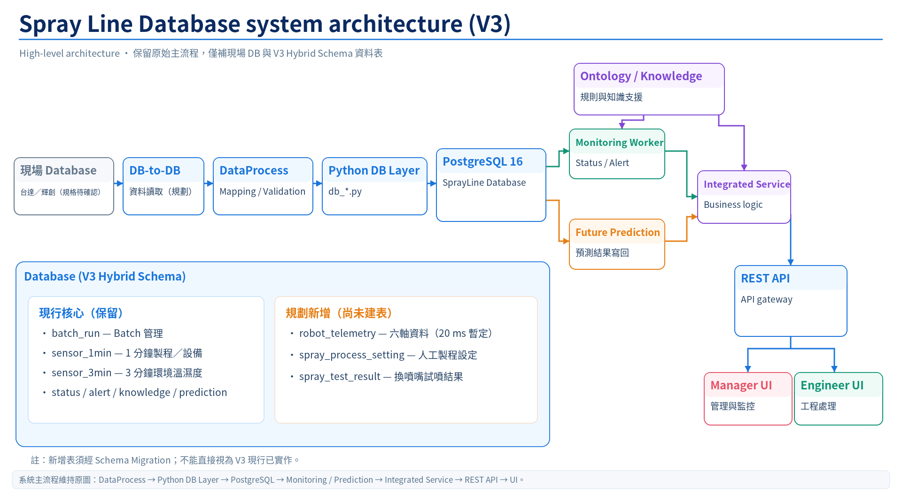
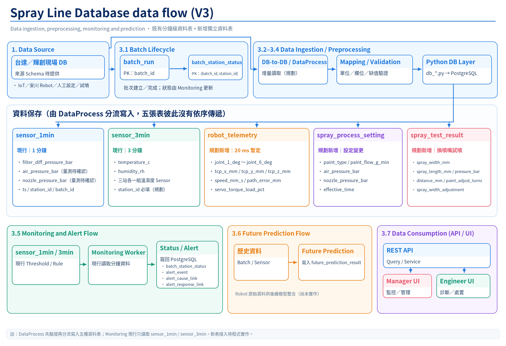
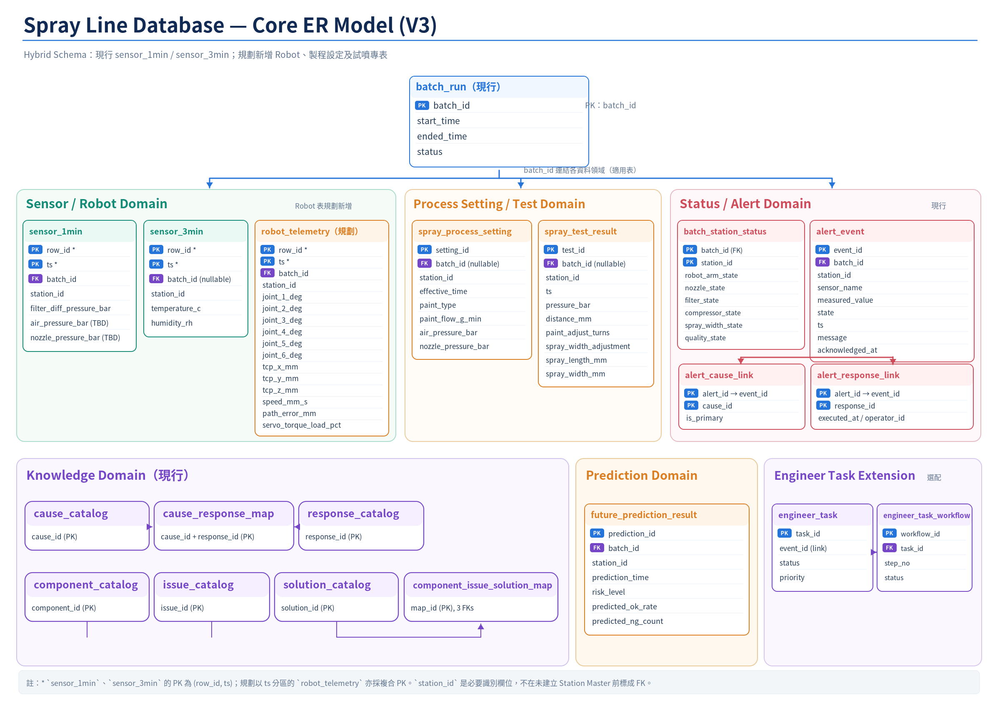

# Spray Line Database — V3 Hybrid Schema Draft

本頁整理 Spray Line 專案目前 Database 的實際架構，並加入新版 Hybrid Schema 規劃。現行 V3 仍以 `sensor_1min` / `sensor_3min` 為主要實作；新版規劃保留這兩張 Table，另外將高頻 Robot Data、製程設定與試噴結果獨立成專用 Table。

本文件的**現行程式**部分以 `Project-SprayLine/final_version_0718_v3` 為依據；**Hybrid Schema** 是依目前討論需求提出的目標設計。圖片呈現兩者並列，請勿將新增表誤認為已部署。

> 目前 V3 的 `dataprocess/dataprocess.py` 負責模擬資料產生、基本資料整理與 Database 寫入。未來接入台達電 / 輝創現場 Database 後，資料來源將改為 DB-to-DB 讀取，下游 Database / Monitoring / API 架構維持相同概念。

---

## 0. 感測資料需求

目前採用 **Hybrid Schema**：

```text
既有分鐘級資料
├─ sensor_1min
└─ sensor_3min

新增獨立資料
├─ robot_telemetry
├─ spray_process_setting
└─ spray_test_result
```

目前已確認 / 暫定條件：

```text
Station 數量        : 3
Robot               : 三個 Station 皆為相同 6 軸機械手臂
Joint Angle Unit    : degree
Robot Data Period   : 暫定固定 20 ms
Robot Data Rate     : 約 50 Hz
Environment Sensor  : 暫定每個 Station 各有一組溫濕度 Sensor
Robot Joint History : 需要保存
Retention Period    : TBD
```

### 0.1 `sensor_1min`

保留作為分鐘級製程 / 設備 Snapshot。

目前規劃主要欄位：

```text
row_id
ts
batch_id
station_id

filter_diff_pressure_bar
air_pressure_bar
nozzle_pressure_bar
```

`air_pressure_bar`、`nozzle_pressure_bar` 是否以實際量測方式進入 `sensor_1min`，待取得實際 Source Sample Data 後確認。

### 0.2 `sensor_3min`

保留作為三個 Station 的環境資料。

```text
row_id
ts
batch_id
station_id
temperature_c
humidity_rh
```

目前暫定：

```text
Station_1 → 1 組溫濕度 Sensor
Station_2 → 1 組溫濕度 Sensor
Station_3 → 1 組溫濕度 Sensor
```

因此 `station_id` 暫定為必要欄位。

### 0.3 `robot_telemetry`

新增，用來保存六軸機械手臂高頻資料。

```text
row_id
ts
batch_id
station_id

joint_1_deg
joint_2_deg
joint_3_deg
joint_4_deg
joint_5_deg
joint_6_deg

tcp_x_mm
tcp_y_mm
tcp_z_mm
speed_mm_s
path_error_mm
servo_torque_load_pct
```

目前規劃：

```text
6-axis Robot
Joint Unit = degree
Source Period ≈ 20 ms
Source Rate ≈ 50 Hz
3 Stations
Historical Storage = Required
```

Robot Joint Angle 經老師與廠商討論後原則上可取得；實際欄位格式、資料型態與回傳週期待取得 Sample Data 後驗證。

### 0.4 `spray_process_setting`

新增，用來保存人工制定 / 製程設定值。

```text
setting_id
effective_time
station_id
batch_id
paint_type
paint_flow_g_min
air_pressure_bar
nozzle_pressure_bar
```

目前廠商提供的塗料流量單位為 `g/min`，因此新版規劃使用 `paint_flow_g_min`。

### 0.5 `spray_test_result`

新增，用來保存更換新噴嘴頭後的試噴結果。

```text
test_id
ts
station_id
batch_id
pressure_bar
distance_mm
paint_adjust_turns
spray_width_adjustment
spray_length_mm
spray_width_mm
```

目前流程：

```text
更換新噴嘴頭
      ↓
試噴一次
      ↓
記錄噴幅結果
      ↓
正式噴塗
```

因此 `spray_width_mm` 不再視為固定每分鐘 Sensor Data。

## 1. Overview

Spray Line Database 使用 **PostgreSQL 16**，預設資料庫名稱為 `sprayline`。本文件同時描述「**目前 `final_version_0718_v3` 已有的實作**」及「**預計提供給台達／輝創的 V3 Hybrid Schema 目標**」，兩者不可視為已同步完成。

| 範圍 | 現行 V3 | Hybrid Schema 規劃 |
|---|---|---|
| 生產批次 | `batch_run` | 保留 |
| 製程／設備分鐘級資料 | `sensor_1min` | 保留表名，調整目標資料欄位及來源 |
| 溫濕度分鐘級資料 | `sensor_3min` | 保留表名；暫定三站各一組溫濕度 Sensor |
| 六軸機械手臂資料 | 部分欄位混在舊 `sensor_1min` | 規劃新增 `robot_telemetry`，約 20 ms／筆 |
| 製程人工設定 | 尚未依本規劃獨立建表 | 規劃新增 `spray_process_setting` |
| 換新噴嘴後的試噴結果 | 舊版把 `spray_width_mm` 當分鐘級欄位 | 規劃新增 `spray_test_result` |
| 監控／異常／知識／預測 | 既有相關表與服務 | 保留；新表整合需另外開發 |

現有 Database 仍負責保存 `batch_station_status`、`alert_event`、原因／處置關聯、Threshold、Knowledge 和 `future_prediction_result`，並透過 `db_*.py` 提供 DataProcess、Monitoring、API 等模組使用。

目前主要 Database 程式位於：

```text
final_version_0718_v3/
└── database/
    ├── setup_db.sql
    ├── setup_db.py
    ├── migrate_schema.py
    ├── migrate_0718_v3_backend.sql
    ├── patch_service_metrics_writeback.sql
    ├── db_connection.py
    ├── db_batch.py
    ├── db_sensor.py
    ├── db_status.py
    ├── db_alert.py
    ├── db_knowledge.py
    ├── db_future.py
    ├── db_composite.py
    ├── db_engineer_task.py
    ├── db_engineer_task_workflow.py
    ├── sprayline_db_queries.py
    └── generate_data.py
```

### 1.1 Hybrid Schema Planning

新版規劃保留目前 V3 已大量使用的：

```text
sensor_1min
sensor_3min
```

並新增：

```text
robot_telemetry
spray_process_setting
spray_test_result
```

原因：

- `sensor_1min` / `sensor_3min` 已被目前 DataProcess、Monitoring Worker、API 使用。
- Robot Joint Angle 約 20 ms 一筆，不適合塞進 `sensor_1min`。
- 製程設定不是固定週期 Sensor Data。
- 噴幅寬度只在更換新噴嘴後試噴時產生，不適合當每分鐘 Sensor。

目前新增 Table 尚屬規劃，需後續新增 Migration 與 Database Module。

## 2. System Architecture



這張圖屬於**高階系統架構圖**，說明現場資料將如何進入 SprayLine PostgreSQL，以及資料庫後續如何支援監控、預測與 UI；它不是逐張 Table 的資料流圖。

### 2.1 圖的左側：現場 DB 到 SprayLine

```text
台達／輝創現場 Database（未來資料來源）
       ↓  DB-to-DB（規劃）
DataProcess：Mapping / Validation
       ↓
Python DB Layer：db_*.py
       ↓
PostgreSQL 16：sprayline
```

- **現場 Database**：未來由台達／輝創先收集 IoT、安川機械手臂、人工設定與試噴資料；其 DBMS、Source Table / View 和實際資料格式仍待確認。
- **DB-to-DB**：由 SprayLine 的 Edge PC 讀取現場資料，並非 SprayLine 一顆一顆直接接收感測器訊號。
- **DataProcess**：執行欄位對應、型別／單位轉換、缺值驗證及分流。
- **Python DB Layer**：透過 `db_*.py` 將資料寫進 PostgreSQL。新表對應寫入函式尚須實作。

**現行程式狀態：** Docker `dataprocess` 目前使用 `final_version_0718_v3/dataprocess/dataprocess.py`，以模擬資料為主要輸入，透過既有 Database Function 寫入；現場 DB-to-DB 尚屬未來整合流程。

### 2.2 圖的中央：V3 Hybrid Schema

圖中的 Database 區塊分成兩類：

| 狀態 | 資料表 | 角色 |
|---|---|---|
| 現行核心 | `batch_run` | 批次生命週期 |
| 現行核心 | `sensor_1min` | 1 分鐘製程／設備資料；欄位調整屬規劃 |
| 現行核心 | `sensor_3min` | 3 分鐘環境溫濕度；三站各一組暫定 |
| 規劃新增 | `robot_telemetry` | 六軸角度及 Robot 歷史資料，暫定 20 ms |
| 規劃新增 | `spray_process_setting` | 人工／設備製程設定 |
| 規劃新增 | `spray_test_result` | 換新噴嘴後的試噴結果 |
| 現行相關 | Status / Alert / Knowledge / Prediction | 維持既有資料表與服務 |

新表**不代表目前 `final_version_0718_v3` 已建立**；正式導入需要新增 Migration、寫入／查詢模組及相依的 Service 調整。

### 2.3 圖的右側：Database 後續服務

- **Monitoring Worker**：現行從 `sensor_1min`、`sensor_3min` 取資料做 Threshold / Rule 判斷，回寫 Alert 和 Station Status；目前不直接掃描全部 `robot_telemetry` 高頻資料。
- **Future Prediction**：使用 DB 歷史資料進行預測，結果寫回 `future_prediction_result`。是否納入新 Robot 原始資料，須再進行模型與程式整合。
- **Ontology / Knowledge**：提供監控規則與 Integrated Service 的知識支援。
- **Integrated Service → REST API → Manager UI / Engineer UI**：提供業務整合、查詢及畫面顯示；新資料表的 API 不應視為已完成。

### 2.4 主要程式位置

| 元件 | 現行程式或位置 |
|---|---|
| DataProcess | `final_version_0718_v3/dataprocess/dataprocess.py` |
| Database Python Layer | `final_version_0718_v3/database/db_*.py`、`sprayline_db_queries.py` |
| Monitoring Worker | `final_version_0718_v3/services/monitoring_worker/` |
| API / Integration Adapter | `final_version_0718_v3/api/`、`services/integration_adapter/` |

圖上保留原本主流程；新增的只有**現場 DB 接入**與**Hybrid Schema 資料表分類**，不是重新設計整個 Service 架構。

---

## 3. Data Flow



這張圖解釋**來源 DB 如何被讀取、驗證及分流寫入五張資料表**，以及其中哪些表供目前的監控與預測使用。圖中的「規劃新增」表示目標流程，**不等於目前系統已經執行這五條寫入路徑**。

### 3.1 Batch Lifecycle（上方左中）

- `batch_run`：由 `batch_id`（PK）識別一個生產批次，包含 `start_time`、`ended_time`、`status`。
- `batch_station_status`：以 `(batch_id, station_id)` 為複合 PK，保存每個 Batch 在各站的綜合診斷狀態。
- **圖中的關係線為批次關聯，不表示 `batch_run` 會自行計算狀態**；Station Status 的現行寫回主要由 Monitoring Worker 執行。

現行模擬流程可由 `insert_batch_run()` 建立批次，並透過 `update_batch_status()` 更新結束狀態。現場整合後 `batch_id` 的生成者、對應規則仍須和來源 DB 協調。

### 3.2–3.4 Data Ingestion / Preprocessing（上方右側與中央）

依照新圖，資料應先走完整流程，再分別寫入各 Table：

```text
台達／輝創現場 Database
        ↓
DB-to-DB / DataProcess（增量讀取：規劃）
        ↓
Mapping / Validation（欄位、單位、缺值、時間與 Station/Batch）
        ↓
Python DB Layer
        ├── sensor_1min
        ├── sensor_3min
        ├── robot_telemetry
        ├── spray_process_setting
        └── spray_test_result
```

**這五張表是分流寫入，不是 `sensor_1min → sensor_3min → robot_telemetry` 依序傳遞。**

| 寫入目標 | 主要內容 | 保存週期或事件 | 狀態 |
|---|---|---|---|
| `sensor_1min` | `filter_diff_pressure_bar`；`air_pressure_bar`、`nozzle_pressure_bar` 是否有每分鐘量測值待確認 | 1 分鐘 | 表現行；新欄位配置規劃中 |
| `sensor_3min` | `temperature_c`、`humidity_rh`，每站各一組感測器暫定 | 3 分鐘 | 表現行；站點需求待確認 |
| `robot_telemetry` | `joint_1_deg`～`joint_6_deg`、TCP XYZ、速度、路徑誤差、伺服負載 | 約 20 ms（暫定） | 規劃新增 |
| `spray_process_setting` | `paint_type`、`paint_flow_g_min`、空氣／噴嘴壓力設定 | 設定生效／變更時 | 規劃新增 |
| `spray_test_result` | 換新噴嘴後試噴的壓力、距離、調節量與噴幅實際長寬 | 事件發生時 | 規劃新增 |

#### `sensor_1min`：製程／設備快照

規劃欄位：`row_id`、`ts`、`batch_id`、`station_id`、`filter_diff_pressure_bar`、`air_pressure_bar`、`nozzle_pressure_bar`。其中後兩種壓力來源目前偏設備顯示／人工設定，**只有確認可提供實測週期值後才適合保留作為 1 分鐘感測值**；人工設定值應放 `spray_process_setting`。

#### `sensor_3min`：環境快照

規劃欄位：`row_id`、`ts`、`batch_id`、`station_id`、`temperature_c`、`humidity_rh`。目前暫定 Station_1、Station_2、Station_3 各有一組溫濕度 Sensor，故 `station_id` 為必要欄位；若無生產批次，`batch_id` 可為 `NULL`。

#### `robot_telemetry`：六軸高頻歷史資料

規劃欄位：`row_id`、`ts`、`batch_id`、`station_id`、`joint_1_deg`～`joint_6_deg`、`tcp_x_mm`、`tcp_y_mm`、`tcp_z_mm`、`speed_mm_s`、`path_error_mm`、`servo_torque_load_pct`。三站皆為六軸手臂；老師與廠商討論後認為關節角度原則上可取得，但單位 degree、約 20 ms 固定週期仍以取得實際樣本後驗證為準。

若三台同時以 50 Hz 運行每日 8 小時，規劃上限約 **4,320,000 rows／日**。建議後續採 `ts` 分區、Batch／Station 查詢索引及保留期限政策；是否每日 Partition、何時清理仍需定案。

#### `spray_process_setting`：製程設定

規劃欄位：`setting_id`、`effective_time`、`station_id`、`batch_id`、`paint_type`、`paint_flow_g_min`、`air_pressure_bar`、`nozzle_pressure_bar`。塗料流量的現場回覆單位為 **g/min**，不是 mL/min；壓力如由 `kgf/cm²` 來源提供，需在 Mapping 階段轉為約定的 `bar`，並保留來源單位說明。

#### `spray_test_result`：試噴事件紀錄

規劃欄位：`test_id`、`ts`、`station_id`、`batch_id`、`pressure_bar`、`distance_mm`、`paint_adjust_turns`、`spray_width_adjustment`、`spray_length_mm`、`spray_width_mm`。噴幅寬度是在**更換新噴嘴頭後試噴一次**取得，不應當作每分鐘連續感測資料。

### 3.5 Monitoring and Alert Flow（下方左側）

圖中的目前實作流程為：

```text
sensor_1min / sensor_3min
       ↓
Monitoring Worker / threshold_evaluator
       ↓
warning / fault detection
       ↓
alert_event + batch_station_status
       ├── alert_cause_link
       └── alert_response_link
```

`alert_event` 保存異常事件；`alert_cause_link`、`alert_response_link` 將異常連到原因與處置。`anchored_worker.py` 使用資料時間 Anchor 和 `runtime/monitoring_checkpoint.json` 管理處理進度；目前的 Duplicate Alert 抑制與狀態 Upsert 機制仍以現行 V3 程式為準。

**重要限制：** 新的 `robot_telemetry` 尚未接入既有 Monitoring Worker。不能因圖中出現此表，就說它已經做到 20 ms 即時異常判斷。

### 3.6 Future Prediction Flow（下方中央）

現行預測使用歷史 Batch／Sensor 資料，將結果寫回 `future_prediction_result`。其中包含 `prediction_time`、`risk_level`、`predicted_ok_rate`、`predicted_ng_count`、`prediction_method`、`idempotency_key` 與 JSONB 規則資料等；相同邏輯預測可藉由 Upsert 避免重複寫入。

圖示不代表 `robot_telemetry` 已接入預測模型；後續若中正或其他模型需要六軸角度歷史資料，還須另行建立讀取、特徵處理與模型介面。現有 `quality_score` 代表製程品質分數，不等於實測產品良率。

### 3.7 Data Consumption（右下方）

`REST API` 將 PostgreSQL 中已可使用的資料提供給 Manager UI（監控／管理）與 Engineer UI（診斷／處置）。新表的 API Query、20 ms 資料區間查詢與批次回放均屬後續整合項目，不能視為已上線。

---

## 4. Core ER Model



這張 ER Model 用來說明**資料表及其關聯**：上方以 `batch_run` 為批次識別來源，中間依資料性質區分 Sensor / Robot、Process Setting / Test、Status / Alert；下方保留 Knowledge、Prediction 與 Engineer Task 區域。ER 圖不是實際執行順序圖。

### 4.1 ER Model 怎麼看

- **PK（Primary Key）**：在該 Table 中唯一識別資料。兩個欄位都標 PK，可能是複合主鍵。
- **FK（Foreign Key）**：參照其他資料表的鍵；實際是否建立 DB 約束，仍要核對目前 SQL 或正式 Migration。
- **1:N**：一筆 Batch 可以對應多筆感測／告警／預測資料。
- **N:M**：多對多，通常透過 Link / Map Table 實作。
- **0:1**：一筆 Alert 不一定有對應的 Engineer Task。
- **現行／規劃**：圖上兩種狀態不可混為一談。`sensor_1min`、`sensor_3min`、`batch_run` 及多數監控／知識相關表屬現行；`robot_telemetry`、`spray_process_setting`、`spray_test_result` 為規劃新增。

### 4.2 Batch Domain（上方藍色）

`batch_run` 主要欄位：`batch_id`（PK）、`start_time`、`ended_time`、`status`。下方不同領域可利用 `batch_id` 連回這張表；但環境資料、製程設定或試噴資料在沒有 Batch 的情況下，可視實際規格允許 `batch_id = NULL`。

**圖上沒有另外建立 `station` 主檔**，所以 `station_id` 是必要識別欄位，但不代表當前 SprayLine DB 已存在 `station.station_id` 這個實體 FK。若交由台達建立來源交換 DB，可另要求建立 Station Master。

### 4.3 Sensor / Robot Domain（左側綠色）

| Table | 主要欄位 | PK | 目前狀態 |
|---|---|---|---|
| `sensor_1min` | `filter_diff_pressure_bar`，以及待確認的 `air_pressure_bar`、`nozzle_pressure_bar` | 現行 `(row_id, ts)` | 保留表，目標欄位調整中 |
| `sensor_3min` | `temperature_c`、`humidity_rh` | 現行 `(row_id, ts)` | 保留表，每站一組溫濕度 Sensor 暫定 |
| `robot_telemetry` | `joint_1_deg`～`joint_6_deg`、TCP XYZ、`speed_mm_s`、`path_error_mm`、`servo_torque_load_pct` | 分區方案規劃 `(row_id, ts)` | **規劃新增** |

**Robot 欄位代表六個獨立關節角度 J1～J6，不是 `rx/ry/rz` 空間姿態旋轉角。** 角度單位暫用 degree，資料週期暫定 20 ms。TCP XYZ 單位為 mm，實際座標系仍待確認。

`robot_telemetry` 的 PK 需要與分區策略一起定案：**若 PostgreSQL 以 `ts` 做 RANGE Partition，PK／UNIQUE 必須包含 `ts` 分區鍵**；若不分區，之前的參考 SQL 使用單一 `row_id` PK 亦可。圖中 `(row_id, ts)` 是**目標分區設計**，不可直接說現有 SQL 已這樣建表。

### 4.4 Process Setting / Test Domain（中央橘色）

`spray_process_setting` 使用 `setting_id`（PK）記錄生效時間 `effective_time`、Station／Batch、塗料種類、`paint_flow_g_min`、空氣與噴嘴壓力設定。這些是**設定值**，不一定是每分鐘即時量測值。

`spray_test_result` 使用 `test_id`（PK）記錄換新噴嘴後的試噴事件，包含 `pressure_bar`、`distance_mm`、`paint_adjust_turns`、`spray_width_adjustment`、`spray_length_mm`、`spray_width_mm`。

兩張表均**規劃新增**，是否強制 `batch_id` 為 FK、何時允許 NULL，應依正式來源資料流程確認。

### 4.5 Status / Alert Domain（右上紅色）

`batch_station_status` 的複合 PK 是 `(batch_id, station_id)`，保存 `robot_arm_state`、`nozzle_state`、`filter_state`、`compressor_state`、`spray_width_state`、`quality_state` 等診斷狀態。

`alert_event` 以 `event_id` 為 PK，保存 `batch_id`、`station_id`、`sensor_name`、`measured_value`、`state`、`ts`、`message`、`acknowledged_at`。目前實作中的有效異常狀態主要為 `warning`、`fault`。

### 4.6 Alert Cause / Response（紅色下方兩張 Link Table）

```text
alert_event.event_id
    ├── alert_cause_link.alert_id → cause_catalog.cause_id
    └── alert_response_link.alert_id → response_catalog.response_id
```

關聯表欄位 `alert_id` 指向 `alert_event.event_id`；**欄位名稱不同不等於兩個事件 ID**。`alert_cause_link` 可記錄 `is_primary`；`alert_response_link` 可記錄 `executed_at`、`operator_id`。這兩張 Link Table 的邏輯是 Alert 與原因／處置的多對多關係。

### 4.7 Knowledge Domain（下方紫色）

- **Cause / Response**：`cause_catalog`、`response_catalog`、`cause_response_map`，保存原因與建議處置關係。
- **Troubleshooting**：`component_catalog`、`issue_catalog`、`solution_catalog`、`component_issue_solution_map`，保存元件／問題／解法對應。

此區維持既有 Knowledge Domain；圖中簡化展示，並未列出所有欄位與完整約束。

### 4.8 Prediction Domain（下方橘色）

`future_prediction_result` 以 `prediction_id` 為 PK，並以 `batch_id` 關聯批次；圖上展示 `prediction_time`、`risk_level`、`predicted_ok_rate`、`predicted_ng_count` 等代表性欄位。實際 V3 還有 `prediction_method`、`idempotency_key`、JSONB 規則資訊，見第 5.12 節。

### 4.9 Engineer Task Extension（下方右側紫色）

`engineer_task` 與 `engineer_task_workflow` 用於警報後的工程師處理流程，為選配擴充。它們的 Migration 不一定已隨標準 V3 啟動程序套用；是否實際建表需要檢查部署環境。

### 4.10 Core Table Summary

| Table | Key / Relation | 主用途 | 狀態 |
|---|---|---|---|
| `batch_run` | PK: `batch_id` | 批次生命週期 | 現行 |
| `sensor_1min` | PK: `(row_id, ts)` | 分鐘級製程／設備快照 | 現行表；目標欄位重整 |
| `sensor_3min` | PK: `(row_id, ts)` | 三站環境溫濕度 | 現行表；來源配置暫定 |
| `robot_telemetry` | 擬分區 PK: `(row_id, ts)` | 六軸 Robot 高頻歷史 | 規劃新增 |
| `spray_process_setting` | 擬 PK: `setting_id` | 製程設定 | 規劃新增 |
| `spray_test_result` | 擬 PK: `test_id` | 試噴紀錄 | 規劃新增 |
| `batch_station_status` | PK: `(batch_id, station_id)` | 批次×站點診斷 | 現行 |
| `alert_event` | PK: `event_id` | Warning / Fault | 現行 |
| `alert_cause_link` | `(alert_id, cause_id)` | Alert ↔ Cause | 現行 |
| `alert_response_link` | `(alert_id, response_id)` | Alert ↔ Response | 現行 |
| `sensor_threshold` | `(sensor_name, threshold_type)` | Threshold | 現行 |
| `cause_catalog` / `response_catalog` / `cause_response_map` | 各自 PK／映射鍵 | 原因與處置知識 | 現行 |
| `component_catalog` / `issue_catalog` / `solution_catalog` / `component_issue_solution_map` | 各自 PK／映射鍵 | 元件、問題與解法 | 現行 |
| `future_prediction_result` | PK: `prediction_id` | 預測結果 | 現行 |
| Engineer Task 相關表 | 各自 PK／FK | 工程師處理工作流 | 選配，部署狀態待核對 |

---

## 5. Main Table Reference

### 5.1 `batch_run`

用途：保存每一個生產 Batch 的開始時間、結束時間與狀態（現行）。

```text
batch_id      VARCHAR(32) PRIMARY KEY
start_time    TIMESTAMPTZ NOT NULL
ended_time    TIMESTAMPTZ
status        running | ok | warning | bad（現行狀態值）
```

關聯：一個 Batch 可對應多筆 `sensor_1min`、`sensor_3min`、`alert_event`、`future_prediction_result`，以及各 Station 的 `batch_station_status`。規劃中的 `robot_telemetry`、`spray_process_setting`、`spray_test_result` 亦將依 `batch_id` 建立批次關係，但允許 NULL 的規則需依資料來源決定。

### 5.2 `sensor_1min`

用途：保存 **1 分鐘製程／設備 Snapshot**。此表在現行 V3 已存在，下面列的是 **Hybrid Schema 目標欄位**，不是說目前 Migration 已將舊欄位全部搬移。

| 分組 | 目標欄位 | 說明 |
|---|---|---|
| 識別 | `row_id`, `ts`, `batch_id`, `station_id` | 現行 PK: `(row_id, ts)`；Station 必須識別 |
| 製程／設備 | `filter_diff_pressure_bar` | IoT 濾網壓差，單位 bar |
| 待確認實測 | `air_pressure_bar`, `nozzle_pressure_bar` | 只有現場能提供週期實測值，才放入本表 |

目前常用 Index 以現行 V3 Schema 為準，包括 `(batch_id, ts DESC)`、`(station_id, ts DESC)`。原本包含 `servo_torque_load_pct` 的 Index 是**現行舊欄位相容設計**；正式欄位移轉後需重新評估。

Robot J1～J6、TCP、Speed、Path Error、Servo Load 的**原始高頻資料**規劃放在 `robot_telemetry`；分鐘級統計值若監控需要，可另外設計聚合欄位，但目前尚未定義。

### 5.3 `sensor_3min`

用途：保存 **3 分鐘環境 Snapshot**（表現行）。目標欄位：

```text
row_id
ts
batch_id
station_id
temperature_c
humidity_rh
```

- `temperature_c`：環境溫度，°C；`humidity_rh`：相對濕度，%RH。
- 暫定三個 Station 各有一組溫濕度 Sensor，`station_id` 要求必填。
- 無生產 Batch 時環境資料仍可能產生，`batch_id` 可允許 `NULL`。
- 現行資料表的 PK 為 `(row_id, ts)`；實際 Source 更新頻率與 3 分鐘保存規則需分開確認。

### 5.4 `robot_telemetry`（規劃新增）

用途：保存六軸 Robot 的高頻歷史資料，提供未來批次動作回放及模擬。

| 欄位 | 規劃型別 | 必填規劃 | 說明 |
|---|---|---|---|
| `row_id` | BIGINT | Yes | 內部流水號 |
| `ts` | TIMESTAMPTZ | Yes | 來源量測時間／預計分區鍵 |
| `station_id` | VARCHAR(32) | Yes | 三個 Station 之一 |
| `batch_id` | VARCHAR(32) | 生產中 Yes，待驗證 | 批次對應；待機資料是否保存需確定 |
| `joint_1_deg` ～ `joint_6_deg` | DOUBLE PRECISION | Yes（資料完整時） | 六軸關節角度，單位暫定 degree |
| `tcp_x_mm`、`tcp_y_mm`、`tcp_z_mm` | DOUBLE PRECISION | 待確認 | TCP 位置，單位 mm |
| `speed_mm_s` | DOUBLE PRECISION | 待確認 | 移動速度，mm/s |
| `path_error_mm` | DOUBLE PRECISION | 待確認 | 軌跡誤差，mm |
| `servo_torque_load_pct` | DOUBLE PRECISION | 待確認 | Servo 負載，% |

規劃原始週期約 20 ms（50 Hz），三台 Robot 每日若各運轉 8 小時，約產生 432 萬筆資料。保存期限尚未定案。

**PK 與 Partition：** ER 圖採「依 `ts` 做分區」方案，因此規劃 `(row_id, ts)` 為複合 PK；但先前提供給台達的 PostgreSQL **未分區參考 SQL** 使用單獨 `row_id` PK。兩者為不同方案，尚須決定並同步，不能視為同一份已落地 Schema。規劃查詢 Index 為 `(station_id, ts)` 及 `(batch_id, station_id, ts)`。

### 5.5 `spray_process_setting`（規劃新增）

用途：保存不是固定每分鐘量測的製程／人工設定。

| 欄位 | 說明 |
|---|---|
| `setting_id` | PK；設定 ID |
| `effective_time` | 設定生效時間 |
| `station_id`、`batch_id` | Station／Batch 對應（Batch 可選規則待確認） |
| `paint_type` | 底漆、面漆、金油等 |
| `paint_flow_g_min` | 塗料質量流量設定，g/min |
| `air_pressure_bar`、`nozzle_pressure_bar` | 空氣／噴槍壓力設定，bar |

`paint_flow_g_min` 不可直接當成 `paint_flow_ml_min`。若設備提供的原始壓力單位不同，應先在 DataProcess 中依確認後的單位進行轉換。

### 5.6 `spray_test_result`（規劃新增）

用途：保存更換新噴嘴頭後的單次試噴事件，而不是 1 分鐘 Sensor Snapshot。

| 欄位 | 說明 |
|---|---|
| `test_id` | PK；試噴 ID |
| `ts` | 試噴時間 |
| `station_id`、`batch_id` | Station／Batch 對應，Batch 可選規則待確認 |
| `pressure_bar` | 試噴壓力 |
| `distance_mm` | 噴槍與測試面的距離 |
| `paint_adjust_turns` | 漆料調節鈕圈數 |
| `spray_width_adjustment` | 噴幅調節設定 |
| `spray_length_mm` | 試噴長度 |
| `spray_width_mm` | 試噴寬度 |

正式 Source Table 和事件觸發方式待台達／輝創確認。

### 5.7 `batch_station_status`

用途：保存一個 Batch 在某個 Station 的綜合診斷狀態。

State 欄位：

```text
robot_arm_state
nozzle_state
filter_state
compressor_state
spray_width_state
quality_state
```

合法值：

```text
ok
warning
fault
```

並保存對應 Response FK，以及 V3 Integrated Service 使用的品質指標：

```text
quality_score_pct
qc_pct
estimated_defect_rate_pct
estimated_film_thickness_um
metric_updated_at
```

`db_status.upsert_batch_station_status()` 使用 `ON CONFLICT DO UPDATE`，所以同一 `(batch_id, station_id)` 可反覆更新成最新診斷快照。

### 5.8 `alert_event`

用途：保存單筆 Warning / Fault Event。

主要欄位：

```text
event_id
batch_id
station_id
sensor_name
measured_value
state
cause
ts
message
acknowledged_at
```

`state` 只允許：

```text
warning
fault
```

`acknowledged_at IS NULL` 代表尚未確認。

### 5.9 `alert_cause_link` / `alert_response_link`

Alert 可能對應多個 Cause，也可能對應多個 Response，因此使用 Junction Table 建立 M:N 關係。

```text
alert_event
   ├── alert_cause_link ── cause_catalog
   └── alert_response_link ── response_catalog
```

`alert_cause_link.is_primary` 可標示主要原因。

`alert_response_link` 另外可以保存：

```text
executed_at
operator_id
```

用來記錄處置是否已實際執行。

### 5.10 `sensor_threshold`

用途：保存各 Sensor 的 Warning / Fault Threshold。

`threshold_type` 支援：

```text
warning
fault
warning_lo
warning_hi
fault_lo
fault_hi
```

`setup_db.sql` 目前包含的代表性 Seed Threshold：

| Sensor | Threshold | Value |
|---|---|---:|
| `filter_diff_pressure_bar` | warning | 0.30 |
| `filter_diff_pressure_bar` | fault | 0.50 |
| `servo_torque_load_pct` | warning | 60.00 |
| `servo_torque_load_pct` | fault | 80.00 |
| `air_pressure_bar` | warning_lo | 2.70 |
| `air_pressure_bar` | warning_hi | 3.80 |
| `spray_width_mm` | warning_lo | 60.00 |
| `spray_width_mm` | warning_hi | 140.00 |

Hotfix 另外補上 `air_pressure_bar` 與 `spray_width_mm` 的 `fault_lo` / `fault_hi`，使**現行 V3 舊欄位**的 DB Seed 與 Runtime Rule Mapping 保持相容。Hybrid Schema 將 `spray_width_mm` 改至 `spray_test_result`，因而 Monitoring 的讀取來源與門檻套用方式也需調整；**不能假設目前規則已自動改為讀新表**。

### 5.11 Knowledge Tables

Knowledge Base 分成兩組。

**Cause / Response**

```text
cause_catalog
response_catalog
cause_response_map
```

用於 Alert 層級的原因與建議處置，例如：

```text
FILTER_CLOG
  → REPLACE_FILTER (priority 1)
  → BACKWASH_FILTER (priority 2)
```

**Component / Issue / Solution**

```text
component_catalog
issue_catalog
solution_catalog
component_issue_solution_map
```

用於更完整的 Troubleshooting Knowledge，例如元件問題、建議解方、優先順序與效果百分比。

### 5.12 `future_prediction_result`

用途：保存 Future / Ontology Runtime 的預測結果。

目前重要欄位包含：

```text
prediction_id
batch_id
station_id
prediction_time
predicted_ok_rate
predicted_ng_count
quality_score
estimated_defect_rate_pct
quality_score_semantics
risk_level
prediction_method
model_input_source
idempotency_key
rule_evaluations JSONB
cause_ids JSONB
response_ids JSONB
rule_sources JSONB
created_at
```

`idempotency_key` 有 Unique Index，可避免同一邏輯 Prediction 重複寫入。

### 5.13 `sensor_1hour` Compatibility Table

目前 `setup_db.sql` 仍保留：

```text
sensor_1hour
```

註解明確指出它是：

```text
0620ver_1 HOTFIX: generate_data.py requires sensor_1hour
```

因此這張表屬於舊 Data Generator 的 Compatibility Table，不應與目前核心 `sensor_1min` / `sensor_3min` Pipeline 混為一談。

---

## 6. Python Database Modules

### 6.1 Module Overview

新版 Hybrid Schema 導入時，建議新增：

```text
db_robot.py
db_process_setting.py
db_spray_test.py
```

目前現行 V3 尚未實作上述 Module。

| Module | Purpose | Main Functions |
|---|---|---|
| `db_connection.py` | PostgreSQL Connection / Query helper | `get_connection`, `_fetch`, `_fetchone` |
| `db_batch.py` | Batch Lifecycle | `get_latest_batches`, `insert_batch_run`, `update_batch_status` |
| `db_sensor.py` | Sensor read / write | `get_latest_sensor_1min`, `get_sensor_1min_series`, `insert_sensor_readings_batch`, `insert_sensor_3min_readings_batch` |
| `db_status.py` | Batch × Station status | `get_batch_station_status`, `get_latest_station_status`, `upsert_batch_station_status` |
| `db_alert.py` | Alert query / write / acknowledge | `get_unacknowledged_alerts`, `get_alert_detail`, `insert_alert_event`, `link_alert_cause`, `link_alert_response` |
| `db_knowledge.py` | Threshold / Knowledge query | `get_sensor_thresholds`, `get_solutions_for_issue`, `get_cause_info`, `get_all_components` |
| `db_future.py` | Future prediction persistence | `insert_future_prediction_result`, `get_latest_future_prediction`, `get_future_prediction_summary` |
| `db_composite.py` | Cross-table aggregation | `get_station_dashboard_snapshot`, `diagnose_component`, `get_batch_detail`, `get_manager_summary` |
| `sprayline_db_queries.py` | Unified re-export entry point | re-export above modules |

`sprayline_db_queries.py` 的設計目的是讓呼叫端可使用單一 import：

```python
import sprayline_db_queries as db
```

而不用自己分別 import 每個 `db_*.py`。

### 6.2 Connection

`db_connection.py` 讀取：

```text
DB_HOST
DB_PORT
DB_USER
DB_PASSWORD
DB_NAME
```

預設：

```text
host     = localhost
port     = 5432
user     = postgres
dbname   = sprayline
```

`get_connection()` 會設定：

```text
autocommit = False
```

因此寫入操作需要由呼叫端明確：

```python
conn.commit()
```

若發生錯誤應：

```python
conn.rollback()
```

### 6.3 Write Path：目前函式與新 Schema 規劃

**目前 V3 已有的寫入函式** 包含：

```python
import sprayline_db_queries as db

# 現行 V3 有以下函式；其可接受欄位仍依當前程式 / DB Schema 為準：
# db.insert_batch_run(...)
# db.insert_sensor_readings_batch(...)
# db.insert_sensor_3min_readings_batch(...)
```

原本文件的寫入示例使用 `paint_flow_ml_min`、`spray_width_mm`、`tcp_x_mm` 等混合欄位，那是**現行 V3 舊資料表／程式的用法**，不是新的 Hybrid Schema 目標寫入格式，因此不在此直接當成新 Schema 的可執行範例。

未來由 Source Database 取得資料後，應依下列分流方式實作：

| 輸入類別 | 目標 Table | 寫入函式狀態 |
|---|---|---|
| 分鐘級設備資料 | `sensor_1min` | 現行有相關函式；欄位 Migration 後需調整 |
| 3 分鐘環境資料 | `sensor_3min` | 現行有相關函式；Station 來源待整合 |
| 六軸 Robot Data | `robot_telemetry` | 待新增 `db_robot.py` / 寫入與批次讀取 |
| 製程設定 | `spray_process_setting` | 待新增 `db_process_setting.py` |
| 噴嘴試噴結果 | `spray_test_result` | 待新增 `db_spray_test.py` |

任何新版 `INSERT` 前仍須先確認來源 `station_id`、`batch_id` 是否有效、時間戳精度、單位及 NULL 處理規則。

### 6.4 Example: Query Latest Sensor

```python
import sprayline_db_queries as db

conn = db.get_connection()
try:
    latest = db.get_latest_sensor_1min(conn, "Station_1")
    print(latest)
finally:
    conn.close()
```

---

## 7. Monitoring Worker Integration

Monitoring Worker 的 README 定義其定位為：

```text
sensor_1min / sensor_3min
→ threshold_evaluator
→ state
→ alert_event payload / batch_station_status update payload
→ Database write-back
```

### 7.1 Read Path

`monitoring_worker.py` 透過 `database_versionb_adapter.py` 呼叫：

```text
query_sensor_1min()
query_sensor_3min()
```

而 Adapter 再載入 `database/db_sensor.py`。

### 7.2 Rule Evaluation

`threshold_evaluator.py` 會從 Sensor Row 取出可用欄位，再呼叫 Rule Classifier。只有結果為：

```text
warning
fault
```

才建立 detection result。

### 7.3 Write-back

Alert 寫入：

```text
insert_alert_event()
link_alert_cause()
link_alert_response()
conn.commit()
```

Station Status 寫入：

```text
get_batch_station_status()
   ↓
merge current + detected
   ↓
upsert_batch_station_status()
```

這樣可避免一次 detection 把其他元件既有狀態覆蓋掉。

---

## 8. API / Service Integration

### 8.1 Database Loader

`api/versionb_loader.py` 會搜尋 Database module 路徑，支援：

```text
VERSIONB_PATH
SPRAYLINE_DB_FUNCTION_PATH
SPRAYLINE_PROJECT_ROOT
```

目前 Docker API service 設定：

```text
VERSIONB_PATH=/app/database
SPRAYLINE_DB_FUNCTION_PATH=/app/database
PYTHONPATH=/app/api:/app/services:/app/database
```

### 8.2 Integration Adapter

`services/integration_adapter/database_versionb_adapter.py` 提供 Service 層統一介面，例如：

```text
query_sensor_1min
query_sensor_3min
get_latest_sensor_1min
get_running_batches
insert_alert_event
link_alert_cause
link_alert_response
get_batch_station_status
upsert_batch_station_status
insert_future_prediction_result
get_future_prediction_summary
```

### 8.3 Database Status Check

`api/database_status.py` 使用 Read-only Query 檢查下列核心 Table：

```text
batch_run
sensor_1min
sensor_3min
batch_station_status
alert_event
future_prediction_result
```

並回傳 Table 是否存在、Row Count，以及 Sensor Table 的最新 Timestamp。**目前清單不包含 `robot_telemetry`、`spray_process_setting`、`spray_test_result`**；正式建表與程式整合後，才可把三張規劃表加入 Status Check。

### 8.4 Current TimeSeries Limitation

`api/time_series_service.py` 目前仍保留 Random Data Prototype Path：

```python
QueryRawDataFromDatabase()
    → BuildRandomRawDataset(...)
```

該檔案自己的註解也說明，正式整合時才會改成真正 Database Query。

因此目前文件不能描述成「所有 TimeSeries API 都已經直接從 PostgreSQL 讀資料」。

---

## 9. Database Initialization and Migration

### 9.1 First-time Initialization

第一次建立全新 Database 可以使用：

```text
setup_db.py
   ↓
setup_db.sql
```

`setup_db.py` 會：

```text
1. 連到 postgres 管理 DB
2. 若 sprayline 不存在則 CREATE DATABASE
3. 執行 setup_db.sql
4. 驗證主要 Table Row Count
```

### 9.2 Important Warning: `setup_db.sql` is Destructive

`setup_db.sql` 內含多個：

```sql
DROP TABLE IF EXISTS ... CASCADE;
```

所以它適合：

```text
全新建置 / 明確要重建測試 DB
```

不適合：

```text
正常開機
既有正式 DB
想保留目前資料的情況
```

### 9.3 Normal Migration

正常 V3 啟動使用：

```text
migrate_schema.py
```

目前標準 Migration Chain 包含：

```text
patch_service_metrics_writeback.sql
migrate_0718_v3_backend.sql
```

`migrate_schema.py` 會自動建立：

```text
schema_migration
```

用來保存：

```text
migration_name
sha256_hex
applied_at
```

並使用 PostgreSQL advisory lock 防止多個 migration 同時套用。若已套用過的 Migration SHA256 被修改，程式會報錯，而不是靜默重跑。

### 9.4 V3 Migration Additions

`patch_service_metrics_writeback.sql` 主要補：

```text
batch_station_status quality metrics
future_prediction_result.prediction_method
```

`migrate_0718_v3_backend.sql` 主要補：

```text
idempotency_key
estimated_defect_rate_pct
quality_score_semantics
rule_evaluations
cause_ids
response_ids
rule_sources
```

並清除同一 idempotency key 的歷史重複 Prediction，再建立 Unique Index。

---

## 10. Docker Deployment

目前 `docker-compose.yml` 定義主要 Service：

| Service | Role | Host Port / Profile |
|---|---|---|
| `db` | PostgreSQL 16 | `5433 → 5432` |
| `db-setup` | First-time DB setup | profile `setup` |
| `db-migrate` | Non-destructive migration | startup dependency |
| `api` | FastAPI / Service API | `8011 → 8000` |
| `frontend` | Manager UI | `8012 → 8002` |
| `engineer` | Engineer UI | `8013 → 8000` |
| `dataprocess` | 模擬資料產生 / 清洗 / DB 寫入 | profile `data` |
| `monitoring_worker` | DB Sensor Monitoring / Alert | profile `monitor` |

### 10.1 PostgreSQL Port

Container 之間使用：

```text
db:5432
```

Windows Host 從 Docker 外部連線時為：

```text
localhost:5433
```

### 10.2 Existing PostgreSQL Volume

目前 Compose 使用既有 External Volume：

```text
final_version_0627_sprayline_pgdata
```

此 Volume 保存既有 PostgreSQL Data。

### 10.3 Standard V3 Startup

`START_0718_v3.bat` 會呼叫：

```text
start.ps1 -Mode start
```

正常啟動順序為：

```text
PostgreSQL
   ↓
db-migrate
   ↓
API
   ↓
Manager UI / Engineer UI
```

正常啟動 **不執行 `setup_db.sql`**，也 **不預設啟動 DataProcess**。

### 10.4 DataProcess Start / Stop

啟動 DataProcess：

```cmd
docker compose --profile data up -d --build dataprocess
```

查看 Log：

```cmd
docker compose --profile data logs -f --tail 50 dataprocess
```

停止 DataProcess：

```cmd
docker compose --profile data stop dataprocess
```

同一時間應只執行一個 DataProcess，否則多個資料產生器會同時寫入 Database，使資料筆數與模擬時間快速增加。

---

## 11. Useful SQL Checks

### 11.1 Check Latest Sensor Data

```sql
SELECT station_id,
       COUNT(*) AS row_count,
       MAX(ts) AS latest_time
FROM sensor_1min
GROUP BY station_id
ORDER BY station_id;
```

### 11.2 Latest 10 Rows

```sql
SELECT *
FROM sensor_1min
ORDER BY ts DESC
LIMIT 10;
```

### 11.3 Check Batch

```sql
SELECT batch_id, start_time, ended_time, status
FROM batch_run
ORDER BY start_time DESC
LIMIT 20;
```

### 11.4 Unacknowledged Alerts

```sql
SELECT event_id, batch_id, station_id,
       sensor_name, measured_value, state, ts
FROM alert_event
WHERE acknowledged_at IS NULL
ORDER BY ts DESC;
```

### 11.5 Check V3 Migration

```sql
SELECT migration_name, applied_at
FROM schema_migration
ORDER BY applied_at;
```

---

### 11.6 Check Planned Tables（Migration 完成後才執行）

```sql
SELECT table_name
FROM information_schema.tables
WHERE table_schema = 'public'
  AND table_name IN ('robot_telemetry', 'spray_process_setting', 'spray_test_result')
ORDER BY table_name;
```

此查詢只是確認 SprayLine **`public` Schema** 是否建立規劃表，不能代表台達來源資料表已完成。若最終部署使用其他 Schema，需修改 `table_schema` 條件；台達交換 Schema 與本機 SprayLine Schema 是兩個不同範圍。

---

## 12. Engineer Task Database Extension

V3 Repository 另外存在：

```text
migrate_add_engineer_task.sql
migrate_extend_engineer_task_workflow.sql
```

這組 Migration 用於 Manager → Engineer Notification / Workflow，會建立或擴充：

```text
engineer_task
station_engineer_assignment
engineer_task_assignee
engineer_task_event
notification_decision
engineer_task_report
engineer_task_attachment
```

並由：

```text
db_engineer_task.py
db_engineer_task_workflow.py
```

提供 Database 操作。

但是目前標準 `migrate_schema.py` 的 `MIGRATIONS` 清單只包含：

```text
patch_service_metrics_writeback.sql
migrate_0718_v3_backend.sql
```

因此 Engineer Task 的兩個 Migration 檔 **不能假設一定已由標準 V3 啟動流程自動套用**。部署前必須確認實際 PostgreSQL 是否已有這些 Table，或是否另有人工 / 部署程序套用。

這一組屬於擴充 Workflow，不是本頁前述 Sensor / Alert Core Pipeline 的必要條件。

---

## 13. Known Version / Documentation Notes

目前 Repository 同時保留過渡版本與相容程式，維護時要避免混淆：

**Hybrid Schema Planning（規劃狀態）**

   本版保留 `sensor_1min` / `sensor_3min`，並規劃新增 `robot_telemetry`、`spray_process_setting`、`spray_test_result`。新增 Table 尚未完全落實到現行 V3 Migration / Python Module。

1. **Active DataProcess**

   Docker 使用：

   ```text
   dataprocess/dataprocess.py
   ```

   Repository 另有：

   ```text
   database/dataprocess.py
   ```

   不應在沒有確認的情況下把後者當成目前 Docker Active Pipeline。

2. **`sensor_1hour`**

   是 `generate_data.py` Compatibility Hotfix，不是目前 DataProcess 的主要資料表。

3. **Old ER Model**

   `sensor_1hz` + TimescaleDB 架構屬於舊版本，不應拿來解釋目前 `final_version_0718_v3`。

4. **TimeSeriesService**

   目前還保留 Random Data Prototype Path，尚不能說所有 TimeSeries Query 都完全接上 PostgreSQL。

## 14. Data Protection / Maintenance Rules

在要保留既有資料時，請不要執行：

```text
docker compose down -v
docker volume rm final_version_0627_sprayline_pgdata
database/setup_db.sql
DROP TABLE
TRUNCATE
任何 reset / re-initialize DB 的操作
```

需要停止資料增加時，應只停止 DataProcess：

```cmd
docker compose --profile data stop dataprocess
```

這不會刪除 PostgreSQL 既有資料，也不會停止 API / UI。

---

## 15. Implementation References

本頁主要依據下列 V3 實際檔案：

```text
final_version_0718_v3/dataprocess/dataprocess.py
final_version_0718_v3/database/setup_db.sql
final_version_0718_v3/database/setup_db.py
final_version_0718_v3/database/migrate_schema.py
final_version_0718_v3/database/migrate_0718_v3_backend.sql
final_version_0718_v3/database/patch_service_metrics_writeback.sql
final_version_0718_v3/database/db_connection.py
final_version_0718_v3/database/db_batch.py
final_version_0718_v3/database/db_sensor.py
final_version_0718_v3/database/db_status.py
final_version_0718_v3/database/db_alert.py
final_version_0718_v3/database/db_knowledge.py
final_version_0718_v3/database/db_future.py
final_version_0718_v3/database/db_composite.py
final_version_0718_v3/database/sprayline_db_queries.py
final_version_0718_v3/services/monitoring_worker/
final_version_0718_v3/services/integration_adapter/database_versionb_adapter.py
final_version_0718_v3/api/versionb_loader.py
final_version_0718_v3/api/database_status.py
final_version_0718_v3/api/time_series_service.py
final_version_0718_v3/docker-compose.yml
final_version_0718_v3/0718_v3_DataProcess啟停教學.ipynb
final_version_0718_v3/README_0718_v3_修改日誌.md
```

---

## 16. Short System Summary

```text
Delta / 輝創現場 Database
          ↓
       DB-to-DB acquisition
          ↓
       DataProcess / Validation
          │
          ├─ 分鐘級製程 / 設備
          │      → sensor_1min
          │
          ├─ 三站溫濕度
          │      → sensor_3min
          │
          ├─ 六軸 Robot 高頻資料
          │      → robot_telemetry
          │
          ├─ 製程 / 人工設定
          │      → spray_process_setting
          │
          └─ 換新噴嘴試噴結果
                 → spray_test_result
                    ↓
                PostgreSQL 16
                    ↓
              Monitoring Worker
              ├─ Rule / Threshold
              ├─ alert_event
              └─ batch_station_status
                    ↓
           Future / Integrated Service
                    ↓
                   API
                    ↓
           Manager UI / Engineer UI
```

目前現行 V3 程式仍以 `sensor_1min` / `sensor_3min` 為主要實作；`robot_telemetry`、`spray_process_setting`、`spray_test_result` 為本版規劃新增 Table，需後續配合 Migration 與 Database Module 實作。
