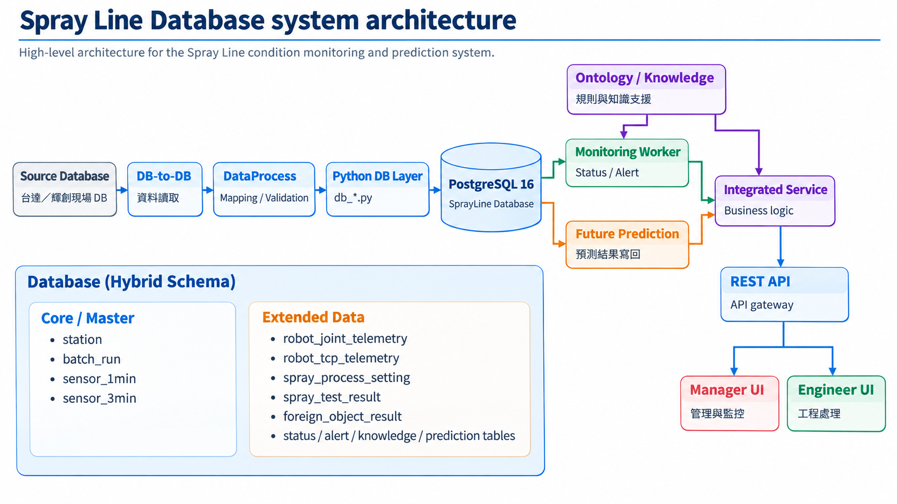
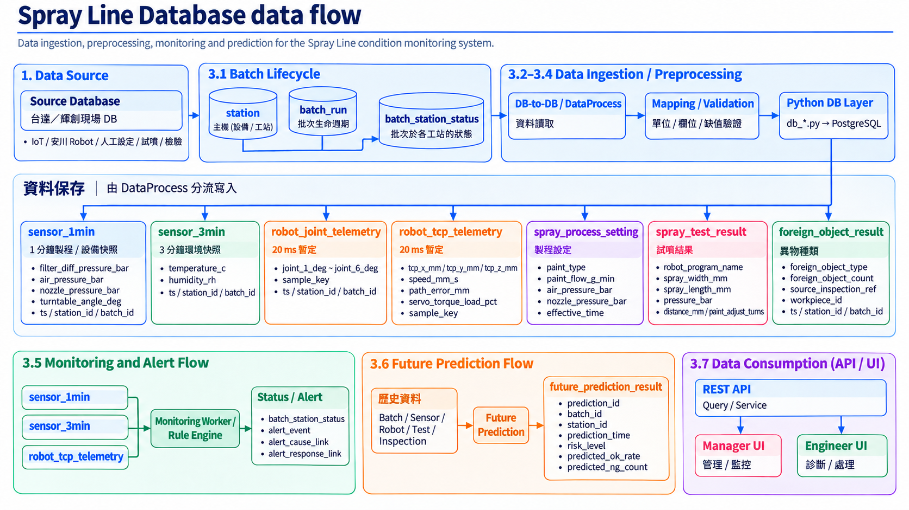
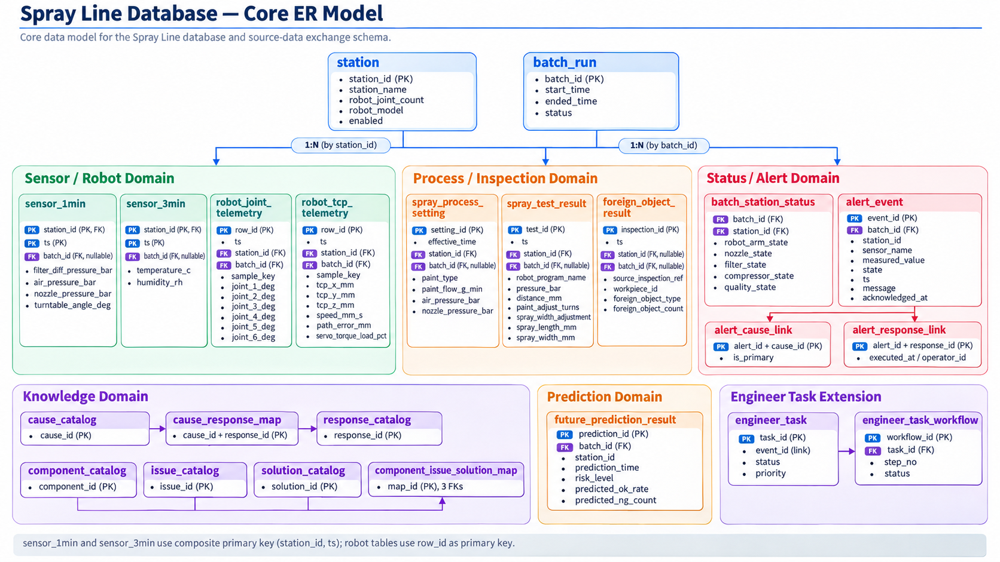

# Spray Line Database — System Architecture & Source DB Exchange Schema

**資料庫參考環境：** PostgreSQL 16 ｜ **日期：** 2026-11-22

本文件定義 Spray Line 資料庫的系統架構、資料流、核心資料模型、來源資料交換介面與相關應用整合方式，供資料庫規劃、資料交換及系統維護使用。


---

## 0. Data Requirements — Source Exchange Schema

```text
來源主檔：station、batch_run
分鐘級資料：sensor_1min、sensor_3min
六軸與空間：robot_joint_telemetry、robot_tcp_telemetry
製程與品檢：spray_process_setting、spray_test_result、defect_result
```

已知／暫定：三站、三台六軸 Robot；角度單位暫定 degree。**Joint 角度資料需要高頻取樣**，20 ms（50 Hz）僅作容量估算，實際可讀頻率及完整歷史保存量待確認；**TCP 座標目前以分鐘級資料滿足應用需求為方向**，來源實際更新頻率仍須驗證。三站各一組溫濕度感測器亦待確認。**來源原始取樣率**不得與**SprayLine 保存頻率**混為一談。

### 0.1 `sensor_1min`

來源每站每分鐘一筆製程／設備快照（**PK `(station_id, ts)`，不使用 `row_id`**）：

```text
ts                     TIMESTAMPTZ NOT NULL
station_id             VARCHAR(32) NOT NULL / FK
batch_id               VARCHAR(32) NULL / FK
filter_diff_pressure_bar  DOUBLE PRECISION NULL
air_pressure_bar       DOUBLE PRECISION NULL
nozzle_pressure_bar    DOUBLE PRECISION NULL
turntable_angle_deg    DOUBLE PRECISION NULL
```

轉盤角度目前以 degree 表示，實際原點、方向、是否有零點偏移、實際更新頻率與來源資料待驗證。空氣／噴嘴壓力若只是設定值，不應冒充感測量測值。

### 0.2 `sensor_3min`

來源每站每三分鐘一筆環境快照（**PK `(station_id, ts)`，不使用 `row_id`**）：

```text
ts               TIMESTAMPTZ NOT NULL
station_id       VARCHAR(32) NOT NULL / FK
batch_id         VARCHAR(32) NULL / FK
temperature_c    DOUBLE PRECISION NULL
humidity_rh      DOUBLE PRECISION NULL / CHECK 0..100
```

Station_1～3 各一組溫濕度 Sensor 為暫定；無 Batch 時環境資料仍可寫入。分鐘表若會有同站同時間多筆有效量測，則複合 PK 方案必須重新評估。

### 0.3 `robot_joint_telemetry` 與 `robot_tcp_telemetry`

機械手臂原始資料依使用目的分為下列兩張表：

**`robot_joint_telemetry`（供中正模擬／六軸歷史回放）**

```text
row_id           BIGINT IDENTITY PRIMARY KEY
ts               TIMESTAMPTZ NOT NULL
station_id       VARCHAR(32) NOT NULL / FK
batch_id         VARCHAR(32) NOT NULL / FK（依參考 SQL 定義）
sample_key       VARCHAR(64) NULL（跨表取樣識別候選）
joint_1_deg ... joint_6_deg   DOUBLE PRECISION NOT NULL
```

**`robot_tcp_telemetry`（供 SprayLine 噴槍位置／品質關聯）**

```text
row_id           BIGINT IDENTITY PRIMARY KEY
ts               TIMESTAMPTZ NOT NULL
station_id       VARCHAR(32) NOT NULL / FK
batch_id         VARCHAR(32) NOT NULL / FK（依參考 SQL 定義）
sample_key       VARCHAR(64) NULL（跨表取樣識別候選）
tcp_x_mm, tcp_y_mm, tcp_z_mm  DOUBLE PRECISION NULL
speed_mm_s, path_error_mm, servo_torque_load_pct DOUBLE PRECISION NULL
```

**資料頻率：** `robot_joint_telemetry` 需求為高頻六軸角度；`robot_tcp_telemetry` 目前以每分鐘座標快照為應用需求。兩者皆須核對控制器可提供的原始頻率、資料時間精度及實際儲存策略。

`sample_key` 的來源與唯一性須經現場資料驗證；只有兩表同源且可提供可靠共同取樣 ID 時，才能拿來 Join。兩表**不保證同頻率**，不可只靠 `ts` 假設一對一。待機 Robot 資料是否要保存、`batch_id` 能否缺值仍待確認。

### 0.4 `spray_process_setting`

保存非固定週期的製程／人工設定：`setting_id`、`effective_time`、`station_id`、`batch_id`、`paint_type`、`paint_flow_g_min`、`air_pressure_bar`、`nozzle_pressure_bar`。流量單位 **g/min**。

### 0.5 `spray_test_result`

保存更換噴嘴後的試噴事件：`test_id`、`ts`、`station_id`、`batch_id`、`robot_program_name VARCHAR(128) NULL`、`pressure_bar`、`distance_mm`、`paint_adjust_turns`、`spray_width_adjustment`、`spray_length_mm`、`spray_width_mm`。

`robot_program_name` 與該筆試噴時間、站點、噴幅結果一起儲存，可追溯該次試噴由哪個站點的機械手臂執行，以及當時使用的程式。若站點配置超過一支機械手臂，另以獨立 `robot_id` 追溯。

### 0.6 `defect_result`（異物種類 / Defect）

異物檢驗結果與膜厚量測屬不同資料型態，採獨立檢驗來源表：

```text
inspection_id          BIGINT IDENTITY PRIMARY KEY
ts                     TIMESTAMPTZ NOT NULL
batch_id               VARCHAR(32) NULL / FK
station_id             VARCHAR(32) NULL / FK
source_inspection_ref  VARCHAR(64) NULL
workpiece_id           VARCHAR(64) NULL
defect_type    VARCHAR(64) NOT NULL
defect_count   INTEGER NOT NULL CHECK (> 0)
```

暫定一筆代表「某次檢驗／某件產品的一個異物種類及其數量」。`station_id` 只代表關聯或檢驗站點，**不能直接推斷異物由該站造成**；須進一步依 `workpiece_id`、檢驗事件及製程履歷追溯。**沒有檢驗結果列 ≠ 已檢驗且合格**。未來必須設計完成檢驗／PASS 狀態或額外檢驗主檔，並確認異物代碼、圖片及 AOI 來源是否可提供。

### 0.7 Row ID / Primary Key

- Source v2 的 `sensor_1min`／`sensor_3min` 暫以 `(station_id, ts)` 複合 PK；三站同時取樣，因此 **`ts` 單獨不唯一**。
- `row_id` 對 Robot 仍保留，因高頻資料可能發生相同時間戳；`setting_id`、`test_id`、`inspection_id` 也保留各自事件識別。
- PK 的選擇與時間範圍查詢效能不是同一件事；時間查詢仍需要合適索引。
- 增量 DB-to-DB 不可單純以 `ts > 上次時間` 判定已全部讀完，需處理遲到／交易晚提交／修改／重送等情況，規劃重疊時間區間重讀和 Upsert 去重，必要時增加來源變更時間或 CDC。

---


### 1. Source Exchange Schema

Source Exchange v2 包含兩張主檔及七張業務資料表：

```text
station（主檔）
batch_run（主檔）
sensor_1min
sensor_3min
robot_joint_telemetry
robot_tcp_telemetry
spray_process_setting
spray_test_result
defect_result
```

- Source DB Exchange v2 供資料介面定義與測試；DataProcess、Migration、API、UI 的部署屬另一階段。
- Robot Joint 的需求為高頻角度取樣（20 ms 僅供估算）；TCP 目前以分鐘級資料為目標，兩表的來源頻率及保存頻率須分別確認。
- `defect_result` 的資料粒度、AOI 映射及「未檢驗／合格」狀態定義須依現場檢驗格式核對。
- `CREATE TABLE` 只在獨立測試 Schema 驗證；不代表正式部署或現有 V3 相容。

目前主要 Database 程式：

```text
final_version_0718_v3/database/
├── setup_db.sql, setup_db.py
├── migrate_schema.py, migrate_0718_v3_backend.sql
├── db_connection.py, db_batch.py, db_sensor.py
├── db_status.py, db_alert.py, db_knowledge.py, db_future.py
├── db_composite.py, db_engineer_task.py, db_engineer_task_workflow.py
└── sprayline_db_queries.py
```

---

## 2. System Architecture



*圖 1：System Architecture。由 Source Database、DataProcess、Python DB Layer、PostgreSQL 至監控、預測、API 與 UI 的系統架構。Source DB-to-DB 路徑屬目標整合架構；現行 Demo 的服務執行情形以部署版本為準。*

### 2.1 圖的左側：現場 DB 到 SprayLine

```text
台達／輝創現場 Database（未來資料來源）
       ↓  DB-to-DB（規劃）
DataProcess：Mapping / Validation
       ↓
Python DB Layer：db_*.py
       ↓
PostgreSQL 16：sprayline
```

- **現場 Database**：未來由台達／輝創先收集 IoT、安川機械手臂、人工設定與試噴資料；其 DBMS、Source Table / View 和實際資料格式仍待確認。
- **DB-to-DB**：由 SprayLine 的 Edge PC 讀取現場資料，並非 SprayLine 一顆一顆直接接收感測器訊號。
- **DataProcess**：執行欄位對應、型別／單位轉換、缺值驗證及分流。
- **Python DB Layer**：透過 `db_*.py` 將資料寫進 PostgreSQL。新表對應寫入函式尚須實作。

**現行程式狀態：** Docker `dataprocess` 目前使用 `final_version_0718_v3/dataprocess/dataprocess.py`，以模擬資料為主要輸入，透過既有 Database Function 寫入；現場 DB-to-DB 尚屬未來整合流程。

### 2.2 Database Data Domains

Source Database Exchange v2 按用途區分為兩張主檔與七張業務表：

| 資料領域 | Source Exchange Table | 資料意義 |
|---|---|---|
| 主檔 | `station`、`batch_run` | 站點識別與生產批次 |
| Sensor | `sensor_1min`、`sensor_3min` | 分鐘級設備、轉盤角度與環境快照 |
| Robot | `robot_joint_telemetry`、`robot_tcp_telemetry` | 六軸角度與 TCP 空間位置 |
| Process / Test | `spray_process_setting`、`spray_test_result` | 製程設定與單次試噴結果，記錄執行程式 |
| Inspection | `defect_result` | 異物種類（Defect）及檢驗事件 |

SprayLine 應用資料庫另有 Status、Alert、Knowledge、Prediction 及 Engineer Task 等領域。來源交換表與應用資料表分屬不同邏輯層，須以欄位映射與明確的整合介面銜接。

### 2.3 圖的右側：Database 後續服務

- **Monitoring Worker**：現行從 `sensor_1min`、`sensor_3min` 取資料做 Threshold / Rule 判斷，回寫 Alert 和 Station Status；目前不掃描 Source v2 規劃中的 `robot_joint_telemetry`／`robot_tcp_telemetry` 高頻資料。
- **Future Prediction**：使用 DB 歷史資料進行預測，結果寫回 `future_prediction_result`。是否納入新 Robot 原始資料，須再進行模型與程式整合。
- **Ontology / Knowledge**：提供監控規則與 Integrated Service 的知識支援。
- **Integrated Service → REST API → Manager UI / Engineer UI**：提供業務整合、查詢及畫面顯示；新資料表的 API 不應視為已完成。

### 2.4 主要程式位置

| 元件 | 現行程式或位置 |
|---|---|
| DataProcess | `final_version_0718_v3/dataprocess/dataprocess.py` |
| Database Python Layer | `final_version_0718_v3/database/db_*.py`、`sprayline_db_queries.py` |
| Monitoring Worker | `final_version_0718_v3/services/monitoring_worker/` |
| API / Integration Adapter | `final_version_0718_v3/api/`、`services/integration_adapter/` |

Source Exchange 表格與既有應用服務的連接須依正式整合及 API 契約實作。

---

## 3. Data Flow



*圖 2：Data Flow。展示來源資料、主檔、DataProcess 分流、七種業務資料，以及監控、預測與 API 消費流程。Source 交換寫入及機械手臂資料的下游分析接入，需依實際部署狀態驗證。*

### 3.1 Batch Lifecycle（上方左中）

- `batch_run`：由 `batch_id`（PK）識別一個生產批次，包含 `start_time`、`ended_time`、`status`。
- `batch_station_status`：以 `(batch_id, station_id)` 為複合 PK，保存每個 Batch 在各站的綜合診斷狀態。
- **批次的 FK 關聯不表示 `batch_run` 會自行計算站點狀態**；`batch_station_status` 的現行寫回主要由 Monitoring Worker 執行。

現行模擬流程可由 `insert_batch_run()` 建立批次，並透過 `update_batch_status()` 更新結束狀態。現場整合後 `batch_id` 的生成者、對應規則仍須和來源 DB 協調。

### 3.2–3.4 Data Ingestion / Preprocessing

```text
台達／輝創現場 Database（Source）
          ↓
DB-to-DB / Mapping / Validation（未實作）
          ↓
Source Exchange v2 規範七種業務資料：
  ├── sensor_1min                  每分鐘設備 + 轉盤角度
  ├── sensor_3min                  每三分鐘環境
  ├── robot_joint_telemetry       J1～J6
  ├── robot_tcp_telemetry         TCP XYZ／速度／負載／誤差
  ├── spray_process_setting       製程設定
  ├── spray_test_result           試噴寬度 + 程式名稱
  └── defect_result       異物分類及數量
（另有 station、batch_run 兩張關聯主檔，合計 9 張）
```

這七種業務資料**是不同來源／事件類別，並不是彼此依序寫入**。`station` 與 `batch_run` 需先可查得有效識別，才能滿足 FK。

| Source v2 Table | 主要欄位與更新情境 | 來源狀態 |
|---|---|---|
| `sensor_1min` | 每站分鐘快照；`turntable_angle_deg`、濾網壓差、待確認的實測壓力 | 暫定，實際來源待確認 |
| `sensor_3min` | 每站三分鐘溫濕度快照 | 暫定，實際來源待確認 |
| `robot_joint_telemetry` | 同筆 J1～J6；高頻取樣需求；回放／模擬 | 實際控制器可讀頻率與欄位待確認 |
| `robot_tcp_telemetry` | TCP XYZ、Speed、Path Error、Servo Load；目前以分鐘級保存為需求 | 原始頻率、座標系與保存策略待確認 |
| `spray_process_setting` | 漆種、流量 g/min、設備／人工壓力設定，於生效時記錄 | 人工／現場輸入方式待確認 |
| `spray_test_result` | 更換噴嘴後試噴結果及 `robot_program_name` | 機械手程式與該次試噴紀錄一併保存 |
| `defect_result` | AOI／人工異物種類（Defect）、數量、識別及時間 | 檢驗結果粒度與狀態待確認 |

#### `sensor_1min` / `sensor_3min`：候選複合主鍵

Source v2 使用 `(station_id, ts)` 作 PK，不保留 Row ID。三站可同時有相同 `ts`，因此**不能只用 `ts` 當單欄 PK**；若現場實際資料同站同時間可有多筆，則此設計必須修改。

#### `robot_joint_telemetry` / `robot_tcp_telemetry`：不同取樣頻率的 Robot 資料

J1～J6 的每筆 Row 同時含六個角度（不是六筆 Row）；TCP XYZ 另存一表，用於噴槍位置／品質分析，**目前以分鐘級資料為保存需求**。兩表皆暫保留 `row_id`，以及候選 `sample_key` 做跨表關聯，但**不要求同取樣頻率**。若 Joint 以假設的 50 Hz 連續採樣，三站×50 rows/s×8 小時＝**4,320,000 Joint Rows／日**，此數字只用於容量估算，不代表 TCP 同量或現場的實測負載。

#### `spray_process_setting`、`spray_test_result` 與 `defect_result`

設定值與感測值要區分；試噴結果是事件資料，不視為每分鐘 Sensor；外觀異物是分類資料，不應對 `defect_type` 套用膜厚數值的 AVG、STDDEV 或 Threshold。若需要判斷「已檢驗且無異物」，必須另外確認檢驗完成狀態／主檔。

### 3.5 Monitoring and Alert Flow

現行 V3 的監控實作流程為：

```text
sensor_1min / sensor_3min
       ↓
Monitoring Worker / threshold_evaluator
       ↓
warning / fault detection
       ↓
alert_event + batch_station_status
       ├── alert_cause_link
       └── alert_response_link
```

`alert_event` 保存異常事件；`alert_cause_link`、`alert_response_link` 將異常連到原因與處置。`anchored_worker.py` 使用資料時間 Anchor 和 `runtime/monitoring_checkpoint.json` 管理處理進度；目前的 Duplicate Alert 抑制與狀態 Upsert 機制仍以現行 V3 程式為準。

**重要限制：** Source Exchange 的 `robot_joint_telemetry`、`robot_tcp_telemetry`、`defect_result` 等尚未接入既有 Monitoring Worker，也沒有 Robot 高頻即時異常判斷實測。

### 3.6 Future Prediction Flow

現行預測使用歷史 Batch／Sensor 資料，將結果寫回 `future_prediction_result`。其中包含 `prediction_time`、`risk_level`、`predicted_ok_rate`、`predicted_ng_count`、`prediction_method`、`idempotency_key` 與 JSONB 規則資料等；相同邏輯預測可藉由 Upsert 避免重複寫入。

Source v2 的 `robot_joint_telemetry`、`robot_tcp_telemetry` 均尚未接入現行預測模型；後續若中正或其他模型需要六軸角度歷史資料，還須另行建立讀取、特徵處理與模型介面。現有 `quality_score` 代表製程品質分數，不等於實測產品良率。

### 3.7 Data Consumption

`REST API` 將 PostgreSQL 中已可使用的資料提供給 Manager UI（監控／管理）與 Engineer UI（診斷／處置）。新表的 API Query、Robot 高頻資料區間查詢與批次回放均屬後續整合項目，不能視為已上線。

---

## 4. Core ER Model



*圖 3：Core ER Model。以 Sensor / Robot、Process / Inspection、Status / Alert、Knowledge、Prediction 和 Engineer Task 分類呈現核心表與關聯。圖中交換表欄位以 `sprayline_exchange_v2` 參考 SQL 為準；應用表以既有 V3 Schema 為準。兩個資料庫範圍之間的邏輯關係不代表已建立跨資料庫實體 FK。*

### 4.1 ER Model 怎麼看

- **PK（Primary Key）**：在該 Table 中唯一識別資料。兩個欄位都標 PK，可能是複合主鍵。
- **FK（Foreign Key）**：參照其他資料表的鍵；實際是否建立 DB 約束，仍要核對目前 SQL 或正式 Migration。
- **1:N**：一筆 Batch 可以對應多筆感測／告警／預測資料。
- **N:M**：多對多，通常透過 Link / Map Table 實作。
- **0:1**：一筆 Alert 不一定有對應的 Engineer Task。
- **資料範圍**：來源交換表的定義以 `sprayline_exchange_v2` 參考 SQL 為準；Status、Knowledge、Prediction 等現行應用表以 `final_version_0718_v3` 的資料庫結構為準。圖中領域關聯為邏輯關聯，不等同跨資料庫實體 FK。

### 4.2 Batch / Station Domain（Source v2 主檔）

`station.station_id`、`batch_run.batch_id` 分別為兩張來源主檔的 PK。七張來源業務表引用這兩張主檔，其中分鐘級 Sensor、製程設定、試噴與異物結果允許沒有 Batch；Robot 兩表暫設 Batch 必填。若待機 Robot 也要保存，須重新評估 nullable 策略。

**現行 V3** 的核心 ER 先前沒有獨立 `station` 表，因此這些 Source FK 不可直接視為 Demo 現有實體 FK。

### 4.3 Sensor / Robot Domain

| Source v2 Table | v2 主要欄位 | v2 PK | 現行 Demo 差異 |
|---|---|---|---|
| `sensor_1min` | `filter_diff_pressure_bar`、`turntable_angle_deg` 等 | `(station_id, ts)` | Demo 現行 PK `(row_id, ts)` |
| `sensor_3min` | `temperature_c`、`humidity_rh` | `(station_id, ts)` | Demo 現行 PK `(row_id, ts)` |
| `robot_joint_telemetry` | `joint_1_deg`～`joint_6_deg`、`sample_key` | `row_id` | 交換介面新表，未部署 |
| `robot_tcp_telemetry` | TCP XYZ、Speed、Path Error、Load、`sample_key` | `row_id` | 交換介面新表，未部署 |

**Row ID／Partition：** v2 參考 SQL 未做時間分區，兩張 Robot 表以 `row_id` 當 PK。若日後對 PostgreSQL 依 `ts` 進行 RANGE Partition，必須重新檢討包含分區鍵的 PK／UNIQUE，不能直接聲稱 v2 SQL 已經分區。

**與時間有關的查詢**可透過 `(station_id, ts)` 或 `(batch_id, station_id, ts)` 索引處理；是否保留 `row_id` 取決於資料來源唯一性、同步及歷史更正需求，不單由查詢條件決定。

### 4.4 Process / Test / Inspection Domain

- `spray_process_setting`：維持 `setting_id` PK、`effective_time`、設定型流量與壓力，不是週期感測資料。
- `spray_test_result`：維持 `test_id` PK、試噴時間／噴幅寬度，定義 `robot_program_name VARCHAR(128)`。
- `defect_result`：定義 `inspection_id` PK、`source_inspection_ref`、`workpiece_id`、`defect_type`、`defect_count > 0`；目前**沒有「無異物／已檢驗」的完整語意**，需與廠商確認。

這些均屬 **Source Exchange v2**，不能推論 Demo 的 `spray_width_mm` 或 `film_thickness_um` 已完成遷移。

### 4.5 Status / Alert Domain（SprayLine 應用資料庫）

`batch_station_status` 的複合 PK 是 `(batch_id, station_id)`，保存 `robot_arm_state`、`nozzle_state`、`filter_state`、`compressor_state`、`spray_width_state`、`quality_state` 等診斷狀態。

`alert_event` 以 `event_id` 為 PK，保存 `batch_id`、`station_id`、`sensor_name`、`measured_value`、`state`、`ts`、`message`、`acknowledged_at`。目前實作中的有效異常狀態主要為 `warning`、`fault`。

### 4.6 Alert Cause / Response

```text
alert_event.event_id
    ├── alert_cause_link.alert_id → cause_catalog.cause_id
    └── alert_response_link.alert_id → response_catalog.response_id
```

關聯表欄位 `alert_id` 指向 `alert_event.event_id`；**欄位名稱不同不等於兩個事件 ID**。`alert_cause_link` 可記錄 `is_primary`；`alert_response_link` 可記錄 `executed_at`、`operator_id`。這兩張 Link Table 的邏輯是 Alert 與原因／處置的多對多關係。

### 4.7 Knowledge Domain

- **Cause / Response**：`cause_catalog`、`response_catalog`、`cause_response_map`，保存原因與建議處置關係。
- **Troubleshooting**：`component_catalog`、`issue_catalog`、`solution_catalog`、`component_issue_solution_map`，保存元件／問題／解法對應。

本節描述 **現行 V3** 的 Knowledge Domain；為避免誤解，這些 Table 未列入上方 Source v2 九表 ER 圖。

### 4.8 Prediction Domain

`future_prediction_result` 以 `prediction_id` 為 PK，並以 `batch_id` 關聯批次；現行 V3 含 `prediction_time`、`risk_level`、`predicted_ok_rate`、`predicted_ng_count`，以及 `prediction_method`、`idempotency_key`、JSONB 規則資訊，見第 5.13 節。此表不屬於 Source v2 九張交換表。

### 4.9 Engineer Task Extension

`engineer_task` 與 `engineer_task_workflow` 用於警報後的工程師處理流程，為選配擴充。它們的 Migration 不一定已隨標準 V3 啟動程序套用；是否實際建表需要檢查部署環境。

### 4.10 Core Table Summary

**A. Source DB Exchange v2（九張交換表）**

| Table | v2 PK | 主用途 |
|---|---|---|
| `station` | `station_id` | 站點主檔 |
| `batch_run` | `batch_id` | 批次主檔 |
| `sensor_1min` | `(station_id, ts)` | 設備快照 + 轉盤角度 |
| `sensor_3min` | `(station_id, ts)` | 環境快照 |
| `robot_joint_telemetry` | `row_id` | 六軸角度與軌跡回放 |
| `robot_tcp_telemetry` | `row_id` | TCP 空間位置、速度等 |
| `spray_process_setting` | `setting_id` | 製程設定 |
| `spray_test_result` | `test_id` | 試噴 + 程式名稱 |
| `defect_result` | `inspection_id` | 異物分類事件 |

**B. SprayLine V3 應用資料庫其他關聯資料**

| V3 Table | 主要角色 | 現況 |
|---|---|---|
| `batch_run` | 批次生命週期 | 現行 |
| `sensor_1min`、`sensor_3min` | 分鐘資料（舊 PK `(row_id, ts)`） | 現行 |
| `batch_station_status`、`alert_event` | 狀態／告警 | 現行 |
| `alert_cause_link`、`alert_response_link` | 異常原因與建議處置關聯 | 現行 |
| `sensor_threshold` | Threshold | 現行 |
| `cause_catalog`、`response_catalog` 等 | 知識庫 | 現行 |
| `future_prediction_result` | 預測結果 | 現行 |
| Engineer Task 相關表 | 工程師任務 | 選配，實際部署待查 |

---

## 5. Main Table Reference

### 5.1 `batch_run`

用途：保存每一個生產 Batch 的開始時間、結束時間與狀態（現行）。

```text
batch_id      VARCHAR(32) PRIMARY KEY
start_time    TIMESTAMPTZ NOT NULL
ended_time    TIMESTAMPTZ
status        running | ok | warning | bad（現行狀態值）
```

關聯：一個 Batch 可對應多筆 `sensor_1min`、`sensor_3min`、`alert_event`、`future_prediction_result`，以及各 Station 的 `batch_station_status`。Source v2 規劃中的 `robot_joint_telemetry`、`robot_tcp_telemetry`、`spray_process_setting`、`spray_test_result`、`defect_result` 亦將依 `batch_id` 建立批次關係，但允許 NULL 的規則需依資料來源決定。

### 5.2 `sensor_1min`

**SprayLine 應用資料庫：** 已存在 `public.sensor_1min`，以 `(row_id, ts)` 為 PK，舊版程式可能仍使用膜厚、噴幅寬度與其他歷史欄位；本文件未對 Demo 進行資料庫遷移。

**Source Exchange v2 欄位定義：**

| 分組 | Source v2 欄位 | 說明 |
|---|---|---|
| 識別 | `station_id`、`ts`、`batch_id` | **PK `(station_id, ts)`；無 `row_id`**；Batch 可空 |
| 感測快照 | `filter_diff_pressure_bar` | 濾網壓差，bar |
| 待確認實測 | `air_pressure_bar`、`nozzle_pressure_bar` | 如僅為設備設定值應放入 `spray_process_setting` |
| 轉盤角度 | `turntable_angle_deg DOUBLE PRECISION NULL` | 當前噴塗轉盤角度，暫以 degree 儲存 |

**PK 與 Row ID：** `(station_id, ts)` 以每站每時間僅一筆快照為前提，不能只用 `ts` 當 PK。舊 Demo 的時間索引與 Row ID 仍存在；未完成移轉前不得直接依 v2 欄位執行舊程式。

轉盤角度需確認來源、取樣時機、角度正方向、範圍與是否需要原始高頻角度。

### 5.3 `sensor_3min`

**SprayLine 應用資料庫：** `public.sensor_3min` 的 PK 仍是 `(row_id, ts)`。

**Source Exchange v2：** `station_id`、`ts`（複合 PK）、`batch_id`（可空）、`temperature_c`（°C）、`humidity_rh`（%RH，0～100，CHECK）。此表不再要求 `row_id`，但需確定一個 Station 在相同 `ts` 不會出現多筆有效資料。

三站各一組 Sensor 仍是規劃假設。無生產 Batch 時可記錄環境資料；若原始高頻需要聚合成每三分鐘，需另外約定聚合方法與缺測處理。

### 5.4 `robot_joint_telemetry`、`robot_tcp_telemetry`（Source Exchange v2）

**資料用途及頻率：** `robot_joint_telemetry` 儲存六軸角度，需求為高頻讀值；`robot_tcp_telemetry` 儲存 TCP 空間資料，目前以分鐘級資料為應用目標。兩者來源可讀頻率、時間精度與保存規則均需由現場確認。

| v2 Table | 欄位 | 型別／可空 | 說明 |
|---|---|---|---|
| 兩表共通 | `row_id` | `BIGINT IDENTITY` PK | **各表獨立流水號**，不可跨表直接 Join |
| 兩表共通 | `ts`、`station_id`、`batch_id` | `TIMESTAMPTZ`、`VARCHAR(32)`，均 NOT NULL（Batch 暫定） | 來源時間、站點與批次 |
| 兩表共通 | `sample_key` | `VARCHAR(64) NULL` | 候選跨表共同取樣 ID；非現場已確認欄位 |
| `robot_joint_telemetry` | `joint_1_deg`～`joint_6_deg` | `DOUBLE PRECISION NOT NULL` | 六軸角度，同筆 Row 含六個軸 |
| `robot_tcp_telemetry` | `tcp_x_mm`、`tcp_y_mm`、`tcp_z_mm` | `DOUBLE PRECISION NULL` | 工具中心點座標；座標系待確認 |
| `robot_tcp_telemetry` | `speed_mm_s`、`path_error_mm`、`servo_torque_load_pct` | `DOUBLE PRECISION NULL` | 速度／誤差／負載的來源與同頻率待確認 |

`robot_joint_telemetry` 是中正模擬與歷史回放用途，要求較高取樣頻率；`robot_tcp_telemetry` 偏噴槍位置與品質分析，目前以分鐘級資料為需求。兩表不保證同一頻率；若要 Join，優先使用**現場確認可共享且唯一的 sample_key** 並加入站點／批次驗證，而不是用兩表 `row_id` 相等或只比 `ts`。

**Joint 高頻／容量假設：** 以三站每站 50 Hz（20 ms）、每天各 8 小時計，`robot_joint_telemetry` 約 432 萬列／日（六軸角度同一列）；`robot_tcp_telemetry` 資料量另算。何時保存完整軌跡、保存天數、是否抽樣／事件留存應與廠商及中正確認。

**PK 與 Partition：** Source Exchange v2 的 PostgreSQL 16 參考 SQL **尚未分區**，兩表以 `row_id` 作單欄 PK。未來若實施依 `ts` 的 RANGE Partition，PK/UNIQUE 設計應包含分區鍵並經效能驗證。

### 5.5 `spray_process_setting`

用途：保存不是固定每分鐘量測的製程／人工設定。

| 欄位 | 說明 |
|---|---|
| `setting_id` | PK；設定 ID |
| `effective_time` | 設定生效時間 |
| `station_id`、`batch_id` | Station／Batch 對應（Batch 可選規則待確認） |
| `paint_type` | 底漆、面漆、金油等 |
| `paint_flow_g_min` | 塗料質量流量設定，g/min |
| `air_pressure_bar`、`nozzle_pressure_bar` | 空氣／噴槍壓力設定，bar |

`paint_flow_g_min` 不可直接當成 `paint_flow_ml_min`。若設備提供的原始壓力單位不同，應先在 DataProcess 中依確認後的單位進行轉換。

### 5.6 `spray_test_result`

用途：保存更換新噴嘴頭後的單次試噴事件，而不是 1 分鐘 Sensor Snapshot。

| 欄位 | 說明 |
|---|---|
| `test_id` | PK；試噴 ID |
| `ts` | 試噴時間 |
| `station_id`、`batch_id` | Station／Batch 對應，Batch 可選規則待確認 |
| `pressure_bar` | 試噴壓力 |
| `distance_mm` | 噴槍與測試面的距離 |
| `paint_adjust_turns` | 漆料調節鈕圈數 |
| `spray_width_adjustment` | 噴幅調節設定 |
| `spray_length_mm` | 試噴長度 |
| `spray_width_mm` | 試噴寬度 |
| `robot_program_name` | 試噴當下的機械手程式名稱；`VARCHAR(128) NULL`，真實來源待確認 |

正式 Source Table 和事件觸發方式待台達／輝創確認。`robot_program_name` 應保存該次試噴實際執行的程式名稱，供追溯噴幅、試噴事件與機械手臂執行流程。

### 5.7 `defect_result` — 異物種類（Defect）

**用途：** 儲存 AOI／人工提供的異物分類結果，**不以此表直接替換 Demo V3 的膜厚量測欄位**。

| 欄位 | 來源 v2 型別 | 說明 |
|---|---|---|
| `inspection_id` | `BIGINT IDENTITY PK` | 交換表中的紀錄 ID；尚非經確認的 AOI 原始 ID |
| `ts` | `TIMESTAMPTZ NOT NULL` | 檢驗時間 |
| `batch_id`、`station_id` | `VARCHAR(32) NULL`，FK | 批次與站點可能無法直接判定，先允許空值 |
| `source_inspection_ref` | `VARCHAR(64) NULL` | 來源檢驗事件代碼 |
| `workpiece_id` | `VARCHAR(64) NULL` | 工件／盤件 ID |
| `defect_type` | `VARCHAR(64) NOT NULL` | 異物種類（Defect）代碼／名稱；字典待確認 |
| `defect_count` | `INTEGER NOT NULL CHECK (> 0)` | 此種類出現的異物數量 |

候選資料粒度：某件工件在某次檢驗中的一種異物類型；可有多筆不同種類。此處的中文名稱為「異物種類」，英文欄位使用 Defect；`station_id` 只是檢驗／關聯站點，不代表已判定異物的來源站點。**沒有資料列不代表檢驗合格**，正式方案須設計檢驗完成／PASS／FAIL 事件或主檔。不得把分類資料套用膜厚 `AVG`、`STDDEV`、上下限檢查。

### 5.8 `batch_station_status`（SprayLine 應用資料庫）

用途：保存一個 Batch 在某個 Station 的綜合診斷狀態。

State 欄位：

```text
robot_arm_state
nozzle_state
filter_state
compressor_state
spray_width_state
quality_state
```

合法值：`ok`、`warning`、`fault`。

並保存對應 Response FK，以及 V3 Integrated Service 使用的品質指標：

```text
quality_score_pct
qc_pct
estimated_defect_rate_pct
estimated_film_thickness_um
metric_updated_at
```

`db_status.upsert_batch_station_status()` 使用 `ON CONFLICT DO UPDATE`，所以同一 `(batch_id, station_id)` 可反覆更新成最新診斷快照。

**這一段為 Demo 現況**：`estimated_film_thickness_um` 與膜厚邏輯目前仍存在，Source v2 的異物分類資料尚未替換這套計算。

### 5.9 `alert_event`

用途：保存單筆 Warning / Fault Event。

主要欄位：

```text
event_id
batch_id
station_id
sensor_name
measured_value
state
cause
ts
message
acknowledged_at
```

`state` 只允許：

```text
warning
fault
```

`acknowledged_at IS NULL` 代表尚未確認。

### 5.10 `alert_cause_link` / `alert_response_link`

Alert 可能對應多個 Cause，也可能對應多個 Response，因此使用 Junction Table 建立 M:N 關係。

```text
alert_event
   ├── alert_cause_link ── cause_catalog
   └── alert_response_link ── response_catalog
```

`alert_cause_link.is_primary` 可標示主要原因。

`alert_response_link` 另外可以保存：

```text
executed_at
operator_id
```

用來記錄處置是否已實際執行。

### 5.11 `sensor_threshold`

用途：保存各 Sensor 的 Warning / Fault Threshold。

`threshold_type` 支援：

```text
warning
fault
warning_lo
warning_hi
fault_lo
fault_hi
```

`setup_db.sql` 目前包含的代表性 Seed Threshold：

| Sensor | Threshold | Value |
|---|---|---:|
| `filter_diff_pressure_bar` | warning | 0.30 |
| `filter_diff_pressure_bar` | fault | 0.50 |
| `servo_torque_load_pct` | warning | 60.00 |
| `servo_torque_load_pct` | fault | 80.00 |
| `air_pressure_bar` | warning_lo | 2.70 |
| `air_pressure_bar` | warning_hi | 3.80 |
| `spray_width_mm` | warning_lo | 60.00 |
| `spray_width_mm` | warning_hi | 140.00 |

Hotfix 另外補上 `air_pressure_bar` 與 `spray_width_mm` 的 `fault_lo` / `fault_hi`，使**現行 V3 舊欄位**的 DB Seed 與 Runtime Rule Mapping 保持相容。Hybrid Schema 將 `spray_width_mm` 改至 `spray_test_result`，因而 Monitoring 的讀取來源與門檻套用方式也需調整；**不能假設目前規則已自動改為讀新表**。

### 5.12 Knowledge Tables

Knowledge Base 分成兩組。

**Cause / Response**

```text
cause_catalog
response_catalog
cause_response_map
```

用於 Alert 層級的原因與建議處置，例如：

```text
FILTER_CLOG
  → REPLACE_FILTER (priority 1)
  → BACKWASH_FILTER (priority 2)
```

**Component / Issue / Solution**

```text
component_catalog
issue_catalog
solution_catalog
component_issue_solution_map
```

用於更完整的 Troubleshooting Knowledge，例如元件問題、建議解方、優先順序與效果百分比。

### 5.13 `future_prediction_result`

用途：保存 Future / Ontology Runtime 的預測結果。

目前重要欄位包含：

```text
prediction_id
batch_id
station_id
prediction_time
predicted_ok_rate
predicted_ng_count
quality_score
estimated_defect_rate_pct
quality_score_semantics
risk_level
prediction_method
model_input_source
idempotency_key
rule_evaluations JSONB
cause_ids JSONB
response_ids JSONB
rule_sources JSONB
created_at
```

`idempotency_key` 有 Unique Index，可避免同一邏輯 Prediction 重複寫入。

### 5.14 `sensor_1hour` Compatibility Table

目前 `setup_db.sql` 仍保留：

```text
sensor_1hour
```

註解明確指出它是：

```text
0620ver_1 HOTFIX: generate_data.py requires sensor_1hour
```

因此這張表屬於舊 Data Generator 的 Compatibility Table，不應與目前核心 `sensor_1min` / `sensor_3min` Pipeline 混為一談。

---

## 6. Python Database Modules

### 6.1 Module Overview

**現行 V3 模組：**

| Module | 現行用途 |
|---|---|
| `db_connection.py` | PostgreSQL Connection / Query helper |
| `db_batch.py` | Batch Lifecycle |
| `db_sensor.py` | 既有 `sensor_1min`／`sensor_3min` 查詢及寫入；仍使用 V3 舊 Schema |
| `db_status.py` | 站點／批次狀態 |
| `db_alert.py` | Alert 事件／承認／原因／處置 |
| `db_knowledge.py` | Threshold / Knowledge |
| `db_future.py` | 預測結果回寫 |
| `db_composite.py` | Cross-table aggregation |
| `sprayline_db_queries.py` | Module re-export |

**日後若要整合 Source v2（目前不在四項任務範圍）**，可能另建 `db_robot_joint.py`、`db_robot_tcp.py`、`db_process_setting.py`、`db_spray_test.py`、`db_defect.py` 或等價 Mapper；這些均為未來候選模組，**不是現行 V3 已有**。此外分鐘表 PK 改動與增量讀取機制的相容性必須先驗證。

### 6.2 Connection

`db_connection.py` 讀取：

```text
DB_HOST
DB_PORT
DB_USER
DB_PASSWORD
DB_NAME
```

預設：

```text
host     = localhost
port     = 5432
user     = postgres
dbname   = sprayline
```

`get_connection()` 會設定：

```text
autocommit = False
```

因此寫入操作需要由呼叫端明確：

```python
conn.commit()
```

若發生錯誤應：

```python
conn.rollback()
```

### 6.3 Write Path：目前函式與 Source v2 目標

**現行 V3 已有寫入 API**（仍依 Demo 原本欄位與 PK）：

```python
import sprayline_db_queries as db
# db.insert_batch_run(...)
# db.insert_sensor_readings_batch(...)
# db.insert_sensor_3min_readings_batch(...)
```

**Source v2 目標七種業務資料**（尚未接到 Demo）：

| 來源類別 | Source v2 Table | 未來整合狀態 |
|---|---|---|
| 1 分鐘設備 + 轉盤角度 | `sensor_1min` | DataProcess Mapping 未完成 |
| 3 分鐘環境 | `sensor_3min` | DataProcess Mapping 未完成 |
| 六軸 Joint | `robot_joint_telemetry` | 寫入／歷史回放未完成 |
| TCP / Speed / Load | `robot_tcp_telemetry` | 寫入／座標時間映射未完成 |
| 製程設定 | `spray_process_setting` | 寫入規則未完成 |
| 噴嘴試噴 + Robot 程式 | `spray_test_result` | 依試噴事件與程式名稱映射 |
| AOI 異物種類 | `defect_result` | 類別字典及來源 Mapping 未完成 |

正式 `INSERT` 前須核對來源 Station / Batch、Row ID／複合 PK、時間戳精度、NULL、單位與來源資料可靠性；Source v2 SQL 本身只證明欄位契約可以在獨立測試 DB 建表。

### 6.4 Example: Query Latest Sensor

```python
import sprayline_db_queries as db

conn = db.get_connection()
try:
    latest = db.get_latest_sensor_1min(conn, "Station_1")
    print(latest)
finally:
    conn.close()
```

---

## 7. Monitoring Worker Integration

Monitoring Worker 的 README 定義其定位為：

```text
sensor_1min / sensor_3min
→ threshold_evaluator
→ state
→ alert_event payload / batch_station_status update payload
→ Database write-back
```

### 7.1 Read Path

`monitoring_worker.py` 透過 `database_versionb_adapter.py` 呼叫：

```text
query_sensor_1min()
query_sensor_3min()
```

而 Adapter 再載入 `database/db_sensor.py`。

### 7.2 Rule Evaluation

`threshold_evaluator.py` 會從 Sensor Row 取出可用欄位，再呼叫 Rule Classifier。只有結果為：

```text
warning
fault
```

才建立 detection result。

### 7.3 Write-back

Alert 寫入：

```text
insert_alert_event()
link_alert_cause()
link_alert_response()
conn.commit()
```

Station Status 寫入：

```text
get_batch_station_status()
   ↓
merge current + detected
   ↓
upsert_batch_station_status()
```

這樣可避免一次 detection 把其他元件既有狀態覆蓋掉。

---

## 8. API / Service Integration

### 8.1 Database Loader

`api/versionb_loader.py` 會搜尋 Database module 路徑，支援：

```text
VERSIONB_PATH
SPRAYLINE_DB_FUNCTION_PATH
SPRAYLINE_PROJECT_ROOT
```

目前 Docker API service 設定：

```text
VERSIONB_PATH=/app/database
SPRAYLINE_DB_FUNCTION_PATH=/app/database
PYTHONPATH=/app/api:/app/services:/app/database
```

### 8.2 Integration Adapter

`services/integration_adapter/database_versionb_adapter.py` 提供 Service 層統一介面，例如：

```text
query_sensor_1min
query_sensor_3min
get_latest_sensor_1min
get_running_batches
insert_alert_event
link_alert_cause
link_alert_response
get_batch_station_status
upsert_batch_station_status
insert_future_prediction_result
get_future_prediction_summary
```

### 8.3 Database Status Check

`api/database_status.py` 使用 Read-only Query 檢查下列核心 Table：

```text
batch_run
sensor_1min
sensor_3min
batch_station_status
alert_event
future_prediction_result
```

並回傳 Table 是否存在、Row Count，以及 Sensor Table 的最新 Timestamp。**目前清單不包含 Source Exchange 定義的 `robot_joint_telemetry`、`robot_tcp_telemetry`、`spray_process_setting`、`spray_test_result`、`defect_result`**；正式整合後才適合加入 Status Check。

### 8.4 Current TimeSeries Limitation

`api/time_series_service.py` 目前仍保留 Random Data Prototype Path：

```python
QueryRawDataFromDatabase()
    → BuildRandomRawDataset(...)
```

該檔案自己的註解也說明，正式整合時才會改成真正 Database Query。

因此目前文件不能描述成「所有 TimeSeries API 都已經直接從 PostgreSQL 讀資料」。

---

## 9. Database Initialization and Migration

### 9.1 First-time Initialization

第一次建立全新 Database 可以使用：

```text
setup_db.py
   ↓
setup_db.sql
```

`setup_db.py` 會：

```text
1. 連到 postgres 管理 DB
2. 若 sprayline 不存在則 CREATE DATABASE
3. 執行 setup_db.sql
4. 驗證主要 Table Row Count
```

### 9.2 Important Warning: `setup_db.sql` is Destructive

`setup_db.sql` 內含多個：

```sql
DROP TABLE IF EXISTS ... CASCADE;
```

所以它適合：

```text
全新建置 / 明確要重建測試 DB
```

不適合：

```text
正常開機
既有正式 DB
想保留目前資料的情況
```

### 9.3 Normal Migration

正常 V3 啟動使用：

```text
migrate_schema.py
```

目前標準 Migration Chain 包含：

```text
patch_service_metrics_writeback.sql
migrate_0718_v3_backend.sql
```

`migrate_schema.py` 會自動建立：

```text
schema_migration
```

用來保存：

```text
migration_name
sha256_hex
applied_at
```

並使用 PostgreSQL advisory lock 防止多個 migration 同時套用。若已套用過的 Migration SHA256 被修改，程式會報錯，而不是靜默重跑。

### 9.4 V3 Migration Additions

`patch_service_metrics_writeback.sql` 主要補：

```text
batch_station_status quality metrics
future_prediction_result.prediction_method
```

`migrate_0718_v3_backend.sql` 主要補：

```text
idempotency_key
estimated_defect_rate_pct
quality_score_semantics
rule_evaluations
cause_ids
response_ids
rule_sources
```

並清除同一 idempotency key 的歷史重複 Prediction，再建立 Unique Index。

---

## 10. Docker Deployment

目前 `docker-compose.yml` 定義主要 Service：

| Service | Role | Host Port / Profile |
|---|---|---|
| `db` | PostgreSQL 16 | `5433 → 5432` |
| `db-setup` | First-time DB setup | profile `setup` |
| `db-migrate` | Non-destructive migration | startup dependency |
| `api` | FastAPI / Service API | `8011 → 8000` |
| `frontend` | Manager UI | `8012 → 8002` |
| `engineer` | Engineer UI | `8013 → 8000` |
| `dataprocess` | 模擬資料產生 / 清洗 / DB 寫入 | profile `data` |
| `monitoring_worker` | DB Sensor Monitoring / Alert | profile `monitor` |

### 10.1 PostgreSQL Port

Container 之間使用：

```text
db:5432
```

Windows Host 從 Docker 外部連線時為：

```text
localhost:5433
```

### 10.2 Existing PostgreSQL Volume

目前 Compose 使用既有 External Volume：

```text
final_version_0627_sprayline_pgdata
```

此 Volume 保存既有 PostgreSQL Data。

### 10.3 Standard V3 Startup

`START_0718_v3.bat` 會呼叫：

```text
start.ps1 -Mode start
```

正常啟動順序為：

```text
PostgreSQL
   ↓
db-migrate
   ↓
API
   ↓
Manager UI / Engineer UI
```

正常啟動 **不執行 `setup_db.sql`**，也 **不預設啟動 DataProcess**。

### 10.4 DataProcess Start / Stop

啟動 DataProcess：

```cmd
docker compose --profile data up -d --build dataprocess
```

查看 Log：

```cmd
docker compose --profile data logs -f --tail 50 dataprocess
```

停止 DataProcess：

```cmd
docker compose --profile data stop dataprocess
```

同一時間應只執行一個 DataProcess，否則多個資料產生器會同時寫入 Database，使資料筆數與模擬時間快速增加。

---

## 11. Useful SQL Checks

### 11.1 Check Latest Sensor Data

```sql
SELECT station_id,
       COUNT(*) AS row_count,
       MAX(ts) AS latest_time
FROM sensor_1min
GROUP BY station_id
ORDER BY station_id;
```

### 11.2 Latest 10 Rows

```sql
SELECT *
FROM sensor_1min
ORDER BY ts DESC
LIMIT 10;
```

### 11.3 Check Batch

```sql
SELECT batch_id, start_time, ended_time, status
FROM batch_run
ORDER BY start_time DESC
LIMIT 20;
```

### 11.4 Unacknowledged Alerts

```sql
SELECT event_id, batch_id, station_id,
       sensor_name, measured_value, state, ts
FROM alert_event
WHERE acknowledged_at IS NULL
ORDER BY ts DESC;
```

### 11.5 Check V3 Migration

```sql
SELECT migration_name, applied_at
FROM schema_migration
ORDER BY applied_at;
```

---

### 11.6 Verify Source Exchange Tables（獨立測試資料庫）

請先確認 Query Tool 連接的是獨立的測試資料庫 `sprayline_schema_test`，且來源交換 Schema 已完成建立，再執行：

```sql
SELECT table_name
FROM information_schema.tables
WHERE table_schema = 'sprayline_exchange_v2'
  AND table_type = 'BASE TABLE'
ORDER BY table_name;
```

預期為九張來源表，**不是 Demo 的 `public` Schema**。另外可執行`SprayLine_Source_DB_PostgreSQL_v2_Defect_TEST.sql` 驗證建表總數、PK/FK、模擬資料讀寫、複合 PK、Check、FK 等。測試腳本使用 Transaction `ROLLBACK`，**不保存插入的模擬資料**。

**測試狀態：** 尚未完成 PostgreSQL 16 的獨立環境實測。`CREATE SCHEMA` 不含 `IF NOT EXISTS`，應在不存在同名 Schema 的獨立測試資料庫執行，避免誤用於既有系統。

---

## 12. Engineer Task Database Extension

V3 Repository 另外存在：

```text
migrate_add_engineer_task.sql
migrate_extend_engineer_task_workflow.sql
```

這組 Migration 用於 Manager → Engineer Notification / Workflow，會建立或擴充：

```text
engineer_task
station_engineer_assignment
engineer_task_assignee
engineer_task_event
notification_decision
engineer_task_report
engineer_task_attachment
```

並由：

```text
db_engineer_task.py
db_engineer_task_workflow.py
```

提供 Database 操作。

但是目前標準 `migrate_schema.py` 的 `MIGRATIONS` 清單只包含：

```text
patch_service_metrics_writeback.sql
migrate_0718_v3_backend.sql
```

因此 Engineer Task 的兩個 Migration 檔 **不能假設一定已由標準 V3 啟動流程自動套用**。部署前必須確認實際 PostgreSQL 是否已有這些 Table，或是否另有人工 / 部署程序套用。

這一組屬於擴充 Workflow，不是本頁前述 Sensor / Alert Core Pipeline 的必要條件。

---

## 13. Implementation Notes

1. **資料庫邊界**：Source Exchange v2 的九張表屬於資料交換契約；SprayLine 應用資料庫的欄位與 PK 依實際部署 Schema 管理。
2. **Sensor 識別**：兩張來源分鐘表採 `(station_id, ts)` 複合 PK，以每站每個時間點最多一筆有效快照為前提。來源若允許同時間多筆數據，需調整識別策略。
3. **Robot 取樣與關聯**：六軸角度同存一列；TCP 可採獨立頻率。兩表不能透過各自的 `row_id` 直接 Join，應核對來源 `sample_key`、站點、批次與時間精度。
4. **試噴事件追溯**：`spray_test_result.robot_program_name` 與 `station_id`、試噴時間及噴幅結果共同保存，以追溯試噴執行程式。
5. **異物資料**：`defect_type` 為類別資料，`defect_count` 為計數；不得套用膜厚連續數值的平均、標準差與上下限規則。無事件列不代表 AOI 已確認 PASS。
6. **容量估算**：三站、每站 50 Hz、每天運作八小時，Joint 表約 4,320,000 rows/day；TCP 的保存量須依實際取樣頻率另行估算。
7. **現行系統相容性**：Docker 的 DataProcess 執行檔為 `final_version_0718_v3/dataprocess/dataprocess.py`；`sensor_1hour` 為相容性資料表，部分 TimeSeries 模組仍可能使用模擬資料路徑。

---

## 14. Data Protection / Maintenance Rules

在要保留既有資料時，請不要執行：

```text
docker compose down -v
docker volume rm final_version_0627_sprayline_pgdata
database/setup_db.sql
DROP TABLE
TRUNCATE
任何 reset / re-initialize DB 的操作
```

需要停止資料增加時，應只停止 DataProcess：

```cmd
docker compose --profile data stop dataprocess
```

這不會刪除 PostgreSQL 既有資料，也不會停止 API / UI。

---

## 15. Implementation References

本頁主要依據下列 V3 實際檔案：

```text
final_version_0718_v3/dataprocess/dataprocess.py
final_version_0718_v3/database/setup_db.sql
final_version_0718_v3/database/setup_db.py
final_version_0718_v3/database/migrate_schema.py
final_version_0718_v3/database/migrate_0718_v3_backend.sql
final_version_0718_v3/database/patch_service_metrics_writeback.sql
final_version_0718_v3/database/db_connection.py
final_version_0718_v3/database/db_batch.py
final_version_0718_v3/database/db_sensor.py
final_version_0718_v3/database/db_status.py
final_version_0718_v3/database/db_alert.py
final_version_0718_v3/database/db_knowledge.py
final_version_0718_v3/database/db_future.py
final_version_0718_v3/database/db_composite.py
final_version_0718_v3/database/sprayline_db_queries.py
final_version_0718_v3/services/monitoring_worker/
final_version_0718_v3/services/integration_adapter/database_versionb_adapter.py
final_version_0718_v3/api/versionb_loader.py
final_version_0718_v3/api/database_status.py
final_version_0718_v3/api/time_series_service.py
final_version_0718_v3/docker-compose.yml
final_version_0718_v3/0718_v3_DataProcess啟停教學.ipynb
final_version_0718_v3/README_0718_v3_修改日誌.md
```

---

## 16. System Summary

Source DB Exchange Schema v2 以 `station`、`batch_run` 為兩張主檔，另外包含七張業務表，依資料性質分別保存分鐘感測、機械手臂六軸角度、TCP 空間資料、製程設定、試噴事件及異物檢驗結果。

```text
現場 Source Database / View
       ↓
Source DB Exchange Schema v2
  ├── station / batch_run
  ├── sensor_1min                 turntable_angle_deg
  ├── sensor_3min                 temperature_c / humidity_rh
  ├── robot_joint_telemetry      J1–J6
  ├── robot_tcp_telemetry        TCP XYZ / speed / load
  ├── spray_process_setting      製程參數
  ├── spray_test_result          robot_program_name / 噴幅
  └── defect_result      異物種類 / 數量
       ↓
DB-to-DB / DataProcess（Mapping / Validation）
       ↓
SprayLine PostgreSQL（應用資料庫）
       ↓
Monitoring / Ontology / Prediction / REST API / UI
```

**使用邊界：** 來源交換 Schema 為標準資料介面，資料交換與後端整合須依實際來源資料、接口權限和部署環境完成驗證。資料庫初始化與破壞性重建只能在獨立測試環境執行，不得影響現有 Demo 系統。
