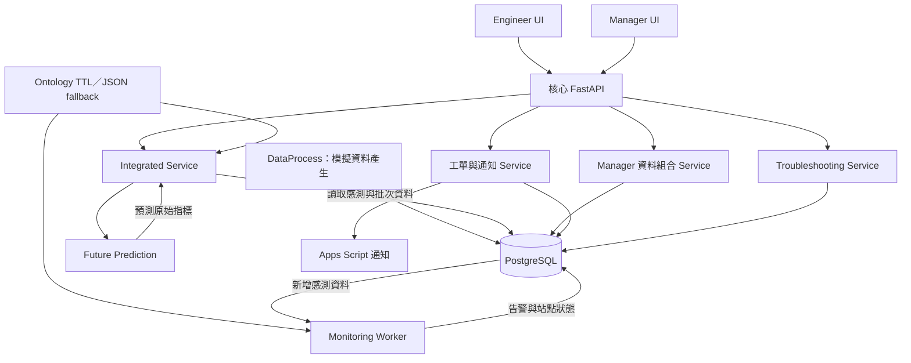
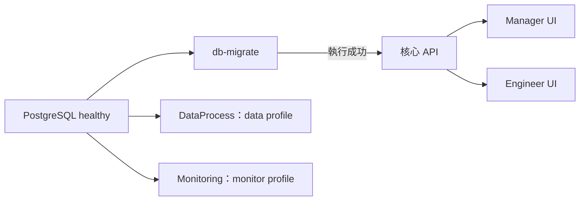
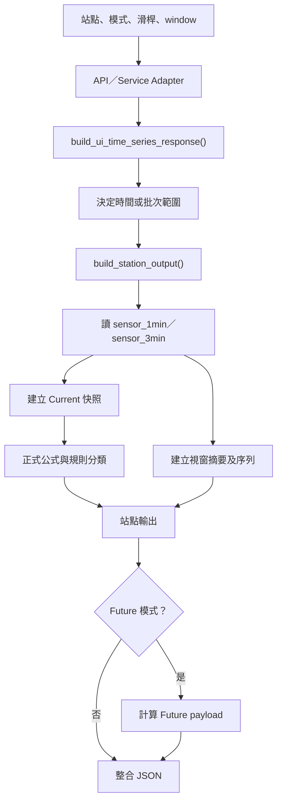
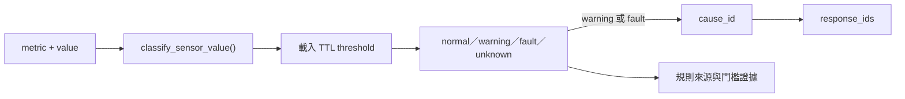
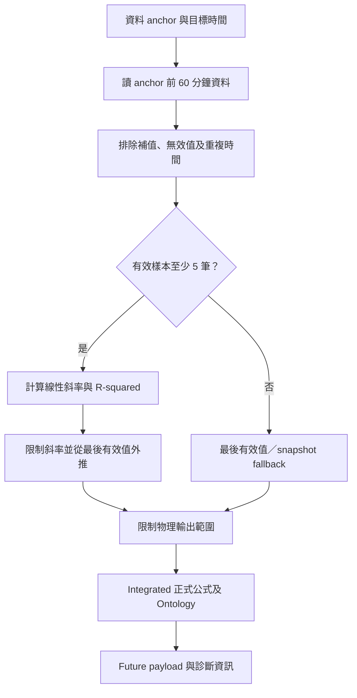
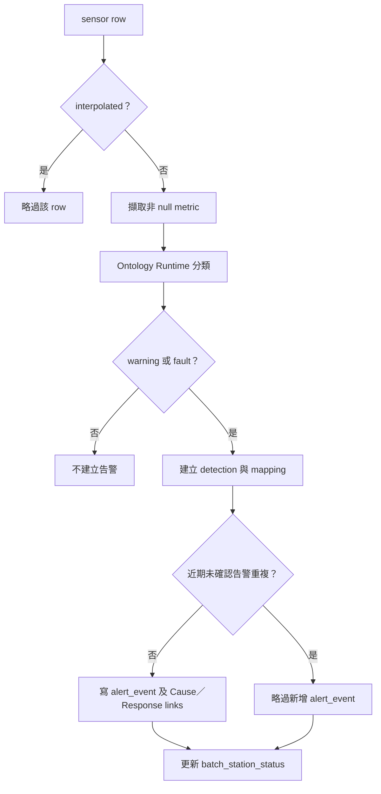
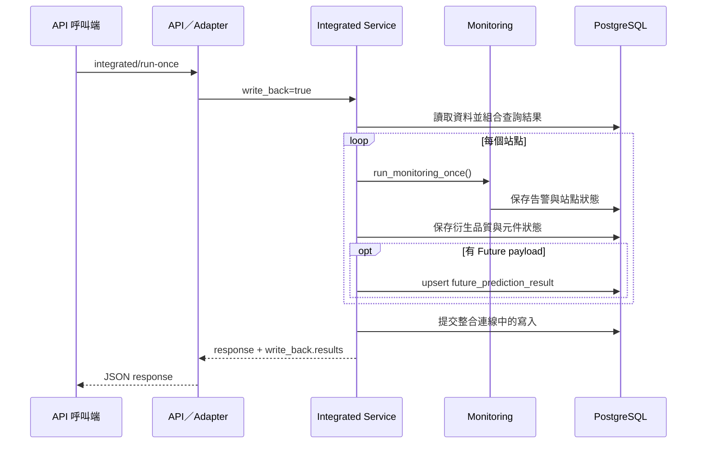
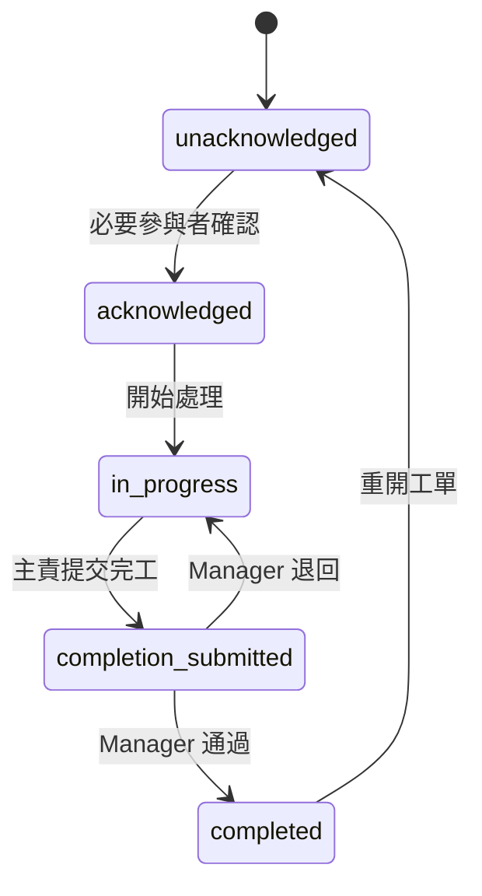

# SprayLine 0718V3 整體流程與系統說明

| 文件項目 | 內容 |
| --- | --- |
| 適用程式 | `final_version_0718_v3` |
| API 版本 | `0718.3` |
| 文件日期 | 2026-10-15 |
| 文件範圍 | 資料產生、資料庫、服務運算、規則推論、預測、背景監控、API、UI 資料流及工單流程 |
| 路徑基準 | 本文件中的程式相對路徑均以 `final_version_0718_v3/` 為根目錄 |
| 程式來源 | [GitHub 程式目錄][source-root] |

## 目錄

1. [系統用途與組成](#system-overview)
2. [整體架構與資料流](#architecture)
3. [資料與識別方式](#data-model)
4. [啟動與資料庫結構準備](#startup)
5. [資料產生與入庫流程](#data-generation)
6. [整合查詢流程](#integrated-query)
7. [製程指標與品質分數](#process-metrics)
8. [Ontology Runtime 與原因處置推論](#ontology-runtime)
9. [Future Prediction 流程](#future-prediction)
10. [Monitoring 告警流程](#monitoring)
11. [資料庫回寫與重複請求處理](#persistence)
12. [處理建議查詢](#troubleshooting)
13. [Manager 與 Engineer UI 資料流程](#ui-flow)
14. [工單、通知與驗收流程](#task-workflow)
15. [API 介面與回應](#api-reference)
16. [程式檔案與函式索引](#source-index)

<a id="system-overview"></a>
## 1. 系統用途與組成

SprayLine 提供噴塗產線的製程資料查詢、元件狀態判斷、異常原因與處置對應、未來趨勢預測，以及告警與工單追蹤。資料以 PostgreSQL 為主要保存位置，由 Python Service 進行運算，再透過 HTTP API 提供給 Manager UI 與 Engineer UI。

系統包含三條主要業務流程：

1. **資料查詢流程**：讀取感測與批次資料，計算指標、狀態及預測，提供畫面顯示。
2. **背景監控流程**：持續處理感測資料，判斷異常，保存告警及批次站點狀態。
3. **異常處理流程**：建立工單、通知工程師、確認與回報處理結果，再由管理者驗收。

### 1.1 元件職責

| 元件 | 職責 | 主要輸入 | 主要輸出 |
| --- | --- | --- | --- |
| DataProcess | 產生模擬製程、批次與環境資料，處理指定資料品質情境 | 站點設定、模擬時間、設備狀態 | 感測列、批次紀錄 |
| PostgreSQL | 保存原始資料、狀態、告警、預測及工單 | 資料寫入與查詢要求 | 資料列及查詢結果 |
| Integrated Service | 協調時間與批次查詢、指標計算、狀態判斷及 Future | 站點、時間或批次參數 | 統一整合結果 |
| Future Service | 依感測歷史外推未來數值，建立及保存預測 payload | 歷史資料、預測時間 | 預測數值、診斷資訊、預測 payload |
| Ontology Runtime | 讀取規則並分類數值，對應原因與處置 | metric、value、TTL 規則 | State、Cause、Response、規則依據 |
| Monitoring Worker | 執行資料品質檢查、異常偵測、告警去重與狀態回寫 | 新增感測資料 | 告警、狀態、處理進度 |
| Troubleshooting Service | 查詢具體異常對應的處理知識 | 元件或異常類型 ID | 處理建議、技能及停機時間等資訊 |
| API 與 Adapter | 接收請求、呼叫服務、整理回應與 HTTP 狀態 | HTTP request、JSON | HTTP response、JSON |
| Manager UI | 呈現管理摘要、站點比較、趨勢、告警與派工 | 管理者操作、API 資料 | 儀表板、派工及驗收操作 |
| Engineer UI | 呈現站點、元件、時間與批次狀態 | 工程師操作、API 資料 | 資訊卡、趨勢與診斷內容 |

Service 多以 Python 模組提供功能，由 API 或背景程式直接呼叫；服務名稱不代表各自部署為獨立 HTTP 伺服器。

<a id="architecture"></a>
## 2. 整體架構與資料流



查詢結果由 Service 回到 API，再轉成各 UI 所需的 JSON。畫面查詢與資料保存使用不同的控制參數；查詢不會因計算出預測值就自動保存該預測。

### 2.1 對外埠與容器角色

| 服務 | 主機埠 | 容器內埠 | 主要用途 |
| --- | ---: | ---: | --- |
| 核心 API | 8011 | 8000 | 時間序列、服務操作、告警及工單 API |
| Manager UI | 8012 | 8002 | 管理者網頁 |
| Engineer UI | 8013 | 8000 | 工程師網頁與本地 Router |
| PostgreSQL | 5433 | 5432 | 資料庫連線 |

Engineer 容器透過 `http://api:8000` 呼叫核心 API。其他裝置存取主機服務時，使用主機可達的 IPv4 與對應埠，例如 `http://<主機IPv4>:8013`。設定來源為 [docker-compose.yml][compose]。

<a id="data-model"></a>
## 3. 資料與識別方式

### 3.1 站點與元件

| 資料庫 `station_id` | API `line_id` | Engineer UI ID | Integrated Service 站點名稱 |
| --- | --- | --- | --- |
| `Station_1` | `line_1` | `M1` | 底漆站 |
| `Station_2` | `line_2` | `M2` | 面漆站 |
| `Station_3` | `line_3` | `M3` | 金漆站 |

主要元件包括機械手臂、噴嘴、空壓機、噴幅、濾網及品質模組。元件查詢使用 `robot_arm`、`nozzle`、`air_compressor`、`spray_width`、`filter_mesh`、`quality_module` 等識別值。

### 3.2 核心資料表

| 資料表 | 保存內容 | 主要關聯 |
| --- | --- | --- |
| `batch_run` | 批次開始、結束時間與狀態 | `batch_id` |
| `sensor_1min` | 一分鐘製程快照 | `batch_id`、`station_id`、`ts` |
| `sensor_3min` | 三分鐘環境讀值 | `batch_id`、`station_id`、`ts` |
| `sensor_1hour` | 小時彙總資料 | 站點與小時 |
| `batch_station_status` | 批次站點元件狀態、處置與衍生品質指標 | `batch_id + station_id` |
| `alert_event` | 感測器、數值、嚴重度、原因、時間與確認資訊 | `event_id` |
| `alert_cause_link` | 告警與原因關聯 | `event_id + cause_id` |
| `alert_response_link` | 告警與處置關聯 | `event_id + response_id` |
| `future_prediction_result` | 預測摘要、風險、方法及規則證據 | `prediction_id`、`idempotency_key` |
| `schema_migration` | 結構腳本名稱、SHA256 與套用時間 | `migration_name` |

知識資料由 `cause_catalog`、`response_catalog`、`cause_response_map`、`component_catalog`、`issue_catalog`、`solution_catalog`、`component_issue_solution_map` 等資料表提供。

### 3.3 時間欄位

| 欄位 | 意義 |
| --- | --- |
| `ts` | 感測或模擬事件發生時間 |
| `anchor_time` | 查詢或處理使用的資料基準時間 |
| `window_start`／`window_end` | 實際資料查詢範圍 |
| `prediction_time` | 預測對應的目標時間 |
| `generated_at` | API 回應建立時間 |
| `created_at`／`write_time` | 資料建立或寫入時間 |

感測時間和 API 建立時間屬於不同概念。Integrated Service 優先以所選站點最新 `sensor_1min.ts` 作為資料基準；多站點查詢取其中最新時間。Manager 的日期與小時選擇使用 `Asia/Taipei`。

### 3.4 資料品質標記

`data_quality_flag=normal` 表示一般資料，`interpolated` 表示補值資料。Future 擬合與 Monitoring 會排除補值資料；Current 快照與視窗彙總依自身查詢資料進行運算。讀取結果時須連同資料時間、品質標記和預測診斷一起解讀。

<a id="startup"></a>
## 4. 啟動與資料庫結構準備

### 4.1 啟動相依流程



一般啟動入口為 `START_0718_v3.bat` 或 `start.ps1`。API 等待資料庫健康檢查及 `db-migrate` 成功後啟動。DataProcess 與 Monitoring 分別由 `data`、`monitor` profile 控制。

資料庫使用既有 `sprayline` 資料庫與 external volume `final_version_0627_sprayline_pgdata`。工單操作另需具備對應的工單資料表結構。正常啟動路徑不呼叫資料庫初始化腳本。

### 4.2 Migration 處理

[database/migrate_schema.py][migration-runner] 的 `apply_migrations()` 依序處理：

1. `database/patch_service_metrics_writeback.sql`。
2. `database/migrate_0718_v3_backend.sql`。

執行流程如下：

1. 建立資料庫連線並取得 transaction advisory lock。
2. 建立或讀取 `schema_migration` 紀錄。
3. 計算每份腳本的 SHA256。
4. 已套用且 SHA256 相同的腳本回傳 `already_applied`。
5. 尚未套用的腳本執行 SQL，並保存名稱與 SHA256。
6. 全部成功後 commit；發生例外時 rollback。

結構腳本加入站點品質欄位、Future 規則證據、語意與冪等欄位。建立 Future 唯一索引前，會依邏輯預測身分整理重複紀錄，保留較新的資料列。[Migration SQL][migration-sql]

<a id="data-generation"></a>
## 5. 資料產生與入庫流程

資料來源由 [dataprocess/dataprocess.py][dataprocess] 的 `run_physical_twin_pipeline()` 提供，包含三個站點及站點之間的批次移動。

```text
連線資料庫
  → 讀取批次時間與生產累積值
  → 建立模擬時間及各站設備狀態
  → 建立／移動批次
  → 產生製程與環境讀值
  → clean_data() 處理指定補值情境
  → 寫 sensor_1min、sensor_3min、batch_run
  → 提交資料並推進模擬時間
```

### 5.1 模擬排程與採樣

- 新批次在模擬營運時段進入第一站，再經輸送狀態移動至後續站點。
- 每分鐘的指定秒數產生有在製批次之站點的一分鐘快照。
- 每三分鐘產生環境溫度與濕度資料。
- 批次完成第三站加工後，更新 `batch_run` 的狀態及結束時間。
- 程式重新啟動時，優先從資料庫最新批次時間銜接模擬時間。

### 5.2 補值處理

`clean_data()` 依站點保存最後有效讀值。遇到 `interpolated` 資料且有先前有效值時，指定的製程欄位以最後有效值填補，並保留補值標記。一般資料則更新最後有效值。

此流程的資料是模擬製程資料；資料庫中的感測時間可依模擬速度持續向前推進。模擬資料列中的膜厚也是產生器計算值，其意義與實際檢驗量測值不同。

<a id="integrated-query"></a>
## 6. 整合查詢流程

### 6.1 呼叫關係



核心類別為 [IntegratedSprayLineService][integrated]。`build_ui_time_series_response()` 管理整體請求；`build_station_output()` 建立單站結果。

### 6.2 時間模式

核心 Service 的 `slider_value` 單位為分鐘，`window_minutes` 預設為 30。

| `slider_value` | 查詢類型 | 時間範圍 |
| ---: | --- | --- |
| 小於 0 | Past | 將 anchor 往前移指定分鐘，再向前取一個 window |
| 等於 0 | Current | 從資料基準時間向前取一個 window |
| 大於 0 | Future | 取目前視窗，並預測資料基準時間之後的指定分鐘 |

例如資料基準時間為 14:00、`window_minutes=30`：

- `slider_value=-60`：查詢 12:30 至 13:00。
- `slider_value=0`：查詢 13:30 至 14:00。
- `slider_value=30`：使用目前視窗與額外的歷史輸入，建立 14:30 的預測。

Engineer UI 的時間滑桿由 `WebservicesClient` 換算：過去每格 60 分鐘、未來每格 30 分鐘。直接呼叫核心 API 時，參數仍按分鐘解讀。

### 6.3 批次模式

`mode=batch` 以各站實際存在感測資料的批次建立查詢軸。

| 參數 | 行為 |
| --- | --- |
| `slider_value=0` | 查詢基準批次 |
| `slider_value=-1` | 查詢基準的前一批 |
| `batch_id` | 直接選取指定批次 |
| `anchor_batch_id` | 固定批次滑桿基準 |
| 正的 `slider_value` | 使用基準批次資料建立未來批次槽位預測 |

未來批次槽位的預測時間依 `anchor + window_minutes × offset` 計算。批次偏移超出可用範圍時，結果包含 `batch_offset_out_of_range`。

### 6.4 快照、序列與摘要

- **Current 快照**：取最後一筆一分鐘製程資料，補入最後一筆三分鐘資料的溫度與濕度，再計算衍生欄位。
- **時間序列**：逐筆加入時間、批次、站點、品質標記及所要求的指標。
- **視窗摘要**：計算數值平均、品質異常樣本比例，以及各元件較嚴重的狀態。
- **補查**：一般時間視窗無資料時，會嘗試查詢 anchor 之前最近的資料；批次環境資料可使用 anchor 附近的鄰近讀值。

快照、視窗平均與資料建立時間具有不同語意，回應中分別提供對應欄位。

### 6.5 整合回應內容

| 欄位 | 說明 |
| --- | --- |
| `viewer_state` | 查詢模式、滑桿、時間範圍與 Future 目標時間 |
| `stations` | 站點結果集合 |
| `time_series` | 站點時間序列與點數 |
| `past_window` | 視窗範圍及摘要 |
| `current_snapshot` | 單站快照及衍生值 |
| `metrics` | 視窗指標摘要 |
| `batch_axis` | 選取批次與批次基準資訊 |
| `future_prediction_payload` | Future 模式的預測結果 |
| `write_back` | 是否執行回寫及執行結果 |

<a id="process-metrics"></a>
## 7. 製程指標與品質分數

### 7.1 基本設定

| 設定 | 值 |
| --- | --- |
| 目標流量 | 115 ml/min |
| 目標空壓 | 3.2 bar |
| 估算膜厚基準 | 15 µm |
| 各站目標噴幅 | Station_1：120 mm；Station_2：100 mm；Station_3：82 mm |
| 濾網指標基準 | 0.1 至 0.7 bar |

這些常數用於製程指標公式；normal、warning、fault 的接受區間由規則來源定義，兩者用途不同。

### 7.2 衍生指標

`clamp(x, 0, 100)` 表示將數值限制在 0 至 100。

```text
流量偏差率 = abs(流量 - 115) / 115 × 100
噴嘴流量損失率 = max(0, (115 - 流量) / 115 × 100)
濾網堵塞指標 = clamp((壓差 - 0.1) / (0.7 - 0.1) × 100, 0, 100)
空壓偏差率 = abs(空壓 - 3.2) / 3.2 × 100
噴幅偏差率 = abs(噴幅 - 站點目標噴幅) / 站點目標噴幅 × 100
估算膜厚 = 15 × (流量 / 115) × (站點目標噴幅 / 噴幅)
```

估算膜厚以有效流量及正的噴幅計算，輸出欄位為 `estimated_film_thickness_um`。

### 7.3 單點製程品質代理分數

```text
流量扣分 = min(30, 流量偏差率 × 2)
空壓扣分 = min(25, 空壓偏差率 × 2)
噴幅扣分 = min(30, 噴幅偏差率 × 2)
路徑扣分 = min(20, 路徑誤差 / 0.15 × 20)
品質分數 = clamp(100 - 扣分合計, 0, 100)
```

分數表示製程條件相對目標的接近程度。例如 Station_1 的流量 115、空壓 3.2、噴幅 120、路徑誤差 0.05，可得到約 93.33 分。

品質分數屬於公式代理值，不能直接作為產品實測良率。欄位缺值時，公式僅使用可用項目；四項全缺時單點公式回傳無分數。

### 7.4 視窗品質指標

視窗品質判斷依各筆 `quality_state` 計算：

```text
ng_sample_flag = 1，當 quality_state 為 warning 或 fault
視窗 Qc = 異常品質樣本數 / 有效品質樣本數 × 100
視窗 quality_score_pct = 100 - 視窗 Qc
```

單點公式分數、視窗異常樣本比例及 Future 分數分別保存在不同位置，不能只依欄位名稱判斷其計算來源。Integrated 寫回站點品質欄位時優先採用視窗摘要。

### 7.5 元件狀態

| 狀態 | 判斷來源 |
| --- | --- |
| `nozzle_state` | 流量 |
| `filter_state` | 濾網壓差 |
| `compressor_state` | 空壓 |
| `spray_width_state` | 噴幅 |
| `robot_arm_state` | 伺服負載與路徑誤差中的較嚴重狀態 |
| `environment_state` | 溫度與濕度中的較嚴重狀態 |
| `quality_state` | 流量、空壓、噴幅、路徑誤差中的較嚴重狀態 |
| `station_state` | 元件與環境中的較嚴重狀態 |

相關實作為 `derive_formal_metrics()`、`build_current_snapshot()`、`build_window_summary()`，位於 [整合服務][integrated]；共用品質公式亦由 [quality_score_common.py][quality-common] 提供。

<a id="ontology-runtime"></a>
## 8. Ontology Runtime 與原因處置推論

### 8.1 推論方式



Runtime 以 [ontology/sprayline_threshold.ttl][threshold-ttl] 為正式規則來源，由 `load_rules()` 讀取指定欄位，再由 `infer_state()` 進行範圍比較。這條執行路徑使用 Python 規則解析與數值分類。

推論需要 metric 與數值；相同 `fault` 嚴重度可對應不同設備問題。Cause 與 Response 由觸發的 metric 規則取得。

### 8.2 來源選擇

1. TTL 存在可用規則時，採用 Ontology 結果。
2. TTL 有該 metric，但數值落在規則未涵蓋區間時，保留 `unknown`。
3. TTL 無該 metric 或載入失敗時，使用 `rules/sensor_thresholds.json` fallback。
4. fallback 結果包含原因與來源，供呼叫端識別。

### 8.3 濾網壓差範例

| `filter_diff_pressure_bar` | State | Cause | Response |
| --- | --- | --- | --- |
| 0.1 至 0.5，含邊界 | `normal` | 無異常原因 | 無異常處置 |
| 大於 0.5 至 0.7 | `warning` | `FILTER_CLOG` | `REPLACE_FILTER`、`BACKWASH_FILTER` |
| 大於 0.7 | `fault` | `FILTER_CLOG` | `REPLACE_FILTER`、`BACKWASH_FILTER` |

### 8.4 規則結果

主要輸出包括 `metric`、`value`、`state`、`level`、`threshold`、`cause_id`、`response_ids`、`rule_source`、`rule_engine`、`fallback_reason`。正常值不帶異常 Cause／Response。

嚴重度、具體異常、原因及處置使用不同識別概念：

| 概念 | 範例 |
| --- | --- |
| 嚴重度 | `warning`、`fault` |
| 異常類型 `issue_id` | `FILTER_CLOG`、`PATH_ERROR_HIGH` |
| 原因 `cause_id` | `FILTER_CLOG`、`SERVO_WEAR` |
| 處置 `response_id` | `REPLACE_FILTER`、`RECALIBRATE_TCP` |

規則入口為 [runtime_rule_classifier.py][classifier] 與 [rule_inference.py][rule-inference]。

<a id="future-prediction"></a>
## 9. Future Prediction 流程

### 9.1 模型輸入與計算

方法名稱為 `linear_trend_v1`，以每個 raw metric 的時間序列獨立做一元線性趨勢外推。



預測輸入包含六個一分鐘製程指標與兩個三分鐘環境指標：

`paint_flow_ml_min`、`filter_diff_pressure_bar`、`servo_torque_load_pct`、`air_pressure_bar`、`spray_width_mm`、`path_error_mm`、`temperature_c`、`humidity_rh`。

每個 metric 排除 `interpolated`、無效時間及非有限數值，再依 timestamp 去重排序。至少 5 筆樣本時計算斜率：

```text
預測值 = 最後有效值 + 限制後斜率 × 目標距離分鐘數
```

迴歸計算也產生 intercept、R-squared 及資料跨度；實際外推以最後觀測值作為起點。樣本不足時使用最後有效值；沒有有效樣本時可使用 snapshot，否則 metric 診斷回傳 `no_data`。

### 9.2 輸出範圍與斜率限制

| 指標 | 輸出範圍 | 每分鐘最大絕對變化 |
| --- | --- | ---: |
| 流量 | 0 至 250 ml/min | 15 |
| 濾網壓差 | 0 至 2 bar | 0.15 |
| 伺服負載 | 0 至 100% | 15 |
| 空壓 | 0 至 10 bar | 0.15 |
| 噴幅 | 0 至 250 mm | 8 |
| 路徑誤差 | 0 至 2 mm | 0.05 |
| 溫度 | -20 至 80 °C | 0.20 |
| 濕度 | 0 至 100%RH | 0.50 |

這些限制控制外推數值範圍；狀態判斷仍使用 Ontology 接受區間。

### 9.3 預測後的正式計算

`estimate_future_from_history()` 將 predicted raw metrics 組成一筆預測 row，再呼叫 `derive_formal_metrics()`。由相同公式與規則產生預測品質分數、估算膜厚、元件狀態、Cause 及 Response。

```text
estimated_defect_rate_pct = 100 - quality_score
qc_pct = estimated_defect_rate_pct
predicted_ng_count = round(estimated_defect_rate_pct / 2.5)
predicted_ok_rate = quality_score
```

這些欄位表示製程條件與異常風險代理值。`predicted_ng_count` 依分數換算，沒有使用實際批次產量。

`risk_level` 的計算如下：

| 風險 | 條件 |
| --- | --- |
| `high` | 品質分數小於 84，或估算異常數至少 35 |
| `medium` | 未達 high，且符合「品質分數小於 90」或「估算異常數至少 20」其中之一 |
| `low` | 其餘可判定情況 |

品質代理風險與設備元件嚴重度分別計算。例如濾網規則為 fault，不代表品質代理風險必然為 high。整合流程無法取得可計算品質分數時，使用 100 作為替代值；此時仍須讀取資料與信心診斷。

### 9.4 信心與輸出欄位

| 信心 | 條件 |
| --- | --- |
| `high` | 至少 20 筆、跨度至少 20 分鐘、R-squared 至少 0.45 |
| `medium` | 未達 high，且至少 8 筆、跨度至少 5 分鐘 |
| `low` | 其他情況或 fallback |

整體信心取有預測值的 metric 中最低等級，屬於樣本及擬合診斷。

Future payload 包含 `predicted_metrics`、`predicted_components`、`input_window`、`confidence`、`metric_diagnostics`、`rule_evaluations`、`cause_ids`、`response_ids`、`rule_sources` 與品質語意欄位。

主要函式為 [FuturePredictionService.predict_metric()][future]、`predict_station_raw_metrics()` 及 [IntegratedService.estimate_future_from_history()][integrated]。

<a id="monitoring"></a>
## 10. Monitoring 告警流程

### 10.1 正式背景執行

Docker 的 `monitoring_worker` 執行 `python -m monitoring_worker.anchored_worker`，設定為 `data_anchor`、`forever`，每 10 秒執行一輪，初始 lookback 為 10 分鐘。

`run_anchored_once()` 依站點及資料表分別處理：

1. 取得該站該表最新 `MAX(ts)`。
2. 讀取 `table:station` 對應 checkpoint。
3. 首次執行從 `anchor - lookback` 開始；其他情況從 checkpoint 開始。
4. 保留 `checkpoint < ts <= anchor` 的資料並依時間排序。
5. 逐筆呼叫 `process_row()`。
6. 該組 rows 全部處理成功後，保存最後 ts。

checkpoint 若晚於資料 anchor，流程重新建立 lookback 範圍。若某筆處理拋出例外，該 station/table checkpoint 不向前更新。[anchored_worker.py][anchored-worker]

### 10.2 單筆資料處理



`process_row()` 只對具備 batch 與 station 的 detection 執行資料回寫；缺少識別資料時回傳 skipped。Worker 直接判斷選定 raw sensor 欄位，不會先執行全部 Integrated 衍生公式。

### 10.3 告警去重

去重條件為同站點、同感測器、同嚴重度、同原因，且在預設 5 分鐘內存在未確認告警。時間比較使用感測 row 的 `ts`；`batch_id` 不納入比對，因此可跨批次抑制。

warning 升級 fault 因嚴重度不同，可建立新告警。已確認告警不屬於未確認告警抑制範圍。[duplicate_alert_guard.py][duplicate-guard]

### 10.4 狀態與提交

告警 writer 先寫事件及關聯，再 commit；狀態 writer 讀取並組合狀態快照，upsert 後另外 commit。checkpoint 保存於 JSON，與資料庫交易分別進行。

狀態合併採既有與新異常中較嚴重的值。normal 不建立 detection，因此不會由這條 Worker 流程將既有 fault 自動降為 ok。

### 10.5 執行入口的時間語意

| 入口 | 時間基準 | 呼叫位置 |
| --- | --- | --- |
| `anchored_worker.run_anchored_once()` | DB data anchor；依 checkpoint 增量讀取 | 背景 Monitoring 容器 |
| `monitoring_worker.run_monitoring_once()` | 系統現在時間之前的 lookback | 手動 Monitoring API、Integrated write-back |

兩個入口共用單筆判斷與寫回邏輯，但資料選取時間範圍不同。[monitoring_worker.py][monitoring-worker]

<a id="persistence"></a>
## 11. 資料庫回寫與重複請求處理

### 11.1 查詢與保存的控制

| 操作 | 行為 |
| --- | --- |
| 正式時間序列及 UI 查詢 | 以 read-only 方式建立畫面資料 |
| `integrated/query` | `write_back` 預設 false；指定 true 時執行回寫 |
| `integrated/run-once` | 強制 `write_back=true` |
| `future/payload` | 依請求欄位組合 payload |
| `future/save` | 建立並保存 payload，`commit` 預設 true |

`future/payload` 是格式建立介面；從資料庫讀歷史並進行趨勢預測的流程位於 Integrated Future 分支。

### 11.2 Integrated 回寫順序



Monitoring 使用自己的連線與提交。Integrated 的 `commit` 參數控制其自身連線中的保存步驟，整條流程不是單一共同交易。

### 11.3 各資料表的回寫內容

| 流程 | 保存內容 | 資料表 |
| --- | --- | --- |
| Monitoring 告警 | sensor、value、state、cause、message、ts | `alert_event` |
| 告警原因及處置 | 一個事件對應的 Cause／Response IDs | `alert_cause_link`、`alert_response_link` |
| Monitoring 狀態 | 六類元件狀態與主要處置 | `batch_station_status` |
| Integrated 指標 | 品質分數、Qc、估計異常比例、估計膜厚及元件狀態 | `batch_station_status` |
| Future 保存 | 預測摘要、風險、方法、語意、規則證據及冪等鍵 | `future_prediction_result` |

### 11.4 Future 冪等保存

`build_future_prediction_idempotency_key()` 將批次、站點、正規化預測時間與預測方法組成邏輯身分，再產生 key。資料庫對該 key 建立唯一索引。

`insert_future_prediction_result()` 使用 `ON CONFLICT DO UPDATE`。同一邏輯預測重送時更新既有資料，並回傳該列 `prediction_id`；不同預測時間或方法屬於不同身分。

DB 保存 `rule_evaluations`、`cause_ids`、`response_ids`、`rule_sources` 等 JSONB 證據；API 中的全部 `predicted_metrics`、`predicted_components`、`confidence`、`metric_diagnostics`、`input_window` 不會由此 insert 全量保存。[database/db_future.py][db-future]

<a id="troubleshooting"></a>
## 12. 處理建議查詢

[Troubleshooting Service][troubleshooting] 透過元件、異常及解方對照資料表，查詢具體異常的處理資訊。

```text
issue_id／元件條件
  → component_issue_solution_map
  → component_catalog、issue_catalog、solution_catalog
  → 異常說明、處理建議、技能、停機時間、相關性與有效性
```

| 函式 | 輸入 | 輸出 |
| --- | --- | --- |
| `get_troubleshooting_matrix()` | `asset_type`、`state` | `total`、`rows` |
| `get_state_recommendations()` | 具體異常 ID、station 標示 | 異常內容與 recommendations |

此處 API 參數雖命名為 `state`，SQL 實際查詢 `issue_catalog.issue_id`，例如 `FILTER_CLOG`。嚴重度字串 `fault` 與具體異常 ID 屬於不同概念。

Ontology 回傳的 Response ID 可用於事件關聯與處置識別；完整建議文字及附加資訊由知識查詢提供。查詢建議本身不執行維修或建立工單。

<a id="ui-flow"></a>
## 13. Manager 與 Engineer UI 資料流程

### 13.1 Manager UI

```text
選擇日期／小時／批次
  → /api/manager/available-dates 或 /api/manager/dashboard
  → ManagerDateService 決定資料範圍
  → 核心 API 組合感測、批次、告警及指標
  → ManagerDashboardService 建立摘要、比較、風險與建議
  → Manager UI 呈現資料
```

`ManagerDateService` 以資料庫實際存在的日期與小時定位資料；未指定時選最新有資料的範圍。`ManagerDashboardService` 產生 `managerView`、`managerSummary`、站點趨勢、建議與派工資訊。

管理畫面包含估算指標：批次產量使用固定每批件數換算，部分稼動指標由資料列覆蓋率計算，OK／NG 指標使用製程分數代理值。這些資料應依其計算來源解讀。

程式入口為 [manager_date_service.py][manager-date]、[manager_dashboard_service.py][manager-dashboard]、[ui/manager/dashboard.js][manager-ui]。

### 13.2 Engineer UI

```text
時間／批次／站點／元件操作
  → Engineer 本地 Router
  → DashboardService
  → WebservicesClient
  → 核心 UI summary／station-detail／component-detail API
  → Integrated Service
  → UI Bridge 轉換格式
  → DashboardService 組合資訊卡、診斷與趨勢
```

`dependencies.py` 組裝 `RulesService`、`DiagnosisService`、`WebservicesClient` 及 `DashboardService`。Client 負責 HTTP、逾時與滑桿換算；DashboardService 管理畫面快照及資料快取。

核心 API 狀態與 Engineer 端顯示分類分別有運算路徑；Engineer 的 RulesService 讀取本地 JSON 參考規則。品質卡片的 `film_thickness_um` 可能來自 UI Bridge 對 `estimated_film_thickness_um` 的欄位映射，數值語意仍為估算膜厚。

程式入口為 [Engineer dependencies][engineer-dependencies]、[webservices_client.py][engineer-client]、[dashboard_service.py][engineer-dashboard]、[UI Bridge][ui-bridge]。

<a id="task-workflow"></a>
## 14. 工單、通知與驗收流程

工單由 Manager 操作建立，與 Monitoring 告警事件分開管理。告警可提供派工上下文，包括批次、站點、原因、處置及來源事件 ID。

### 14.1 完整流程

1. Manager 選擇站點、異常與參與工程師，送出工單建立請求。
2. Service 建立任務、參與者、角色與時間軸紀錄。
3. 為參與者建立 token，資料庫保存 token hash。
4. 依通知設定呼叫 Apps Script，寄送任務存取連結。
5. 工程師使用 token 讀取、確認及開始處理任務。
6. 處理中提交文字回報與圖片附件。
7. 主責人提交完工，任務進入待驗收。
8. Manager 通過驗收或退回處理；完成任務可依工作流程重開或開放補件。

### 14.2 工作狀態



寄送狀態與工作狀態分開保存。通知已寄送不等於工程師已確認；提交完工也不等於完成驗收。

### 14.3 存取與資料保存

token 授權檢查包含雜湊比對、有效期限、撤銷及 active 參與者狀態。必要參與者的 ACK 會影響工作狀態轉換，主責角色控制完工提交。

工單資料保存於 `engineer_task`、`engineer_task_assignee`、`engineer_task_event`、`engineer_task_report`、`engineer_task_attachment`，站點指派及通知決策分別保存於 `station_engineer_assignment`、`notification_decision`。

圖片附件驗證格式與大小後保存到附件目錄，DB 保存 metadata 與 hash。支援 JPEG、PNG、WEBP；單張最多 5 MB，每份回報最多 5 張，每件任務最多 30 張。

通知決策評估用於記錄寄送或抑制決策；實際建立工單與寄送通知由對應工單操作執行。

程式入口為 [工單 Router][task-router]、[工作流程 Router][workflow-router]、[工單 Service][task-service]、[工作流程 Service][workflow-service] 及 [工單資料庫模組][db-workflow]。

<a id="api-reference"></a>
## 15. API 介面與回應

API 文件位於 `http://<主機IPv4>:8011/docs`。

### 15.1 狀態與 UI 查詢

| 方法 | 路徑 | 用途 |
| --- | --- | --- |
| GET | `/api/health` | API 名稱、版本與服務資訊 |
| GET | `/api/database/status` | 連線、必要表與資料狀態 |
| GET | `/api/service-orchestration/status` | Service 與 Adapter 載入狀態 |
| GET | `/api/routes` | 路由清單 |
| POST | `/api/time-series` | 整合時間與批次查詢 |
| POST | `/api/time-series/ui/summary` | 站點概覽格式 |
| POST | `/api/time-series/ui/station-detail` | 站點明細格式 |
| POST | `/api/time-series/ui/component-detail` | 元件明細格式 |
| GET | `/api/manager/available-dates` | 可用日期與小時 |
| GET | `/api/manager/dashboard` | 管理者儀表板資料 |

### 15.2 核心服務與告警

| 方法 | 路徑 | 用途 |
| --- | --- | --- |
| POST | `/api/service-orchestration/integrated/query` | 整合查詢；接受 `write_back` |
| POST | `/api/service-orchestration/integrated/run-once` | 明確執行整合回寫 |
| POST | `/api/service-orchestration/future/payload` | 組合 Future payload |
| POST | `/api/service-orchestration/future/save` | 保存 Future payload |
| POST | `/api/service-orchestration/monitoring/run` | 依固定 lookback 執行監控一次 |
| GET | `/api/service-orchestration/troubleshooting/matrix` | 異常解方矩陣 |
| GET | `/api/service-orchestration/troubleshooting/states/{state}/recommendations` | 指定異常 ID 的建議 |
| GET | `/api/alerts` | 告警列表 |
| GET | `/api/alerts/unacknowledged/{station_id}` | 站點未確認告警 |
| GET | `/api/alerts/{event_id}` | 告警詳細內容 |
| PATCH | `/api/alerts/{event_id}/acknowledge` | 確認告警 |

### 15.3 工單介面

| 操作 | 介面位置 |
| --- | --- |
| 建立與查詢工單 | `/api/manager/engineer-tasks` |
| 任務明細 | `/api/manager/engineer-tasks/{task_id}` |
| 時間軸、重寄、參與者、驗收、重開與補件 | 對應任務下的 `timeline`、`resend`、`assignees`、`review`、`reopen`、`supplementation` |
| 站點工程師分配 | `/api/manager/station-engineer-assignments` |
| 通知決策 | `/api/manager/notification-decisions` |
| 工程師任務存取 | `/api/engineer-task-access/task` |
| 確認、開始、回報、完工送審 | `/api/engineer-task-access/` 下的 `ack`、`start`、`reports`、`completion-submit` |
| 附件上傳與下載 | 工程師 reports/attachments 及 Manager attachment 介面 |

### 15.4 整合查詢範例

下列請求查詢 Station_1 的未來 30 分鐘結果，資料顯示視窗為 30 分鐘，Future 模型另讀固定 60 分鐘歷史：

```json
{
  "request_id": "QUERY_FUTURE_001",
  "mode": "time",
  "slider_value": 30,
  "window_minutes": 30,
  "station_scope": ["Station_1"],
  "write_back": false
}
```

Orchestration 的成功回應外層包含 `success`、`output_type`、`write_back_requested`、`data`。UI endpoints 使用各自的 summary、station-detail、component-detail 格式。

### 15.5 錯誤回應

Adapter 依例外分類回傳內部 `_http_status`，API 的 `_service_json_response()` 使用該值建立 HTTP response，並移除內部欄位。

| HTTP 狀態 | Orchestration `error_code` | 意義 |
| ---: | --- | --- |
| 422 | `invalid_request` | 不適用的輸入型別或值 |
| 403 | `forbidden` | 權限拒絕 |
| 409 | `database_conflict` | 唯一鍵、外鍵或 check 衝突 |
| 503 | `database_unavailable` | 資料庫連線不可用 |
| 504 | `upstream_timeout` | 逾時 |
| 500 | `database_schema_error`／`internal_error` | 結構或內部執行問題 |

錯誤 body 包含 `success=false`、`stage`、`error_code`、`error_type` 與 `error_message`。完整 traceback 保存於 API log。JSON 解碼及 Router request model 驗證也可由 FastAPI 回傳自身的驗證格式。

介面實作位於 [api_server.py][api-server]、[service_orchestration_adapter.py][orchestration] 與各工單 Router。

<a id="source-index"></a>
## 16. 程式檔案與函式索引

| 功能 | 相對路徑 | 主要函式或類別 |
| --- | --- | --- |
| 模擬資料 | [dataprocess/dataprocess.py][dataprocess] | `run_physical_twin_pipeline()`、`clean_data()` |
| 核心 API | [api/api_server.py][api-server] | `RunIntegratedServiceQuery()`、`RunIntegratedServiceOnce()`、UI handlers |
| Service 橋接 | [api/service_orchestration_adapter.py][orchestration] | `run_integrated_service_query()`、`run_monitoring_once_for_api()` |
| UI 回應轉換 | [api/shaoyu_ui_bridge.py][ui-bridge] | summary、station、component 輸出轉換 |
| 整合服務 | [services/integrated_service/sprayline_integrated_service.py][integrated] | `IntegratedSprayLineService` |
| 共用品質公式 | [services/integrated_service/quality_score_common.py][quality-common] | 製程品質分數計算 |
| Future | [services/future_service/future_service.py][future] | `FuturePredictionService`、payload/save 函式 |
| 規則分類入口 | [services/event_rule_service/runtime_rule_classifier.py][classifier] | `classify_sensor_value()` |
| TTL 規則解析 | [ontology/rule_inference.py][rule-inference] | `load_rules()`、`infer_state()` |
| 正式門檻 | [ontology/sprayline_threshold.ttl][threshold-ttl] | SensorThreshold 定義 |
| JSON 門檻 | [rules/sensor_thresholds.json][threshold-json] | fallback 接受區間 |
| 事件 mapping | [rules/sensor_event_mapping.json][event-mapping] | metric 與狀態／原因／處置欄位對照 |
| 背景增量監控 | [services/monitoring_worker/anchored_worker.py][anchored-worker] | `get_anchor_time()`、`fetch_incremental_rows()`、`run_anchored_once()` |
| 單次監控 | [services/monitoring_worker/monitoring_worker.py][monitoring-worker] | `fetch_rows()`、`process_row()`、`run_monitoring_once()` |
| Monitoring 規則 | [services/monitoring_worker/threshold_evaluator.py][threshold-evaluator] | `extract_sensor_payload()`、`evaluate_sensor_payload()` |
| 告警去重 | [services/monitoring_worker/duplicate_alert_guard.py][duplicate-guard] | `is_duplicate_unacknowledged_alert()` |
| 告警回寫 | [services/monitoring_worker/alert_event_writer.py][alert-writer] | `write_alert_event()` |
| 狀態回寫 | [services/monitoring_worker/batch_station_status_writer.py][status-writer] | `upsert_batch_station_status()` |
| 狀態 record | [services/monitoring_worker/detection_mapping.py][detection-mapping] | `build_detection_result()`、`build_batch_station_status_record()` |
| 進度保存 | [services/monitoring_worker/checkpoint_repository.py][checkpoint] | `load_checkpoint()`、`save_checkpoint()` |
| 處理知識 | [services/troubleshooting_service/troubleshooting_service.py][troubleshooting] | `get_troubleshooting_matrix()`、`get_state_recommendations()` |
| DB 模組橋接 | [services/integration_adapter/database_versionb_adapter.py][db-adapter] | DB 函式匯入與呼叫 |
| Future 保存 | [database/db_future.py][db-future] | 冪等鍵、upsert、預測查詢 |
| 告警資料 | [database/db_alert.py][db-alert] | 告警、原因及處置關聯、ACK |
| 站點狀態資料 | [database/db_status.py][db-status] | `get_batch_station_status()`、`upsert_batch_station_status()` |
| 結構腳本執行 | [database/migrate_schema.py][migration-runner] | `apply_migrations()` |
| Manager 選時 | [api/manager_date_service.py][manager-date] | `get_manager_available_dates()`、`resolve_manager_date_hour()` |
| Manager 資料組合 | [api/manager_dashboard_service.py][manager-dashboard] | `build_manager_dashboard_payload()` |
| Engineer 組裝 | [ui/engineer/app/dependencies.py][engineer-dependencies] | UI Service 實例建立 |
| Engineer HTTP | [ui/engineer/app/services/webservices_client.py][engineer-client] | `WebservicesClient` |
| Engineer 畫面資料 | [ui/engineer/app/services/dashboard_service.py][engineer-dashboard] | `DashboardService` |
| 工單入口 | [api/engineer_task_router.py][task-router] | 工單建立、查詢、ACK 同步 |
| 工單流程入口 | [api/engineer_task_workflow_router.py][workflow-router] | token、回報、驗收、附件路由 |
| 工單寄送 | [api/engineer_task_service.py][task-service] | `create_and_send_engineer_task()` |
| 多人工作流程 | [api/engineer_task_workflow_service.py][workflow-service] | 建立、確認、處理、送審、驗收及補件 |
| 工單 DB | [database/db_engineer_task_workflow.py][db-workflow] | 任務、參與者、回報、附件及時間軸 |
| 容器部署 | [docker-compose.yml][compose] | 服務、profile、連線及啟動相依設定 |

[source-root]: https://github.com/HoraceYang2019/Project-SprayLine/tree/bf1f8bff95f052cd1c31da34faaf0bf6d48968c2/final_version_0718_v3
[compose]: https://github.com/HoraceYang2019/Project-SprayLine/blob/bf1f8bff95f052cd1c31da34faaf0bf6d48968c2/final_version_0718_v3/docker-compose.yml
[dataprocess]: https://github.com/HoraceYang2019/Project-SprayLine/blob/bf1f8bff95f052cd1c31da34faaf0bf6d48968c2/final_version_0718_v3/dataprocess/dataprocess.py
[api-server]: https://github.com/HoraceYang2019/Project-SprayLine/blob/bf1f8bff95f052cd1c31da34faaf0bf6d48968c2/final_version_0718_v3/api/api_server.py
[orchestration]: https://github.com/HoraceYang2019/Project-SprayLine/blob/bf1f8bff95f052cd1c31da34faaf0bf6d48968c2/final_version_0718_v3/api/service_orchestration_adapter.py
[ui-bridge]: https://github.com/HoraceYang2019/Project-SprayLine/blob/bf1f8bff95f052cd1c31da34faaf0bf6d48968c2/final_version_0718_v3/api/shaoyu_ui_bridge.py
[integrated]: https://github.com/HoraceYang2019/Project-SprayLine/blob/bf1f8bff95f052cd1c31da34faaf0bf6d48968c2/final_version_0718_v3/services/integrated_service/sprayline_integrated_service.py
[quality-common]: https://github.com/HoraceYang2019/Project-SprayLine/blob/bf1f8bff95f052cd1c31da34faaf0bf6d48968c2/final_version_0718_v3/services/integrated_service/quality_score_common.py
[future]: https://github.com/HoraceYang2019/Project-SprayLine/blob/bf1f8bff95f052cd1c31da34faaf0bf6d48968c2/final_version_0718_v3/services/future_service/future_service.py
[classifier]: https://github.com/HoraceYang2019/Project-SprayLine/blob/bf1f8bff95f052cd1c31da34faaf0bf6d48968c2/final_version_0718_v3/services/event_rule_service/runtime_rule_classifier.py
[rule-inference]: https://github.com/HoraceYang2019/Project-SprayLine/blob/bf1f8bff95f052cd1c31da34faaf0bf6d48968c2/final_version_0718_v3/ontology/rule_inference.py
[threshold-ttl]: https://github.com/HoraceYang2019/Project-SprayLine/blob/bf1f8bff95f052cd1c31da34faaf0bf6d48968c2/final_version_0718_v3/ontology/sprayline_threshold.ttl
[threshold-json]: https://github.com/HoraceYang2019/Project-SprayLine/blob/bf1f8bff95f052cd1c31da34faaf0bf6d48968c2/final_version_0718_v3/rules/sensor_thresholds.json
[event-mapping]: https://github.com/HoraceYang2019/Project-SprayLine/blob/bf1f8bff95f052cd1c31da34faaf0bf6d48968c2/final_version_0718_v3/rules/sensor_event_mapping.json
[anchored-worker]: https://github.com/HoraceYang2019/Project-SprayLine/blob/bf1f8bff95f052cd1c31da34faaf0bf6d48968c2/final_version_0718_v3/services/monitoring_worker/anchored_worker.py
[monitoring-worker]: https://github.com/HoraceYang2019/Project-SprayLine/blob/bf1f8bff95f052cd1c31da34faaf0bf6d48968c2/final_version_0718_v3/services/monitoring_worker/monitoring_worker.py
[threshold-evaluator]: https://github.com/HoraceYang2019/Project-SprayLine/blob/bf1f8bff95f052cd1c31da34faaf0bf6d48968c2/final_version_0718_v3/services/monitoring_worker/threshold_evaluator.py
[duplicate-guard]: https://github.com/HoraceYang2019/Project-SprayLine/blob/bf1f8bff95f052cd1c31da34faaf0bf6d48968c2/final_version_0718_v3/services/monitoring_worker/duplicate_alert_guard.py
[alert-writer]: https://github.com/HoraceYang2019/Project-SprayLine/blob/bf1f8bff95f052cd1c31da34faaf0bf6d48968c2/final_version_0718_v3/services/monitoring_worker/alert_event_writer.py
[status-writer]: https://github.com/HoraceYang2019/Project-SprayLine/blob/bf1f8bff95f052cd1c31da34faaf0bf6d48968c2/final_version_0718_v3/services/monitoring_worker/batch_station_status_writer.py
[detection-mapping]: https://github.com/HoraceYang2019/Project-SprayLine/blob/bf1f8bff95f052cd1c31da34faaf0bf6d48968c2/final_version_0718_v3/services/monitoring_worker/detection_mapping.py
[checkpoint]: https://github.com/HoraceYang2019/Project-SprayLine/blob/bf1f8bff95f052cd1c31da34faaf0bf6d48968c2/final_version_0718_v3/services/monitoring_worker/checkpoint_repository.py
[troubleshooting]: https://github.com/HoraceYang2019/Project-SprayLine/blob/bf1f8bff95f052cd1c31da34faaf0bf6d48968c2/final_version_0718_v3/services/troubleshooting_service/troubleshooting_service.py
[db-adapter]: https://github.com/HoraceYang2019/Project-SprayLine/blob/bf1f8bff95f052cd1c31da34faaf0bf6d48968c2/final_version_0718_v3/services/integration_adapter/database_versionb_adapter.py
[db-future]: https://github.com/HoraceYang2019/Project-SprayLine/blob/bf1f8bff95f052cd1c31da34faaf0bf6d48968c2/final_version_0718_v3/database/db_future.py
[db-alert]: https://github.com/HoraceYang2019/Project-SprayLine/blob/bf1f8bff95f052cd1c31da34faaf0bf6d48968c2/final_version_0718_v3/database/db_alert.py
[db-status]: https://github.com/HoraceYang2019/Project-SprayLine/blob/bf1f8bff95f052cd1c31da34faaf0bf6d48968c2/final_version_0718_v3/database/db_status.py
[migration-runner]: https://github.com/HoraceYang2019/Project-SprayLine/blob/bf1f8bff95f052cd1c31da34faaf0bf6d48968c2/final_version_0718_v3/database/migrate_schema.py
[migration-sql]: https://github.com/HoraceYang2019/Project-SprayLine/blob/bf1f8bff95f052cd1c31da34faaf0bf6d48968c2/final_version_0718_v3/database/migrate_0718_v3_backend.sql
[manager-date]: https://github.com/HoraceYang2019/Project-SprayLine/blob/bf1f8bff95f052cd1c31da34faaf0bf6d48968c2/final_version_0718_v3/api/manager_date_service.py
[manager-dashboard]: https://github.com/HoraceYang2019/Project-SprayLine/blob/bf1f8bff95f052cd1c31da34faaf0bf6d48968c2/final_version_0718_v3/api/manager_dashboard_service.py
[manager-ui]: https://github.com/HoraceYang2019/Project-SprayLine/blob/bf1f8bff95f052cd1c31da34faaf0bf6d48968c2/final_version_0718_v3/ui/manager/dashboard.js
[engineer-dependencies]: https://github.com/HoraceYang2019/Project-SprayLine/blob/bf1f8bff95f052cd1c31da34faaf0bf6d48968c2/final_version_0718_v3/ui/engineer/app/dependencies.py
[engineer-client]: https://github.com/HoraceYang2019/Project-SprayLine/blob/bf1f8bff95f052cd1c31da34faaf0bf6d48968c2/final_version_0718_v3/ui/engineer/app/services/webservices_client.py
[engineer-dashboard]: https://github.com/HoraceYang2019/Project-SprayLine/blob/bf1f8bff95f052cd1c31da34faaf0bf6d48968c2/final_version_0718_v3/ui/engineer/app/services/dashboard_service.py
[task-router]: https://github.com/HoraceYang2019/Project-SprayLine/blob/bf1f8bff95f052cd1c31da34faaf0bf6d48968c2/final_version_0718_v3/api/engineer_task_router.py
[workflow-router]: https://github.com/HoraceYang2019/Project-SprayLine/blob/bf1f8bff95f052cd1c31da34faaf0bf6d48968c2/final_version_0718_v3/api/engineer_task_workflow_router.py
[task-service]: https://github.com/HoraceYang2019/Project-SprayLine/blob/bf1f8bff95f052cd1c31da34faaf0bf6d48968c2/final_version_0718_v3/api/engineer_task_service.py
[workflow-service]: https://github.com/HoraceYang2019/Project-SprayLine/blob/bf1f8bff95f052cd1c31da34faaf0bf6d48968c2/final_version_0718_v3/api/engineer_task_workflow_service.py
[db-workflow]: https://github.com/HoraceYang2019/Project-SprayLine/blob/bf1f8bff95f052cd1c31da34faaf0bf6d48968c2/final_version_0718_v3/database/db_engineer_task_workflow.py
