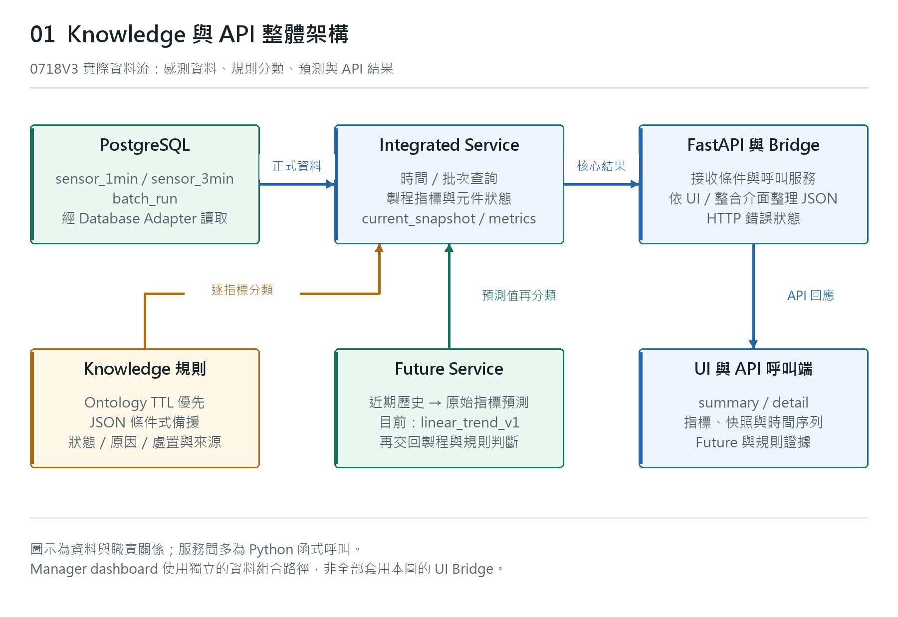
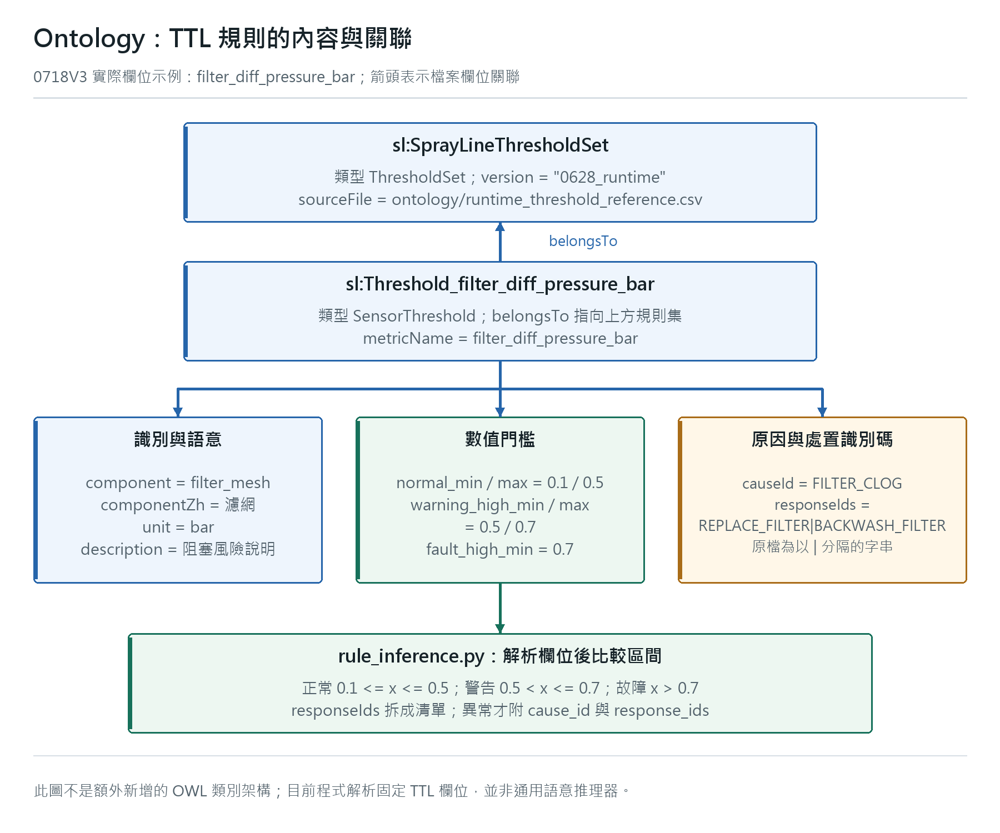
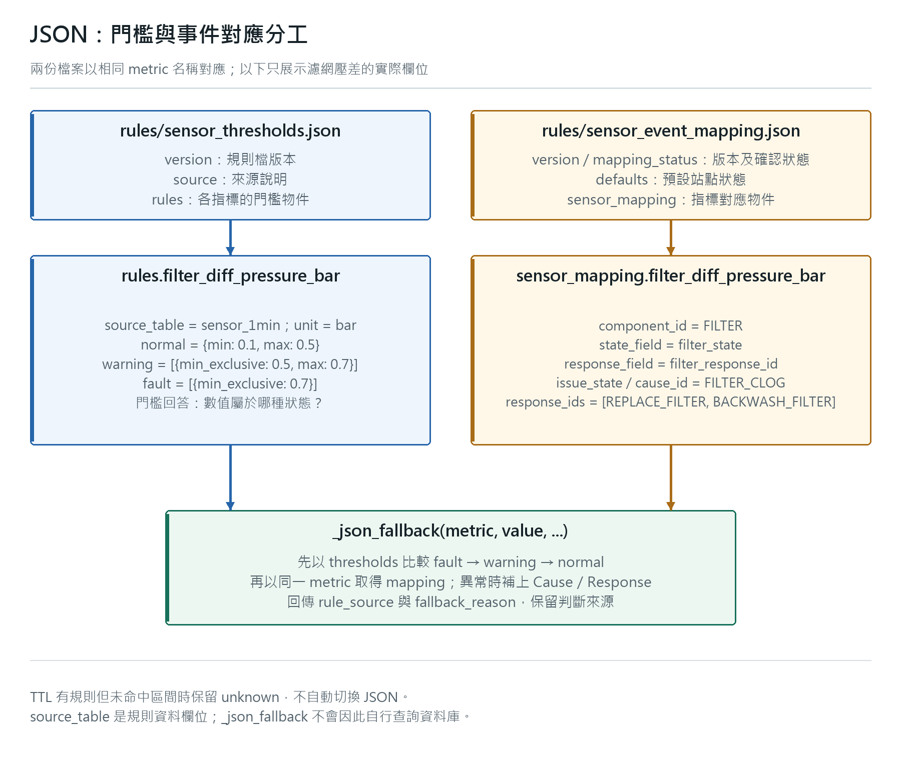
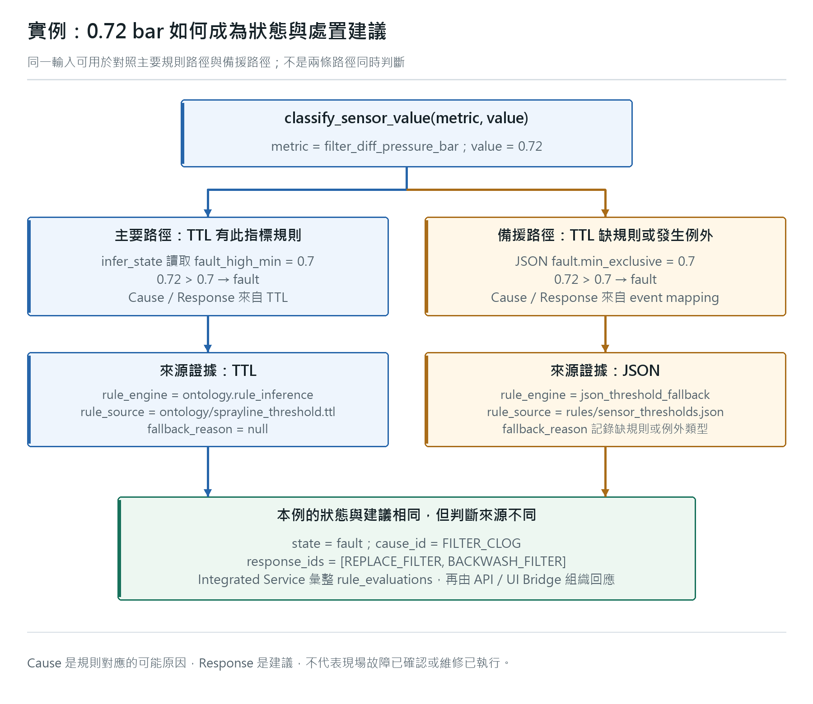
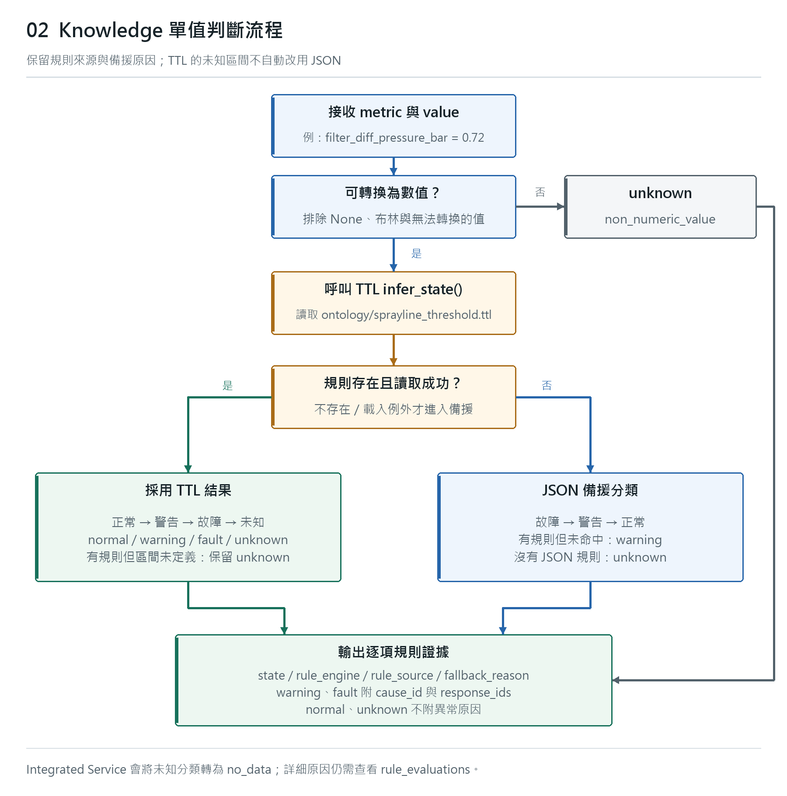
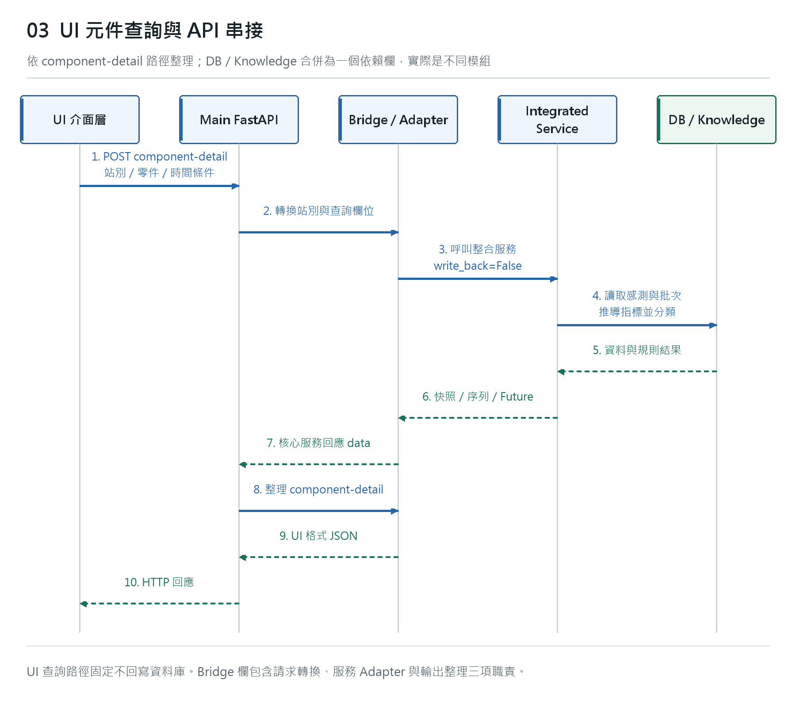
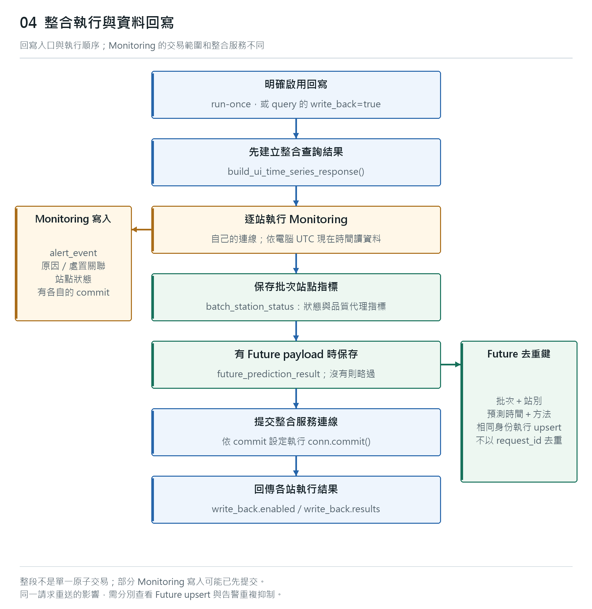
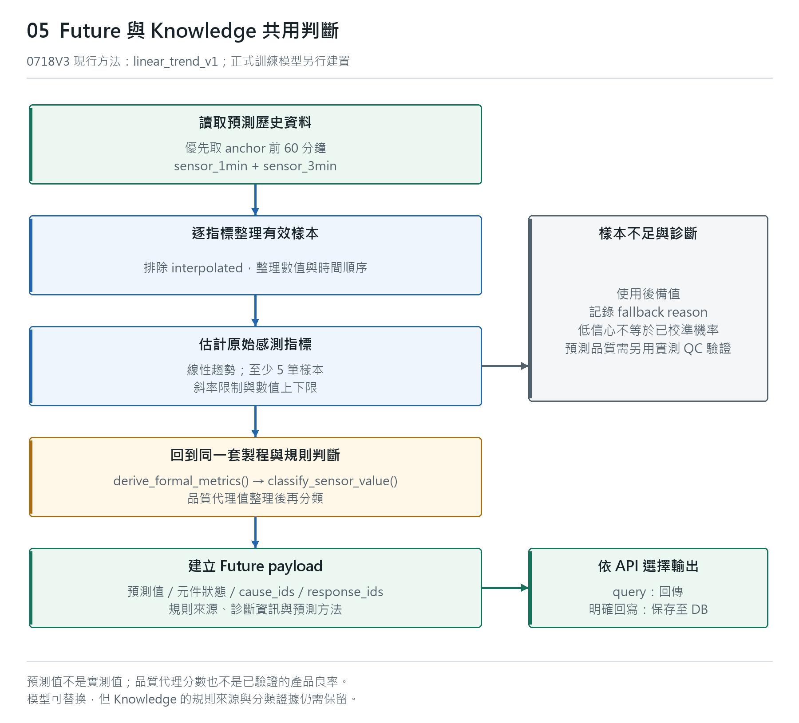

# SprayLine Knowledge 判斷與 API 串接說明

| 文件項目 | 內容 |
| --- | --- |
| 適用程式 | `final_version_0718_v3`，API 版本 `0718.3` |
| 文件日期 | 2026-10-29 |
| 核對來源 | [Project-SprayLine 程式快照][source-root]，commit `dcd619bee985577880def608974556beec1eb761` |
| 文件範圍 | Knowledge 規則、狀態判斷、原因與處置、API 查詢、Future 及資料回寫 |
| 程式路徑基準 | 本文的程式相對路徑以 `final_version_0718_v3/` 為根目錄 |

SprayLine 將感測資料轉換為製程指標、元件狀態、異常原因與處理建議，透過 API 提供給查詢端。Knowledge 保存判斷範圍與對應知識，Integrated Service 負責讀取資料及組織運算，API 負責接收請求與整理回應。

本文中的圖形對應上述程式快照的實際呼叫關係。Future 使用的現行方法為 `linear_trend_v1`；後續以真實資料訓練的預測模型屬於另外的建置工作。

點選流程圖片可開啟原尺寸圖片，方便放大閱讀。

## 文件導覽

1. [整體架構與元件職責](#architecture)
2. [Knowledge 的資料來源](#knowledge-sources)
   - [Knowledge 維護教學](#knowledge-maintenance)
3. [感測值如何判斷狀態](#classification)
4. [濾網壓差判斷實例](#worked-example)
5. [元件、站點與品質結果](#aggregation)
6. [UI 與 API 查詢流程](#query-flow)
7. [API 請求與回應範例](#api-examples)
8. [明確回寫與 Monitoring 流程](#writeback)
9. [Future 如何使用 Knowledge](#future)
10. [處理建議查詢與知識關聯](#troubleshooting)
11. [結果判讀與適用邊界](#boundaries)
12. [程式閱讀索引](#source-index)

<a id="architecture"></a>
## 1. 整體架構與元件職責

[](images/sl_km_1027_architecture.png)

**圖 1 說明：** PostgreSQL 提供感測與批次資料，Integrated Service 組合資料、計算指標並呼叫規則分類器。規則結果與 Future 結果經由 API 回傳。圖中的服務為程式模組職責，不表示每個模組都是獨立的 HTTP 服務。

| 元件 | 實際職責 | 主要結果 |
| --- | --- | --- |
| PostgreSQL / Database Adapter | 讀取 `sensor_1min`、`sensor_3min`、`batch_run` 等正式資料 | 感測列、批次及時間範圍 |
| Integrated Service | 組合快照與時間窗、推導製程指標、彙整狀態 | `current_snapshot`、`metrics`、`time_series` |
| Runtime Rule Classifier | 選用 TTL 規則或 JSON 備援，分類單一指標 | `state`、`cause_id`、`response_ids`、規則來源 |
| Future Service | 由歷史數值推估未來原始指標，再交回 Integrated Service 分類 | `future_prediction_payload` |
| UI Bridge / API Adapter | 轉換請求、呼叫服務、整理輸出與錯誤 | UI 格式 JSON 或整合服務 JSON |
| Monitoring | 讀取感測資料、評估異常、寫入事件與站點狀態 | 告警、原因處置關聯及狀態紀錄 |

此處的 UI 查詢流程主要對應 `/api/time-series/...` 及 Engineer 顯示資料。Manager 的 `/api/manager/dashboard` 有獨立的資料組合流程，不能將全部 Manager 查詢畫成經過相同的 UI Bridge。

實作入口：[Integrated Service][integrated-response]、[UI 查詢入口][api-ui-entry]、[Database Adapter][db-adapter]。

<a id="knowledge-sources"></a>
## 2. Knowledge 的資料來源

| 資料或程式 | 用途 | 執行時的關係 |
| --- | --- | --- |
| `ontology/sprayline_threshold.ttl` | 指標名稱、正常／警告／故障區間、原因與處置 ID | 單值分類的優先規則來源 |
| `ontology/rule_inference.py` | 解析專案使用的 TTL 欄位並比較數值區間 | 由分類器呼叫 `infer_state()` |
| `rules/sensor_thresholds.json` | 備援數值區間 | TTL 沒有該指標規則，或讀取／解析出錯時使用 |
| `rules/sensor_event_mapping.json` | 指標對應的元件、事件狀態、原因與處置 ID | JSON 備援與 Monitoring 對應時使用 |
| DB 的 catalog / mapping 資料表 | 保存異常類型、原因、處置與事件關聯 | 告警寫入、處理建議查詢時使用 |
| `services/troubleshooting_service/` | 依異常類型查詢已保存的處理建議 | 提供 matrix 與 recommendations API |

`rule_inference.py` 以專案所需的固定欄位解析 TTL，並進行區間比較；這裡的判斷不是通用 OWL 推理器，也沒有透過 SPARQL 查詢遠端知識服務。DB 的門檻資料表亦不代表這條 Runtime 分類路徑會自動改讀 DB 門檻。

TTL 目前的規則集 metadata 為 `0628_runtime`；這是規則資料自己的標記，與應用程式版本 `0718.3` 不同。Runtime 判斷以實際載入的 TTL／JSON 內容為準，不能只依 UI 顯示的歷史來源名稱認定所用規則。

規則與 JSON 讀取使用快取。修改規則檔後，需要讓相關服務程序重新載入，才能確認新內容生效。原因／處置 mapping 仍有草案標記，對外使用前需要核對 catalog ID 與現場語意。

### 2.1 Ontology 的 TTL 規則結構

[](images/sl_km_1029_ontology_structure.png)

**圖 2-A 說明：** 規則集保存來源及版本，每個指標規則透過 `sl:belongsTo` 關聯至規則集。指標規則同時保存識別資訊、數值區間、原因及處置識別碼。圖中的箭頭表示實際檔案欄位關聯，不表示新增服務或資料表。

檔案：`ontology/sprayline_threshold.ttl`。以下為濾網壓差規則的實際節錄，省略中文描述欄位；使用 `sl:`、`xsd:` 的前綴宣告位於原檔開頭。

```turtle
sl:Threshold_filter_diff_pressure_bar a sl:SensorThreshold ;
    sl:metricName "filter_diff_pressure_bar" ;
    sl:component "filter_mesh" ;
    sl:unit "bar" ;
    sl:causeId "FILTER_CLOG" ;
    sl:responseIds "REPLACE_FILTER|BACKWASH_FILTER" ;
    sl:belongsTo sl:SprayLineThresholdSet ;
    sl:normal_min "0.1"^^xsd:decimal ;
    sl:normal_max "0.5"^^xsd:decimal ;
    sl:warning_high_min "0.5"^^xsd:decimal ;
    sl:warning_high_max "0.7"^^xsd:decimal ;
    sl:fault_high_min "0.7"^^xsd:decimal .
```

| 欄位／語法 | 表達的內容 | 執行時如何使用 |
| --- | --- | --- |
| `a sl:SensorThreshold` | 這個資源是一條感測門檻規則 | 描述資源類型，不表示程式會執行通用類別推理 |
| `sl:metricName` | 輸入指標的名稱 | 用來找到該指標的門檻 |
| `sl:component`、`sl:unit` | 元件名稱及量測單位 | 提供判斷結果的語意；呼叫端應提供相符單位，不能假設自動換算 |
| `sl:belongsTo` | 規則所屬的規則集 | 表達規則集關聯，不是資料庫外鍵 |
| `normal_*`、`warning_*`、`fault_*` | 區間端點 | 由 `infer_state()` 的比較條件決定端點是否包含 |
| `sl:causeId` | 規則對應的可能原因 | 本例異常時回傳 `FILTER_CLOG` |
| `sl:responseIds` | 以 `|` 分隔的處置識別碼字串 | 解析為清單；正常及未定義狀態不附異常處置 |
| `^^xsd:decimal` | Turtle 的十進位數值型別標記 | 目前專案解析器取得數值後執行數值比較 |

例如 `fault_high_min = 0.7` 在本例表示 **大於** 0.7 才故障，而不是大於等於。0.7 仍屬警告。端點語意必須一起閱讀 [TTL 判斷實作][rule-loader] 與第 4 節的邊界實例，不能只看欄位名稱推測。

### 2.2 兩份 JSON 的內容與分工

[](images/sl_km_1029_json_structure.png)

**圖 2-B 說明：** `sensor_thresholds.json` 回答「這個數值屬於什麼狀態」，`sensor_event_mapping.json` 回答「這個指標對應哪個元件、原因與處置」。兩者以相同的指標名稱查找，不是以陣列位置配對。TTL 正常提供結果時，分類器不需要用這兩份 JSON 重新覆蓋 TTL 結果。

**門檻檔案：** `rules/sensor_thresholds.json`。以下保留實際 `rules` 層級，只節錄濾網壓差，省略其他指標與頂層 metadata。

```json
{
  "rules": {
    "filter_diff_pressure_bar": {
      "source_table": "sensor_1min",
      "unit": "bar",
      "normal": {"min": 0.1, "max": 0.5},
      "warning": [{"min_exclusive": 0.5, "max": 0.7}],
      "fault": [{"min_exclusive": 0.7}]
    }
  }
}
```

`min`／`max` 包含端點，`min_exclusive`／`max_exclusive` 不包含端點。`warning`、`fault` 是區間陣列，可表示偏低與偏高等多個區段。`source_table` 是資料來源資訊；分類器接收的是已取出的數值，不會因為這個欄位而自行查資料庫。

**事件對應檔案：** `rules/sensor_event_mapping.json`。以下保留實際 `sensor_mapping` 層級，省略其他 mapping 與頂層 metadata。

```json
{
  "sensor_mapping": {
    "filter_diff_pressure_bar": {
      "component_id": "FILTER",
      "state_field": "filter_state",
      "response_field": "filter_response_id",
      "issue_state": "FILTER_CLOG",
      "cause_id": "FILTER_CLOG",
      "response_ids": ["REPLACE_FILTER", "BACKWASH_FILTER"]
    }
  }
}
```

| 欄位 | 用途與注意事項 |
| --- | --- |
| `component_id` | 元件識別碼；JSON 備援結果會帶出此值。`FILTER` 與 TTL 的 `filter_mesh` 是不同命名欄位，不能假設字串完全一致 |
| `state_field` | 站點狀態欄位對應資訊，例如 `filter_state`；不是故障狀態本身 |
| `response_field` | 站點處置欄位對應資訊；不表示所有 `response_ids` 都會直接存入單一欄位 |
| `issue_state` | 異常類型，例如 `FILTER_CLOG`；不同於嚴重程度 `fault` |
| `cause_id` | 可能原因識別碼；本例與異常類型名稱相同，不應推論所有規則都相同 |
| `response_ids` | 處置識別碼陣列；與 TTL 的分隔字串表示法不同 |

`_json_fallback()` 實際取用 mapping 的 `component_id`、`cause_id` 與 `response_ids`；圖中其餘欄位是 mapping 檔保存的資訊，不表示此函式會逐欄使用。檔案的頂層 `defaults` 是預設狀態資料，不是一次感測判斷已通過的證據。頂層 `mapping_status` 仍標示草案待確認，對外部署前需核對 catalog 識別碼與現場定義。

實作依據：[規則來源與分類器][classifier]、[TTL 解析][rule-loader]、[TTL 規則內容][threshold-ttl]、[事件 mapping][event-mapping]。

### 2.3 從規則檔到 API 回應的完整實例

[](images/sl_km_1029_knowledge_example.png)

**圖 2-C 說明：** 對同一輸入 `filter_diff_pressure_bar = 0.72`，TTL 主路徑與 JSON 備援在本例都得到故障、濾網阻塞原因及兩個處置建議，但來源證據不同。這是兩種條件下的對照，不表示每次請求會同時跑兩條路徑，也不保證所有指標與邊界的結果一致。

1. Integrated Service 將數值交給 `classify_sensor_value()`。
2. 主路徑由 `infer_state()` 解析 TTL；0.72 大於 0.7，結果為 `fault`，Cause／Response 直接取自 TTL。
3. 只有 TTL 缺少該指標規則或發生例外時，才由 `_json_fallback()` 查找 JSON 門檻及事件對應。本例亦符合 `min_exclusive: 0.7`。
4. 回傳 `state = fault`、`cause_id = FILTER_CLOG`、`response_ids = [REPLACE_FILTER, BACKWASH_FILTER]`，並保留 `rule_engine`、`rule_source`、`fallback_reason`。
5. Integrated Service 將各指標證據彙整到 `rule_evaluations`；API／UI Bridge 再依端點整理回應，回應外層結構依端點不同而異，詳見第 6、7 節。

| 對照條件 | 狀態 | 規則來源與備援理由 |
| --- | --- | --- |
| TTL 有濾網壓差規則，值為 0.72 | `fault` | `ontology/sprayline_threshold.ttl`；理由為 `null` |
| TTL 缺少該指標、JSON 有該規則，值為 0.72 | `fault` | `rules/sensor_thresholds.json`；`ontology_rule_missing` |
| TTL 載入發生例外、JSON 有該規則，值為 0.72 | `fault` | `rules/sensor_thresholds.json`；`ontology_error:` 加例外類型 |
| TTL 有該規則，但值為 0.05、未落入任何區間 | `unknown` | 保留 TTL 來源；不轉交 JSON |

處置建議不是已執行指令，可能原因也不是經維修確認的故障事實。查詢本身不代表已新增告警或完成資料庫回寫；回寫流程另見第 8 節。

<a id="knowledge-maintenance"></a>
### 2.4 Knowledge 維護教學

本節適用於 0718V3 的 TTL、JSON 與 Docker 打包方式。操作會改變後續判斷結果，應先在測試環境驗證並取得製程規則確認；本文不授權變更現場安全門檻。範例命令使用 Windows PowerShell，工作目錄須為實際部署專案根目錄，即包含 `docker-compose.yml`、`ontology/`、`rules/` 的資料夾。不要在文件資料夾執行。

#### A. 決定修改哪個檔案

| 要修改的內容 | 主要檔案 | 必須一起核對 |
| --- | --- | --- |
| 正常、警告、故障範圍 | `ontology/sprayline_threshold.ttl` | JSON 備援的同名指標、端點包含方式、現場單位與配方 |
| JSON 備援門檻 | `rules/sensor_thresholds.json` | TTL 的同名指標；若刻意不同，記錄差異原因與測試結果 |
| TTL 的可能原因／處置 | TTL 的 `causeId`／`responseIds` | JSON mapping 及 DB catalog 是否有對應 ID |
| JSON 的原因／處置／元件對應 | `rules/sensor_event_mapping.json` | `sensor_mapping` 的 metric 名稱、catalog ID、Monitoring 的使用方式 |
| 新增指標 | 不只新增規則檔 | 資料庫、Integrated Service 取值、API 輸出與 UI 支援需另做開發；新增 TTL 不會自動完成串接 |

TTL 的 `responseIds` 是以 `|` 分隔的字串；JSON 的 `response_ids` 是陣列。不要任意改 metric、元件或 catalog ID 的大小寫。修改 mapping 不會自動在資料庫建立 cause／response catalog。

#### B. 備份與變更紀錄

先記錄規則來源、適用設備／配方、原值、新值、理由、確認人員角色、日期與測試結果。不要只改版本名稱而沒有記錄實際變更。TTL `version` 與 JSON `version` 是各自的 metadata，不等同 API 版本。

在同一個 PowerShell 工作階段執行以下備份，備份放在專案及 OneDrive 之外：

```powershell
$backup = Join-Path $env:LOCALAPPDATA ('SprayLineRuleBackups\' + (Get-Date -Format 'yyyyMMdd_HHmmss'))
New-Item -ItemType Directory -Path $backup -Force | Out-Null
Copy-Item -LiteralPath '.\ontology\sprayline_threshold.ttl' -Destination $backup
Copy-Item -LiteralPath '.\rules\sensor_thresholds.json' -Destination $backup
Copy-Item -LiteralPath '.\rules\sensor_event_mapping.json' -Destination $backup
Get-FileHash -LiteralPath '.\ontology\sprayline_threshold.ttl', '.\rules\sensor_thresholds.json', '.\rules\sensor_event_mapping.json' -Algorithm SHA256
Write-Output $backup
```

保留輸出的備份路徑；若關閉視窗，之後需要自行重新設定 `$backup` 為該實際路徑。若專案已有 Git，另保留本次規則的 commit／diff，避免混入其他人的未提交修改。

#### C. 修改範例與格式限制

以下只示範修改方法，**0.8 bar 不是新的建議現場門檻**。假設經核准要將濾網高警告上限由 0.7 改為 0.8，且高故障起點同步調整：

| 位置 | 原值 | 示範新值 |
| --- | --- | --- |
| TTL `warning_high_max` | `"0.7"^^xsd:decimal` | `"0.8"^^xsd:decimal` |
| TTL `fault_high_min` | `"0.7"^^xsd:decimal` | `"0.8"^^xsd:decimal` |
| JSON 該指標 `warning[0].max` | `0.7` | `0.8` |
| JSON 該指標 `fault[0].min_exclusive` | `0.7` | `0.8` |

其他正常範圍不變時，示範新規則應得到：0.5 正常、0.5001 警告、0.8 警告、0.8001 故障。不能只改其中一個端點，造成缺口或重疊。正常優先的 TTL 與故障優先的 JSON 在重疊區間可能給出不同答案。

目前 TTL 解析器使用固定格式的正規表示式，**不是完整 Turtle 解析器**。保留原有 `a sl:SensorThreshold`、`sl:` 前綴、引號及 `^^xsd:decimal` 格式；不同規則之間保留空行，同一規則內不要插入空白段落。即使某種寫法符合 Turtle 標準，也不代表目前解析器能讀懂。JSON 不接受註解或尾端多餘逗號，請維持 UTF-8 編碼。

#### D. 先建置測試映像，不立即替換執行中的服務

0718V3 的 Dockerfile 使用 `COPY . /app`；API 的 Compose 沒有將本機規則資料夾掛載進容器。因此只改本機檔案或執行 `docker restart`，不會把新檔案送入既有容器。

```powershell
docker compose build api
```

確認建置成功後，在獨立的一次性容器做讀取測試。下列命令使用 `--no-deps`，不啟動資料庫、migration、DataProcess 或正式 Monitoring；所執行的 Python 僅載入規則，不寫資料庫。

```powershell
docker compose run --rm --no-deps --workdir /app api python -m json.tool rules/sensor_thresholds.json
docker compose run --rm --no-deps --workdir /app api python -m json.tool rules/sensor_event_mapping.json
docker compose run --rm --no-deps --workdir /app api python ontology/rule_inference.py --run-smoke-test
```

前兩個命令只檢查 JSON 格式；smoke test 只印出分類結果，**都不代表所有語意與邊界已驗收**。還必須確認預期指標實際被載入，並執行下列有斷言的邊界測試。

#### E. 邊界、來源與備援測試

以下是原始 0718V3 濾網規則的驗收值。若實際門檻已修改，請同步依核准規格修改測試值與預期結果；不可為了讓測試通過而改回錯誤的預期。

```powershell
@'
from pathlib import Path
from services.event_rule_service.runtime_rule_classifier import classify_sensor_value
from ontology.rule_inference import load_rules

metric = 'filter_diff_pressure_bar'
assert metric in load_rules(Path('ontology/sprayline_threshold.ttl'))
cases = [(0.1, 'normal'), (0.5, 'normal'), (0.5001, 'warning'),
         (0.7, 'warning'), (0.7001, 'fault'), (0.72, 'fault'),
         (0.05, 'unknown'), (None, 'unknown'), ('abc', 'unknown')]
for value, expected in cases:
    result = classify_sensor_value(metric, value)
    assert result['state'] == expected, (value, result)
    if expected in ('normal', 'unknown'):
        assert result['cause_id'] is None and result['response_ids'] == []
    if value == 0.05:
        assert result['rule_source'] == 'ontology/sprayline_threshold.ttl'
        assert result['fallback_reason'] is None

missing = Path('/tmp/sprayline_rule_test_missing.ttl')
assert not missing.exists()
fallback = classify_sensor_value(metric, 0.72, ttl_path=missing)
assert fallback['state'] == 'fault'
assert fallback['rule_engine'] == 'json_threshold_fallback'
assert fallback['fallback_reason'].startswith('ontology_error:')
assert fallback['cause_id'] == 'FILTER_CLOG'
assert fallback['response_ids'] == ['REPLACE_FILTER', 'BACKWASH_FILTER']
print('PASS: original V3 boundaries, provenance and JSON fallback')
'@ | docker compose run --rm --no-deps -T --workdir /app api python -
```

刻意不存在的測試路徑只影響這次函式呼叫，不需刪除或改名正式 TTL。這是測試「TTL 讀取失敗」的備援；不是將部署改成長期依賴備援。還需對此次修改的每個 metric 分別測試端點、端點兩側、無效值及 Cause／Response，不能用一個濾網案例代表全部規則。語意核對包括：所有新 ID 可對應 catalog、單位正確、規則數量沒有意外減少。

#### F. 發布與重新載入

在測試全部通過及維護時段內，替換 API 容器：

```powershell
docker compose up -d --no-deps --force-recreate api
docker compose logs --tail 80 api
docker compose exec -T --workdir /app api python ontology/rule_inference.py --metric filter_diff_pressure_bar --value 0.72
```

這裡使用前一步已建置的映像。`--no-deps` 的前提是既有 DB／migration 狀態正常；它不是首次部署或修復 migration 的指令。重新建立容器會短暫中斷 API，需避開使用中的操作。

若有啟用獨立 `monitoring_worker`，它也持有自己的程式及規則快取，須以相同規則重新建置並重建該服務；若未啟用，不要為規則更新而額外啟動它。其他獨立 Python 程序若會載入規則，也需重新載入。不得只在測試程序清除 `lru_cache` 就認為正式 API 快取已更新。

確認發布後的檔案內容／hash 與已驗證來源一致，並檢查實際服務的 `rule_source`、`fallback_reason` 及結果。以上命令不執行 `run-once`、不啟動 DataProcess、不清除 DB volume；新規則也不會自動重算過去的告警與預測紀錄。舊紀錄如何重算屬另外的資料治理作業。

#### G. 驗收失敗時還原

先停止後續發布，從本次備份還原這三個檔案，不要使用整個儲存庫的強制重設：

```powershell
Copy-Item -LiteralPath (Join-Path $backup 'sprayline_threshold.ttl') -Destination '.\ontology\sprayline_threshold.ttl' -Force
Copy-Item -LiteralPath (Join-Path $backup 'sensor_thresholds.json') -Destination '.\rules\sensor_thresholds.json' -Force
Copy-Item -LiteralPath (Join-Path $backup 'sensor_event_mapping.json') -Destination '.\rules\sensor_event_mapping.json' -Force
docker compose build api
```

先確認還原檔案及建置成功，重跑 D、E 的讀取與邊界測試，再用 F 的命令重建 API；已更新的獨立 worker 也需回到同一規則版本。記錄失敗原因及還原結果。**不要執行 `docker compose down -v`、資料庫初始化、刪表或刪 volume。**

實作依據：`ontology/rule_inference.py` 的 `load_rules()`／`infer_state()`、`runtime_rule_classifier.py` 的 `_load_json()`／`classify_sensor_value()`，以及 0718V3 的 `Dockerfile`、`docker-compose.yml`。上述為維護指引；本次文件更新沒有實際修改規則或重新啟動部署環境。

<a id="classification"></a>
## 3. 感測值如何判斷狀態

[](images/sl_km_1027_knowledge_decision.png)

**圖 2 說明：** 分類器先檢查數值是否可轉換，再呼叫 TTL 規則。TTL 已定義指標但數值落在未定義區間時，保留 `unknown`；只有規則不存在或載入出錯才進入 JSON 備援。

### 3.1 單一指標的判斷順序

1. 接收 `metric` 與 `value`，例如 `filter_diff_pressure_bar` 與 `0.72`。
2. `None`、布林值或無法轉換為數字的輸入，回傳 `unknown`，`fallback_reason` 為 `non_numeric_value`。
3. 呼叫 `infer_state()`，讀取該指標的 TTL 區間。
4. TTL 依正常、警告、故障順序比較；未符合已配置區間時回傳 `unknown`。
5. 若 TTL 有該指標的規則，即使結果是未定義區間的 `unknown`，也保留此結果。
6. TTL 沒有該指標，或載入發生例外時，才使用 JSON 備援。JSON 依故障、警告、正常順序比較；存在規則但未命中時使用 `warning`，沒有規則則為 `unknown`。
7. 回傳狀態與規則來源；`warning`、`fault` 才附上原因與處置，`normal`、`unknown` 不附異常原因。

上述順序是目前程式行為。TTL 與 JSON 的判斷順序和未命中處理不同，因此必須保留 `rule_engine`、`rule_source`、`fallback_reason`，以便辨識此次實際使用的規則。

### 3.2 回傳欄位

| 欄位 | 說明 |
| --- | --- |
| `metric` / `value` / `unit` | 被分類的指標、輸入值與規則所定義的單位 |
| `state` | `normal`、`warning`、`fault`、`unknown` |
| `level` | 正常時為 `ok`；其他依分類結果表示 |
| `cause_id` | 規則對應的可能原因識別碼 |
| `response_ids` | 規則對應的處置識別碼清單 |
| `threshold` | TTL 路徑回傳的已配置區間；其他路徑不保證具備 |
| `rule_engine` / `rule_source` | 實際執行的分類程式與規則檔 |
| `fallback_reason` | 是否因規則缺少或錯誤而使用備援；TTL 成功時為 `null` |

Runtime 的 `unknown` 進入 Integrated Service 後會轉成元件判讀用的 `no_data`。查閱詳細原因時應回到原始 `rule_evaluations`，不要把沒有資料視為正常。

實作依據：[classify_sensor_value()][classifier]、[infer_state()][infer-state]、[JSON 備援][_json-fallback]。

<a id="worked-example"></a>
## 4. 濾網壓差判斷實例

TTL 的 `filter_diff_pressure_bar` 規則定義：

| 數值範圍，單位 bar | 分類 | 原因與處置 |
| --- | --- | --- |
| `0.1 ≤ value ≤ 0.5` | `normal` | 無異常原因與處置 |
| `0.5 < value ≤ 0.7` | `warning` | `FILTER_CLOG`；`REPLACE_FILTER`、`BACKWASH_FILTER` |
| `value > 0.7` | `fault` | `FILTER_CLOG`；`REPLACE_FILTER`、`BACKWASH_FILTER` |
| 例如 `value = 0.05` | `unknown` | TTL 未定義此區間，保留未知 |

當某站正式資料中的濾網壓差為 `0.72 bar` 時，執行 `classify_sensor_value("filter_diff_pressure_bar", 0.72)`，得到以下實際分類結果的節錄：

```json
{
  "metric": "filter_diff_pressure_bar",
  "value": 0.72,
  "unit": "bar",
  "state": "fault",
  "level": "fault",
  "cause_id": "FILTER_CLOG",
  "response_ids": ["REPLACE_FILTER", "BACKWASH_FILTER"],
  "rule_engine": "ontology.rule_inference",
  "rule_source": "ontology/sprayline_threshold.ttl",
  "fallback_reason": null
}
```

這表示壓差已超過目前規則的故障邊界，對應濾網堵塞風險及候選處置。它不是維修人員已確認濾網堵塞的證據，也不會因此自動執行更換或反洗。

本表為程式已配置的示例門檻，正式用於現場前應由設備與製程規格確認適用範圍。

<a id="aggregation"></a>
## 5. 元件、站點與品質結果

`derive_formal_metrics()` 先推導流量偏差、濾網堵塞指標、空壓偏差、噴幅偏差、估計膜厚與製程品質分數，再分類八項原始感測指標。

| 結果 | 判斷來源 |
| --- | --- |
| `nozzle_state` | 塗料流量規則 |
| `filter_state` | 濾網壓差規則 |
| `compressor_state` | 空壓規則 |
| `spray_width_state` | 噴幅規則 |
| `robot_arm_state` | 伺服負載與路徑誤差，取較嚴重狀態 |
| `environment_state` | 溫度與濕度，取較嚴重狀態 |
| `quality_state` | 流量、空壓、噴幅與路徑誤差的狀態彙整 |
| `station_state` | 各元件、環境及品質狀態的嚴重度彙整 |

結果中的 `rule_evaluations` 保存逐項判斷。`current_snapshot` 表示選定時間點的快照；`metrics` 是查詢時間窗的彙總，兩者不可當成同一種值。

製程品質分數是依製程條件計算的代理分數。單點分數、視窗內異常樣本比例與 Future 的品質代理值各有不同計算語意；它們都不能直接當作實際產品 QC 良率。

API Bridge 的元件卡片整理另有自己的欄位邏輯，部分卡片 `status` 只反映是否有數值。UI 的顏色或文字不應直接作為核心規則已一致套用的證據；需要比對快照狀態與 `rule_evaluations`。

實作依據：[derive_formal_metrics()][derive-metrics]、[UI Bridge][ui-bridge]。

<a id="query-flow"></a>
## 6. UI 與 API 查詢流程

[](images/sl_km_1027_api_query.png)

**圖 3 說明：** UI 請求先由 Bridge 轉成 Integrated Service 可接受的格式，再由 Adapter 呼叫服務。資料庫查詢與規則判斷是 Python 模組呼叫；沒有再次透過另一個內部 HTTP API 繞接。最後 Bridge 依 summary、station-detail 或 component-detail 整理 JSON。

### 6.1 請求如何進入核心服務

1. Engineer UI 的介面層提出站別、零件、模式與時間條件。
2. Main API 接收 `/api/time-series/ui/component-detail` 等請求並檢查必要欄位。
3. `build_integrated_request_from_ui()` 轉換站別識別與查詢欄位。例如 `line_1`、`M1` 對應 `Station_1`。
4. `_run_integrated_for_ui()` 呼叫 `run_integrated_service_query(..., write_back=False)`。
5. Integrated Service 透過 Database Adapter 查詢資料、推導指標及判斷狀態。Future 模式另走預測流程。
6. Bridge 整理成 UI 所需欄位，API 回傳結果。

這組 UI 查詢路徑固定不啟用回寫。正式 DB 路徑的查詢失敗時，不會自動改用 Demo 假資料補成成功結果。

### 6.2 主要 API

| 方法與路徑 | 用途 | 是否回寫 |
| --- | --- | --- |
| `POST /api/time-series` | 核心 UI 時間／批次查詢 | 否 |
| `POST /api/time-series/ui/summary` | UI 摘要 | 否 |
| `POST /api/time-series/ui/station-detail` | 指定站點詳細資料 | 否 |
| `POST /api/time-series/ui/component-detail` | 指定零件指標與時間序列 | 否 |
| `POST /api/service-orchestration/integrated/query` | 原始整合服務查詢 | 預設否；可明確傳入 `write_back: true` |
| `POST /api/service-orchestration/integrated/run-once` | 執行整合服務並啟用回寫 | 是，路由強制啟用 |
| `POST /api/service-orchestration/monitoring/run` | 執行一次監控 | 可能寫入告警與站點狀態 |
| `GET /api/service-orchestration/troubleshooting/matrix` | 查詢異常類型與處置矩陣 | 否 |
| `GET /api/service-orchestration/troubleshooting/states/{state}/recommendations` | 查詢指定異常類型的建議 | 否 |

`query` 與 `run-once` 不會自動建立常駐排程；`run-once` 也不是訓練預測模型的 API。

實作依據：[UI 路由][api-ui-entry]、[請求轉換][ui-bridge]、[整合服務路由][api-query]、[服務 Adapter][service-adapter]。

<a id="api-examples"></a>
## 7. API 請求與回應範例

### 7.1 目前濾網元件查詢

向 `POST /api/time-series/ui/component-detail` 傳送：

```json
{
  "request_id": "REQ_KM_FILTER_CURRENT_001",
  "mode": "time",
  "line_id": "line_1",
  "component_name": "filter_mesh",
  "slider_value": 0,
  "window_minutes": 60
}
```

成功時的頂層資料包括 `output_type: "ui_component_detail"`、`viewer_state`、`station_id`、`component_name`、`metrics`、`current_snapshot`、`time_series` 與 `future_prediction`。規則證據可從 `current_snapshot.rule_evaluations.filter_diff_pressure_bar` 查看。

### 7.2 原始整合查詢

向 `POST /api/service-orchestration/integrated/query` 傳送：

```json
{
  "schema_version": "v1.0",
  "service_name": "IntegratedSprayLineService",
  "request_id": "REQ_KM_INTEGRATED_CURRENT_001",
  "mode": "time",
  "window_type": "time_slider",
  "slider_value": 0,
  "window_minutes": 60,
  "station_scope": ["Station_1"],
  "write_back": false
}
```

成功回應的結構示意如下；省略欄位以 `...` 表示，因此本段為結構說明，並非可直接解析的 JSON：

```text
success: true
output_type: integrated_service_result
write_back_requested: false
data:
  output_type: ui_time_series
  viewer_state: {...}
  stations:
    - station_id: Station_1
      current_snapshot: {..., rule_evaluations: {...}}
      metrics: {...}
      time_series: {...}
  write_back:
    enabled: false
```

在原始整合查詢的時間模式中，`slider_value = 0` 為目前、負數為過去分鐘偏移、正數為未來分鐘偏移。例如 `5` 表示資料 anchor 後 5 分鐘。UI 顯示的時間軸尺度須依介面轉換，不可直接假設所有前端 slider 都使用同一單位。批次模式的 slider 則用於批次位置，語意不同。

目前查詢的 anchor 優先採用所查站別的最新 `sensor_1min` 時間；`generated_at` 是回應產生時間。資料時間與電腦現在時間可能不同，尤其是模擬資料環境。

### 7.3 錯誤回應

Service orchestration 的 Adapter 會將例外分類，API 再使用對應 HTTP 狀態回應：

| 情況 | HTTP 狀態 | `error_code` |
| --- | --- | --- |
| 無效型別／數值請求 | `422` | `invalid_request` |
| 權限錯誤 | `403` | `forbidden` |
| 資料庫連線不可用 | `503` | `database_unavailable` |
| 上游逾時 | `504` | `upstream_timeout` |
| 資料庫約束衝突 | `409` | `database_conflict` |
| 資料表／欄位等 schema 錯誤 | `500` | `database_schema_error` |
| 其他未分類錯誤 | `500` | `internal_error` |

這張表描述 Service orchestration 的錯誤轉換。UI wrapper 有自己的必要欄位檢查，部分核心錯誤由 UI wrapper 回傳 `500`；不能將上述分類視為所有 API 已完全一致的錯誤規格。格式錯誤的 JSON 也可能先被 FastAPI 擋下，回應結構不同。

實作依據：[錯誤分類][http-errors]、[HTTP 回應組裝][http-response]、[元件輸出格式][component-output]。

<a id="writeback"></a>
## 8. 明確回寫與 Monitoring 流程

[](images/sl_km_1027_writeback.png)

**圖 4 說明：** `run-once` 先建立整合查詢結果，再對每站執行 Monitoring、站點指標保存及可選的 Future 保存。Monitoring 自行取得連線，事件寫入有自己的提交；後續整合結果則使用整合服務連線。整段不是單一原子交易。

### 8.1 回寫順序

1. `run-once` 路由強制設為 `write_back=True`；`query` 則依明確傳入的設定決定。
2. 呼叫 `build_ui_time_series_response()`，先建立查詢與 Future 結果。
3. 對每個站點呼叫 `run_monitoring_once(station=..., lookback_minutes=...)`。
4. 寫入 `batch_station_status` 的狀態與品質代理指標。缺少必要的 `batch_id` 或 `station_id` 時，該站指標寫入會回報略過原因。
5. 該站具備 `future_prediction_payload` 時，保存至 `future_prediction_result`。
6. 依整合服務的 `commit` 設定提交後續整合寫入，再回傳 `write_back.results`。

Monitoring 的這個入口依電腦 UTC 現在時間計算 lookback，不是沿用 Integrated Service 的資料 anchor。若資料庫使用模擬時間或正在查歷史資料，Monitoring 讀到的資料範圍可能與該次查詢不同。

### 8.2 告警與知識關聯

Monitoring 先評估每筆感測資料；被偵測到的異常透過 DB 函式建立 `alert_event`，並依 mapping 建立 `alert_cause_link` 與 `alert_response_link`，同時更新批次站點狀態。告警的重複抑制由 Monitoring 的 duplicate guard 處理。

### 8.3 Future 重複寫入

Future 以 `batch_id + station_id + prediction_time + prediction_method` 建立穩定的 `idempotency_key`。資料庫使用對應唯一索引與 `ON CONFLICT ... DO UPDATE`，同一組身份再次保存會更新原紀錄。

`request_id` 用於追蹤請求，不是這個 Future 去重鍵。最新感測時間改變而產生新的 `prediction_time` 時，可能形成新紀錄。此去重機制也不代表整個 `run-once`、所有告警與其他資料表都共用同一個去重鍵。

實作依據：[run_integrated_once()][integrated-write]、[Monitoring 入口][monitoring]、[告警寫入][alert-writer]、[Future upsert][future-upsert]。

<a id="future"></a>
## 9. Future 如何使用 Knowledge

[](images/sl_km_1027_future.png)

**圖 5 說明：** Future 預測的是原始感測指標；狀態、原因與處置由同一條製程推導與規則分類路徑產生。預測結果是對未來條件的估計，不是未來實測值。

1. Integrated Service 在 Future 分支優先取得 anchor 前 60 分鐘的 `sensor_1min`、`sensor_3min`；擴大歷史查詢失敗或沒有資料時，使用已取得的資料作備援。
2. Future Service 排除標記為 `interpolated` 的補值資料，逐指標整理有效樣本及時間順序。
3. 目前各指標以至少 5 筆有效樣本進行線性趨勢估計，並套用斜率與數值上下限；樣本不足時使用後備值並標記診斷資訊。
4. 預測出的八項原始指標送回 `derive_formal_metrics()`，重新計算製程指標與元件狀態。
5. Future 品質代理值整理後，重新分類相關品質指標，再從異常結果蒐集不重複的 `cause_ids`、`response_ids` 與 `rule_sources`。
6. 建立 `future_prediction_payload`，包含預測時間、方法、資料來源、規則評估與診斷；查詢只回傳，明確回寫流程才保存。

查看 Future 時，應核對 `prediction_method`、`prediction_time`、`model_input_source`、`quality_score_semantics`、`rule_evaluations`、`confidence` 與 `metric_diagnostics`。`confidence` 是目前程式的診斷標示，不能解讀為已校準的機率或實際預測準確率。

現行欄位 `predicted_ok_rate` 保留相容名稱，其內容是品質代理分數；`predicted_ng_count` 亦不是依真實產量與 QC 訓練得到的件數模型。正式品質預測需要可追溯的現場感測、產品／配方與實際 QC 資料，並另行完成模型訓練與獨立回測。

實作依據：[Future 整合入口][future-integration]、[Future Service][future-service]、[Future payload][future-payload]。

<a id="troubleshooting"></a>
## 10. 處理建議查詢與知識關聯

Runtime 的 `cause_id`／`response_ids` 與 DB 的異常類型查詢是相關但不同的資料介面：

| 概念 | 例子 | 在哪裡使用 |
| --- | --- | --- |
| 嚴重程度 | `normal`、`warning`、`fault` | 感測分類、元件與站點狀態 |
| 異常類型 | `FILTER_CLOG` | issue catalog、Monitoring mapping、處理建議查詢 |
| 原因 ID | `FILTER_CLOG`、`AIR_PRESSURE_UNSTABLE` | 規則結果與告警原因關聯 |
| 處置 ID | `REPLACE_FILTER`、`CALIBRATE_PRESSURE_VALVE` | Runtime 建議與事件處置關聯 |
| 知識處置項目 | `solution_catalog.solution_id` | Troubleshooting matrix 與 recommendations 的 `countermeasure_id` |

例如：

```http
GET /api/service-orchestration/troubleshooting/matrix?asset_type=FILTER&state=FILTER_CLOG
GET /api/service-orchestration/troubleshooting/states/FILTER_CLOG/recommendations?station=Station_1
```

此處路徑參數 `{state}` 對應 DB 的 `issue_id`，不是傳入嚴重度 `fault`。Matrix 會讀取 `component_issue_solution_map`、`component_catalog`、`issue_catalog`、`solution_catalog`，回傳處置、排序與其他已保存資訊。`station` 在目前 recommendations 函式中會帶入回應，沒有作為 SQL 的站別篩選條件。

Catalog 中的 `effectiveness_pct` 為資料庫保存欄位，單憑欄位名稱不能認定它是經現場試驗驗證的成功率。知識表 ID 與 Runtime mapping 的對應也需要一致維護。

實作依據：[處理矩陣查詢][troubleshooting-matrix]、[指定異常建議][troubleshooting-recommendations]。

<a id="boundaries"></a>
## 11. 結果判讀與適用邊界

| 閱讀項目 | 應如何判讀 |
| --- | --- |
| `unknown` / `no_data` | 無法完成已定義的分類，應查看資料與規則證據 |
| `cause_id` | 規則對應的可能原因；維修確認原因需要另外保存證據 |
| `response_ids` | 候選處理建議；不是自動控制命令 |
| TTL / JSON | 保留此次來源與備援原因，才能追溯判斷依據 |
| 品質分數 | 製程條件代理指標，需要實測 QC 才能驗證與品質的關係 |
| Future 結果 | 查看預測目標時間、輸入資料時間與方法；不能當成已量測資料 |
| 元件顏色 | 需與 API 快照、規則結果及前端自己的判斷邏輯一起核對 |
| 回寫成功 | 需查看各站 `write_back.results`，不能只看 HTTP 200 |

現場接入需確認感測欄位與單位、時間戳記及時區、站別／批次／工件關聯、補值與無效資料標記、產品／配方適用門檻，以及實際 QC 與維修回饋。本文不將現有模擬資料或規則常數視為廠商已核准的製程規格。

<a id="source-index"></a>
## 12. 程式閱讀索引

以下連結固定至本文件核對的 GitHub commit，避免預設分支變動造成行號與內容對不上。

| 想了解的內容 | 程式入口 |
| --- | --- |
| TTL 載入與欄位解析 | [ontology/rule_inference.py：load_rules()][rule-loader] |
| TTL 區間判斷 | [ontology/rule_inference.py：infer_state()][infer-state] |
| TTL / JSON 選用與備援 | [runtime_rule_classifier.py：classify_sensor_value()][classifier] |
| 製程指標與元件狀態 | [sprayline_integrated_service.py：derive_formal_metrics()][derive-metrics] |
| UI 請求轉換 | [shaoyu_ui_bridge.py：build_integrated_request_from_ui()][ui-bridge] |
| UI 元件輸出 | [shaoyu_ui_bridge.py：build_ui_component_detail_output()][component-output] |
| API 元件入口 | [api_server.py：HandleTimeSeriesUiComponentDetailRequest()][api-ui-entry] |
| 整合查詢與回寫路由 | [api_server.py：RunIntegratedServiceQuery()][api-query] |
| 服務錯誤轉換 | [service_orchestration_adapter.py：_http_status_for_exception()][http-errors] |
| 整合回寫順序 | [sprayline_integrated_service.py：run_integrated_once()][integrated-write] |
| Future 與規則整合 | [sprayline_integrated_service.py：estimate_future_from_history()][future-integration] |
| Future 原始指標預測 | [services/future_service/future_service.py][future-service] |
| Future 去重與 upsert | [database/db_future.py][future-upsert] |
| Monitoring 單次處理 | [services/monitoring_worker/monitoring_worker.py][monitoring] |
| 異常處理建議 | [services/troubleshooting_service/troubleshooting_service.py][troubleshooting-matrix] |

[source-root]: https://github.com/HoraceYang2019/Project-SprayLine/tree/dcd619bee985577880def608974556beec1eb761/final_version_0718_v3
[threshold-ttl]: https://github.com/HoraceYang2019/Project-SprayLine/blob/dcd619bee985577880def608974556beec1eb761/final_version_0718_v3/ontology/sprayline_threshold.ttl
[event-mapping]: https://github.com/HoraceYang2019/Project-SprayLine/blob/dcd619bee985577880def608974556beec1eb761/final_version_0718_v3/rules/sensor_event_mapping.json
[rule-loader]: https://github.com/HoraceYang2019/Project-SprayLine/blob/dcd619bee985577880def608974556beec1eb761/final_version_0718_v3/ontology/rule_inference.py#L46
[infer-state]: https://github.com/HoraceYang2019/Project-SprayLine/blob/dcd619bee985577880def608974556beec1eb761/final_version_0718_v3/ontology/rule_inference.py#L94
[classifier]: https://github.com/HoraceYang2019/Project-SprayLine/blob/dcd619bee985577880def608974556beec1eb761/final_version_0718_v3/services/event_rule_service/runtime_rule_classifier.py#L88
[_json-fallback]: https://github.com/HoraceYang2019/Project-SprayLine/blob/dcd619bee985577880def608974556beec1eb761/final_version_0718_v3/services/event_rule_service/runtime_rule_classifier.py#L41
[derive-metrics]: https://github.com/HoraceYang2019/Project-SprayLine/blob/dcd619bee985577880def608974556beec1eb761/final_version_0718_v3/services/integrated_service/sprayline_integrated_service.py#L795
[integrated-response]: https://github.com/HoraceYang2019/Project-SprayLine/blob/dcd619bee985577880def608974556beec1eb761/final_version_0718_v3/services/integrated_service/sprayline_integrated_service.py#L1241
[integrated-write]: https://github.com/HoraceYang2019/Project-SprayLine/blob/dcd619bee985577880def608974556beec1eb761/final_version_0718_v3/services/integrated_service/sprayline_integrated_service.py#L1395
[future-integration]: https://github.com/HoraceYang2019/Project-SprayLine/blob/dcd619bee985577880def608974556beec1eb761/final_version_0718_v3/services/integrated_service/sprayline_integrated_service.py#L1013
[db-adapter]: https://github.com/HoraceYang2019/Project-SprayLine/blob/dcd619bee985577880def608974556beec1eb761/final_version_0718_v3/services/integration_adapter/database_versionb_adapter.py
[ui-bridge]: https://github.com/HoraceYang2019/Project-SprayLine/blob/dcd619bee985577880def608974556beec1eb761/final_version_0718_v3/api/shaoyu_ui_bridge.py#L96
[component-output]: https://github.com/HoraceYang2019/Project-SprayLine/blob/dcd619bee985577880def608974556beec1eb761/final_version_0718_v3/api/shaoyu_ui_bridge.py#L311
[api-ui-entry]: https://github.com/HoraceYang2019/Project-SprayLine/blob/dcd619bee985577880def608974556beec1eb761/final_version_0718_v3/api/api_server.py#L870
[api-query]: https://github.com/HoraceYang2019/Project-SprayLine/blob/dcd619bee985577880def608974556beec1eb761/final_version_0718_v3/api/api_server.py#L949
[service-adapter]: https://github.com/HoraceYang2019/Project-SprayLine/blob/dcd619bee985577880def608974556beec1eb761/final_version_0718_v3/api/service_orchestration_adapter.py#L175
[http-errors]: https://github.com/HoraceYang2019/Project-SprayLine/blob/dcd619bee985577880def608974556beec1eb761/final_version_0718_v3/api/service_orchestration_adapter.py#L54
[http-response]: https://github.com/HoraceYang2019/Project-SprayLine/blob/dcd619bee985577880def608974556beec1eb761/final_version_0718_v3/api/api_server.py#L91
[monitoring]: https://github.com/HoraceYang2019/Project-SprayLine/blob/dcd619bee985577880def608974556beec1eb761/final_version_0718_v3/services/monitoring_worker/monitoring_worker.py#L55
[alert-writer]: https://github.com/HoraceYang2019/Project-SprayLine/blob/dcd619bee985577880def608974556beec1eb761/final_version_0718_v3/services/monitoring_worker/alert_event_writer.py#L11
[future-upsert]: https://github.com/HoraceYang2019/Project-SprayLine/blob/dcd619bee985577880def608974556beec1eb761/final_version_0718_v3/database/db_future.py#L14
[future-service]: https://github.com/HoraceYang2019/Project-SprayLine/blob/dcd619bee985577880def608974556beec1eb761/final_version_0718_v3/services/future_service/future_service.py#L190
[future-payload]: https://github.com/HoraceYang2019/Project-SprayLine/blob/dcd619bee985577880def608974556beec1eb761/final_version_0718_v3/services/future_service/future_service.py#L369
[troubleshooting-matrix]: https://github.com/HoraceYang2019/Project-SprayLine/blob/dcd619bee985577880def608974556beec1eb761/final_version_0718_v3/services/troubleshooting_service/troubleshooting_service.py#L5
[troubleshooting-recommendations]: https://github.com/HoraceYang2019/Project-SprayLine/blob/dcd619bee985577880def608974556beec1eb761/final_version_0718_v3/services/troubleshooting_service/troubleshooting_service.py#L39
