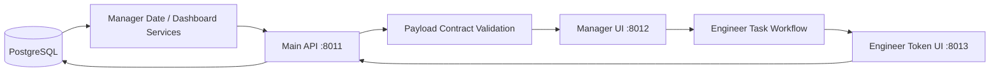
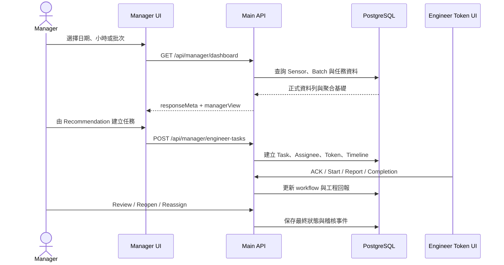

# Spray Line Manager UI

> Repository: https://github.com/HoraceYang2019/Project-SprayLine  
> Parent Path: `final_version_0718_v3/`  
> Code Baseline: `a9550494ad27d19dbd0079349fbc1cd2660d0dc1`  
> 文件日期: 2026-10-12

本文件說明 Spray Line 專案中 Manager UI 的實際架構、畫面功能、前後端模組、API 串接、資料來源、狀態判斷、異常診斷、趨勢圖、時間／批次檢視、工程師任務閉環、Docker 部署與目前限制。內容範圍限定於 `final_version_0718_v3/` 的實際工作流程。

> **系統定位**：Manager UI 不是資料採集端，也不是即時控制器。它接收 Main API 整理後的 Manager View Model，協助主管查看三站製程風險、建立工程師任務、追蹤回報並完成審核。

> **閱讀邊界**：實際程式碼、API Contract 與資料庫狀態是最終依據。本文件只列入目前頁面確實載入且工作流程確實呼叫的模組與函式，不納入 dead code。文件編排參考同資料夾的 Database、Engineer UI、Knowledge Management 與 Web Service 文件；內容未引用既有 Manager UI 文件。

## 文件導覽

1. Overview 與 Runtime：說明 Manager UI 在整體系統中的責任與執行端點。
2. System Architecture：說明 Browser、Main API、Services、PostgreSQL 與工程師任務之間的關係。
3. 畫面功能：逐區說明 Dashboard、通知紀錄與 Engineer Token 頁面。
4. Frontend and Backend Modules：列出實際工作流程使用的模組及責任。
5. API 串接：逐一說明請求來源、參數、後端處理、資料去向與使用畫面。
6. Scenario Data Flow：以使用情境串起完整資料流。
7. 至 15.：說明資料來源、狀態、診斷、趨勢、時間／批次、任務流程、錯誤處理、Docker 與限制。
16. Implementation References：列出程式碼依據。
附錄 A：逐一說明目前工作流程中的具名函式。

## 1. Overview 與 Runtime

Manager UI 是管理決策與工程師任務閉環介面。Dashboard 查詢本身只讀取彙整資料；建立任務、通知決策、改派、審核、重開與補充回報等明確操作才會寫入任務相關資料。

- Manager UI：`http://localhost:8012`
- Main API：`http://localhost:8011`
- 三個介面：Dashboard、通知／任務紀錄、Engineer Token 安全頁。
- 主 Dashboard 只接受 DB-backed payload，拒絕 mock、web_service 或 fallback 標記。

主要 Active Files：`dashboard.js`、`main/api-client.js`、`main/manager-api-validation.js`、`main/time-review.js`、`main/summary-state.js`、三個 render 模組、`notification-history.js` 與 `engineer-task.js`。

## 2. System Architecture

`PostgreSQL → Manager API／Services → Payload 驗證 → Dashboard → 派工 → 工程師處理 → Manager 審核`

Browser 不直接存取 PostgreSQL。Dashboard 先呼叫 Main API，再由 Manager Date／Dashboard Services 解析日期、聚合三站資料、計算 KPI、風險、建議及 24 小時趨勢；前端通過 payload contract 後才更新畫面。

## 3. 畫面功能

### 3.1 Manager Dashboard

Header 左側顯示「Manager Dashboard」與「通知紀錄與工程師任務」入口。右側 Date 只列資料庫可查日期，最新日期會標示 DB latest；Hour 只列該日期有資料的小時。使用者改變 Date 或 Hour 時，前端會重新向 Dashboard API 取得整份畫面資料。

「主管重點指標」包含四張 KPI：估算 OK rate、估算 NG rate、今日產能達成率，以及目前最嚴重站點。OK／NG 由 selectedDate 感測資料加權估算；產能達成率會顯示批次數、每批 264 pcs 與每日 20,000 pcs 目標；最嚴重站點包含站名、製程與主要問題。

「三站狀態比較表」上方有 Batch selector，可查看該小時全部批號或單一批次。每站顯示 Station／Process、稼動率、預估 OK pcs、預估 NG pcs 與主要問題。稼動率、OK 與 NG 欄旁的圖示可開啟該站該指標的 24 小時 Trend Drawer。

「需要處理的項目」由後端 Recommendations 產生。每張建議卡顯示站別、製程、風險等級、主要問題、建議與發送通知按鈕；沒有建議時明確顯示目前無需處理事項。派工時 Dialog 讓 Manager 選擇 Primary、Collaborator 與必要參與者；Toast 顯示建立任務結果。API 或 payload 失敗時，Error Banner 會清除 KPI、三站與建議，避免殘留舊資料。

### 3.2 通知紀錄與工程師任務

Header 顯示通知紀錄、PostgreSQL 為唯一正式狀態來源的提示及返回 Dashboard 連結。頁面分成「通知決策」與「工程師任務」兩個頁籤。

篩選區可輸入起日、迄日、小時、站別、批次、決策類型、寄送狀態、流程狀態、工程師 Email 與 Task ID；預設起日為目前日期往前六天。通知決策結果顯示時間、站別、風險、決策、抑制次數與原因。工程師任務結果顯示建立時間、Task ID、站別／批次、問題、指派者寄送及 ACK 狀態、workflowStatus 與明細入口，每頁 50 筆。

任務明細 Dialog 會同時讀取 Task 與 Timeline，顯示完整指派、建議、工程回報、圖片附件與事件歷程。Manager 可重送第一位未 ACK 人員；只有任務處於 completion_submitted 時，驗收通過與退回按鈕才可操作。

### 3.3 Engineer Token 安全頁

Header 顯示工程師任務與安全連結驗證狀態。Token 無效、過期或 API 失敗時顯示 Error Panel。驗證成功後，任務區顯示 workflow badge、站別／問題、Task ID、批次、風險、建議及所有指派者的 Primary、必要參與和 ACK 狀態。

工程師可依序 ACK 與開始處理；只有 Primary 且 workflowStatus 為 in_progress 才能提交完成。現場回報必填觀察狀況、採取措施與處理結果；確認原因、剩餘問題及備註可選填；每次最多上傳 5 張 JPG、PNG 或 WEBP。頁面下方顯示既有回報、附件及完整 Timeline。任務完成後，只有 supplementationOpen 且該工程師獲准時才能繼續補充。

## 4. Frontend and Backend Modules

- `dashboard.js`：載入、時間／批次狀態與畫面事件。
- `render-overview.js`：Header、KPI 與三站比較。
- `render-diagnosis.js`：24 小時趨勢抽屜與 SVG。
- `render-recommendations.js`：異常主因、建議與派工 Dialog。
- `manager-api-validation.js`：驗證正式來源、三站與 24 小時序列。
- `summary-state.js`：只保存已通過驗證的 managerView。
- `manager_date_service.py`：解析可用日期、小時與批次。
- `manager_dashboard_service.py`：計算 KPI、風險、診斷、建議與趨勢。
- Engineer task／notification decision services：維護任務、通知、回報、附件與 Timeline。

## 5. API 串接

### 5.1 Dashboard API

`dashboard.js` 在初次載入、20 分鐘輪詢或 Date／Hour／Batch 改變時呼叫 `GET /api/manager/dashboard`。date 可省略；hour 只有 date 有效時才加入；batch_id 只有 date 與 hour 都有效時才加入。

`api_server.py` 收到請求後，先由 `manager_date_service.py` 解析可用日期與小時，再讀取該時段三站資料、當日 Sensor rows、Batch 數與 24 小時聚合。結果交給 `manager_dashboard_service.py` 產生 responseMeta、KPI、三站比較、Batch selector、Risk、Recommendation 與 Trend drawer。前端 `manager-api-validation.js` 驗證完成後，才把資料送往 Header、KPI、站別比較、建議與趨勢畫面。

`GET /api/manager/available-dates` 不需參數，從資料庫取得有 Sensor 資料的日期、小時及 latestDate／latestHour。Dashboard 目前主要使用 dashboard responseMeta 內同一組資訊，此 Endpoint 可供獨立時間範圍查詢。

### 5.2 派工 API

Manager 在 Recommendation 按下發送通知後，先呼叫 `GET /api/manager/station-engineer-assignments?station_id=...&active_only=true`，從正式站別指派資料取得 assignmentId、姓名與 Email。前端用這些資料建立派工 Dialog。

Manager 完成選擇後，前端呼叫 `POST /api/manager/engineer-tasks`。Body 包含站別、日期、小時、批次、風險、問題、建議、通知文字及 assignees。後端建立 Task、Assignee、Token、寄送狀態與 Timeline，回傳 Task ID；前端以 Toast 顯示結果，之後可在通知紀錄頁查到任務。

### 5.3 任務查詢與 Manager 動作

`GET /api/manager/engineer-tasks` 接收日期、站別、批次、deliveryStatus、workflowStatus、engineerEmail、taskId、limit 與 offset，從任務資料表回傳分頁清單。打開明細時，頁面並行呼叫 `GET .../{task_id}` 與 `GET .../{task_id}/timeline`，把任務、指派、回報、附件與事件時間線交給 Dialog。

附件由 `GET /api/manager/engineer-task-attachments/{attachment_id}` 串流給 Manager 預覽。重寄使用 `POST .../{task_id}/resend`；改派使用 `PATCH .../{task_id}/assignees`；審核使用 `POST .../{task_id}/review`；重開使用 `POST .../{task_id}/reopen`；完成後補充則由 `POST .../supplementation/open|close` 控制。

### 5.4 通知決策 API

`GET /api/manager/notification-decisions` 接收日期、站別、批次、決策類型及分頁，回傳 riskLevel、decisionType、suppressedCount 與 decisionReason，交給通知決策頁籤。`POST /api/manager/notification-decisions/evaluate` 接收 severity、fingerprint 與異常識別資料，由後端決定 email_task_created、dashboard_only、suppressed 或 cooldown_skipped；重複抑制與 cooldown 的正式判斷在後端，不在前端按鈕。

### 5.5 Engineer Token API

Engineer 頁從 URL 取得 Token，並以 `Authorization: Bearer ...` 呼叫 `/api/engineer-task-access/*`。`GET /task` 取得任務、目前 Assignee、回報與 Timeline；`POST /ack`、`/start` 與 `/completion-submit` 推進 workflow；`POST /reports` 建立現場回報；`POST /reports/{report_id}/attachments` 上傳圖片。後端先以 `authorize_token()` 限定工程師及任務範圍。

## 6. Scenario Data Flow

### 6.1 Dashboard Load

`GET manager/dashboard → 日期解析 → PostgreSQL 聚合 → KPI／風險／趨勢 → payload validation → summary-state → render`

### 6.2 時間切換

切換日期會清除 hour 與 batch，再由後端選該日最新小時；切換 hour 會保留日期並清除 batch；只有 date 與 hour 都有效時才傳送 `batch_id`。

### 6.3 建議轉派工

`Recommendation → station assignments → Primary／Collaborator → POST engineer-tasks → Task／Token／Email 狀態 → Timeline`

### 6.4 工程師閉環

`Token page → ACK → Start → Report／Attachments → Submit Completion → Manager Review／Reopen → completed`

## 7. 資料來源

PostgreSQL 是 Sensor、Batch、Alert、Task、Assignee、Report、Attachment metadata 與 Timeline 的正式來源。Manager Dashboard API 將資料庫查詢結果轉成 Manager 專用 View Model；前端不直接查資料庫，也不重新計算風險。

responseMeta 的 source 識別正式來源；generatedAt 是 Response 建立時間；selectedDate 與 selectedHour 才是畫面資料時間；availableDates、availableHours 與 availableHoursByDate 驅動 Header 選項。

managerView 內的 kpis、stationComparison、recommendations、trendDrawer 與 batchSelector 都是後端衍生資料。taskId 則串起 Manager UI、Email、安全 Token 頁、Assignee、Report、Attachment 與 Timeline。deliveryStatus 描述寄送／ACK；workflowStatus 描述工作生命週期，兩者不能混用。

前端記憶體保存日期、小時、批次、Trend Drawer 及目前 Recommendation。localStorage 只保存任務顯示快取與舊 ACK 相容資訊；清除瀏覽器資料不應改變 PostgreSQL 的正式任務。圖片本體存於附件 volume，資料庫保存附件識別、檔名、MIME、大小與 Report 關聯。

## 8. 狀態判斷

Dashboard 的站別狀態由後端風險分數決定：分數達 70 顯示 `alarm`，達 35 但未滿 70 顯示 `warning`，其餘顯示 `normal`。前端只套用對應樣式與文字，不自行重算門檻。風險分數的輸入來自品質、堵塞、利用率、cycle time、噴幅、流量及壓力偏差；計算結果會進入站別比較、最嚴重站點與 Recommendation。

任務流程從 `unacknowledged` 開始。工程師確認後成為 `acknowledged`，開始處理後成為 `in_progress`，Primary 提交完成後成為 `completion_submitted`，最後由 Manager 驗收成為 `completed`。若 Manager 退回或重開，後端會依動作更新流程並留下 Timeline，而不是只改前端標籤。

`deliveryStatus` 是通知傳遞狀態，包含 `pending`、`sent`、`failed` 與 `acknowledged`；`workflowStatus` 是任務工作進度。前者回答「通知有沒有送達或確認」，後者回答「工作做到哪裡」，兩者不能混用。

## 9. 異常診斷

品質診斷讀取 `quality_score_pct`，低於 92% 時把品質偏低列入原因並增加風險。堵塞診斷讀取 `clog_rate_pct`，達 10% 時提示濾網或噴嘴相關風險。稼動率將目前值與 baseline 比較，低於基準超過 5 個百分點時判為稼動不足；cycle time 高於 baseline 的 1.08 倍時，代表節拍至少慢 8%。

噴幅診斷將 `spray_width` 與 target_min／target_max 比較，超出範圍判為異常，雖在範圍內但距邊界 2 mm 以內則標示 near。流量低於 baseline 的 92%，或壓力相對 baseline 的偏差超過 8%，也會成為問題候選。後端把符合條件的原因彙整、加權並選出主要問題，再產生 Recommendation 給 Manager。

這些規則是製程風險 proxy，用來排序注意力與產生檢查方向；它們不是實測產品良率，也不是經現場標註驗證的根因模型。Manager 仍需配合現場檢查與工程師回報判讀。

## 10. 趨勢圖

Manager 在三站比較中點選稼動率、預估 OK 或預估 NG 旁的趨勢圖示後，前端以站別與指標鍵從 `managerView.trendDrawer` 取出序列，打開右側 Drawer。可用指標為 `utilizationPct`、`estimatedOkPcs` 與 `estimatedNgPcs`。

每站每指標的 Contract 要求 24 個小時位置，資料由 Dashboard API 的 24 小時聚合而來。前端使用原生 SVG 繪製折線、面積與資料點，Y 軸依有效值範圍縮放；`null` 代表缺資料，會跳過而不是畫成 0。整條序列都沒有有效值時顯示空狀態，避免把缺測誤解成零產出。

## 11. 時間與批次

初次載入時 Browser 可不傳 date，後端會從有 Sensor 資料的日期中選 latestDate，再選該日 latestHour。Header 的 Date 與 Hour 選項完全依 responseMeta 建立，因此畫面不會列出資料庫沒有資料的時段。

切換 Date 時，前端先清除舊 Hour 與 Batch，重新呼叫 Dashboard API，由後端選出新日期可用的最新小時；切換 Hour 時保留日期但清除 Batch；只有 Date 與 Hour 都有效時才允許送 `batch_id`。未選 Batch 表示彙整該小時全部批號，選定後則讓後端以單一批次重算同一組 KPI、站別比較、診斷與趨勢回應。

`generatedAt` 是 API 建立 Response 的時間，不代表畫面資料發生時間；`selectedDate` 與 `selectedHour` 才是目前檢視的資料時段。查看歷史日期時，即使 generatedAt 是現在，KPI 仍是歷史時段資料。

## 12. Engineer Task Workflow

工作流從 Recommendation 卡開始。Manager 先讀取站別正式工程師指派，選擇一位 Primary、其他 Collaborator 及必要參與者，再送出建立任務 API。後端建立 Task、Assignee、安全 Token、寄送狀態與第一批 Timeline 事件，通知中的安全連結把工程師帶到 Token 頁。

Engineer Token 頁先以 Bearer Token 取得自己的任務範圍。工程師必須先 ACK 才能開始；開始後可提交現場回報及最多 5 張圖片。只有 Primary 可以把 in_progress 任務提交為 completion_submitted。Manager 在通知紀錄頁查看回報、附件與 Timeline，選擇驗收完成、退回、改派或重開；任務完成後若要新增資料，必須開啟 supplementation 並授權對應工程師。

Task ID 是跨 Manager UI、Email、Token 頁、Assignee、Report、Attachment 與 Timeline 的追蹤鍵。PostgreSQL 保存正式狀態，附件本體在 volume，資料庫保存附件 metadata；Email 與 localStorage 都不是工作流權威來源。

## 13. Refresh、Error Handling 與 Fallback

Dashboard 預設每 20 分鐘重新取得一份完整 payload；Date、Hour 或 Batch 改變時則立即重新查詢。這是定期輪詢，不是 WebSocket 或即時串流。通知紀錄頁只有在工程師任務頁籤可見時，才每 120 秒執行舊 ACK 相容同步，正式狀態仍以 API 回傳的 PostgreSQL 紀錄為準。

API 連線失敗、HTTP 非成功、JSON 無法解析、來源標記不合法或 Contract 缺欄位時，前端會關閉 Trend Drawer、清除 KPI／站別／建議等舊內容，並在 Error Banner 顯示 Endpoint、HTTP Status、Reason、Missing Field 與處理建議。這個清場動作防止使用者把上一筆成功資料誤認成目前資料。

正式 Dashboard 不會在 DB/API 失敗時靜默改用 simulated data。站別沒有正式工程師指派時，舊 Email fallback 也必須由 Manager 明確確認，避免系統在使用者不知情時走另一套通知路徑。

## 14. Docker 部署

`db` 使用 PostgreSQL 16，Host 端 5433 對應 Container 5432，並使用既有 external volume 保存資料。healthcheck 成功後，`db-migrate` 以 one-shot 方式執行非破壞性 migration；migration 成功後 `api` 才以 Uvicorn 啟動，Host 8011 對應 Container 8000，並掛載工程師附件 volume。

`frontend` 是 Manager UI 靜態服務，Host 8012 對應 Container 8002，Browser 再從這裡連到 8011 Main API。`engineer` 對外為 8013，提供工程師工作頁。`dataprocess` 只在 data profile 啟動；`monitoring_worker` 只在 monitor profile 啟動，預設 10 秒週期並以 5 分鐘窗口抑制重複通知。

最小啟動順序是 `db → db-migrate → api → frontend`。只看到靜態頁能開啟不代表 API 或資料庫已就緒；必須另外確認 DB healthcheck、migration、API 回應與附件 volume 權限。

## 15. 存取安全邊界與已知限制

Engineer API 的 `/api/engineer-task-access/*` 明確要求 Bearer Token，後端 `authorize_token()` 會把工程師限制在該 Token 對應的任務與身分，工程師附件也使用同一授權邊界。Manager 附件與任務操作走 `/api/manager/*`。

目前 Manager routers 的程式碼未宣告登入或 Bearer Token dependency。這是應用層路由的原始碼觀察，不代表部署網路一定公開；若要上正式環境，應把 8011／8012 保留於內網，或在反向代理／Cloudflare Access 加上身分驗證與 HTTPS。Compose 範例中的預設 DB 帳密也應改由 Secret 或部署環境變數提供。

品質分數、estimated NG 與規則式原因都是 proxy；前端 Contract 固定三站，擴站需同步修改 API、驗證與畫面；20 分鐘輪詢不是即時監控；正式多人派工與舊 Email fallback 並存；localStorage 可被清除，不能作為稽核依據。原始碼存在也不代表 API、PostgreSQL、Email 或 Apps Script 當下正在執行。本地測試曾受缺少 httpx 與 Python/Pydantic 相容性影響，因此未執行完成的測試不能直接解讀成功能失敗。

## 16. Implementation References

主要依據：`ui/manager/index.html`、`dashboard.js`、`main/*.js`、`notification-history.*`、`engineer-task.*`、`api/api_server.py`、`api/manager_date_service.py`、`api/manager_dashboard_service.py`、`api/engineer_task_*.py`、`api/notification_decision_*.py`、`database/db_engineer_task.py` 與 `docker-compose.yml`。

## 17. Short System Summary

`PostgreSQL → Manager Services → Main API :8011 → Contract Validation → Manager UI :8012 → Engineer Task Workflow`

Manager UI 將三站製程資料轉為 KPI、狀態、規則式診斷、建議與 24 小時趨勢，並把管理建議延伸為可追蹤的工程師任務閉環。

## 附錄 A. Function 清冊

只收錄目前工作流確實引用的 103 個具名函式。未載入檔案與載入後沒有呼叫點的函式均不列入。

### `renderCockpit()`

轉呼叫 Manager 主畫面渲染程序，作為舊命名的相容入口。

來源：`dashboard.js:3`；使用頁面：Dashboard。

### `renderStaticHeader()`

在尚未取得資料或錯誤狀態時，仍建立 Dashboard 標題與通知紀錄連結。

來源：`dashboard.js:7`；使用頁面：Dashboard。

### `applyManagerDatabaseResponse()`

將通過驗證的 API payload 寫入全域狀態，取出 managerView，並同步日期、小時與批次選擇。

來源：`dashboard.js:19`；使用頁面：Dashboard。

### `captureManagerErrorDetails()`

把任意例外正規化為畫面可顯示的標題、端點、狀態、原因與缺少欄位。

來源：`dashboard.js:36`；使用頁面：Dashboard。

### `clearManagerSections()`

清空錯誤、總覽與建議區，避免切換狀態後殘留舊資料。

來源：`dashboard.js:53`；使用頁面：Dashboard。

### `renderManagerErrorState()`

關閉趨勢抽屜，顯示 API／資料錯誤 Banner，並移除可能誤導的舊資料。

來源：`dashboard.js:63`；使用頁面：Dashboard。

### `renderManagerView()`

依資料是否有效，在正式 Dashboard 與錯誤畫面之間切換。

來源：`dashboard.js:96`；使用頁面：Dashboard。

### `parseManagerPayloadResponse()`

讀取 HTTP 回應文字，解析 JSON，並將非 2xx 或格式錯誤轉為 Manager UI 錯誤。

來源：`dashboard.js:110`；使用頁面：Dashboard。

### `isValidDateKeyForManagerRequest()`

檢查日期是否為 YYYY-MM-DD。

來源：`dashboard.js:150`；使用頁面：Dashboard。

### `isValidHourForManagerRequest()`

檢查小時是否為 0 至 23 的整數。

來源：`dashboard.js:154`；使用頁面：Dashboard。

### `isValidBatchIdForManagerRequest()`

檢查批次識別是否為非空字串。

來源：`dashboard.js:160`；使用頁面：Dashboard。

### `buildManagerDashboardRequestEndpoint()`

只在日期、小時與批次通過相依驗證時加入查詢參數，建立 Dashboard API URL。

來源：`dashboard.js:164`；使用頁面：Dashboard。

### `fetchRealtimeDataFromDB()`

呼叫 Manager Dashboard API、解析回應、附加 requestedEndpoint，並執行嚴格 payload 驗證。

來源：`dashboard.js:191`；使用頁面：Dashboard。

### `loadManagerData()`

協調參數清理、API 讀取、狀態更新與失敗清場；成功時記錄更新時間。

來源：`dashboard.js:234`；使用頁面：Dashboard。

### `refreshManagerDataAndRender()`

重新載入 Dashboard、重畫畫面，並非同步更新已寄送任務的 ACK 狀態。

來源：`dashboard.js:273`；使用頁面：Dashboard。

### `startAutoDataRefresh()`

依 DB_POLL_INTERVAL_MS 啟動週期刷新；目前設定為 20 分鐘。

來源：`dashboard.js:281`；使用頁面：Dashboard。

### `initCockpit()`

註冊日期、時段、批次、趨勢、通知、抽屜及 Escape 鍵事件。

來源：`dashboard.js:290`；使用頁面：Dashboard。

### `request()`

工程師安全頁的 Bearer Token API client。

來源：`engineer-task.js:4`；使用頁面：工程師安全頁。

### `showError()`

顯示安全連結無效、過期或 API 失敗。

來源：`engineer-task.js:5`；使用頁面：工程師安全頁。

### `render()`

呈現工程師任務、指派人、回報、Timeline，並依 workflowStatus 控制按鈕。

來源：`engineer-task.js:6`；使用頁面：工程師安全頁。

### `reload()`

重新取得 Token 所代表的任務與 Timeline。

來源：`engineer-task.js:7`；使用頁面：工程師安全頁。

### `action()`

以 POST 執行 ACK、開始處理或完成提交，然後重畫頁面。

來源：`engineer-task.js:8`；使用頁面：工程師安全頁。

### `managerApiRequest()`

共用 JSON API client；統一 Content-Type、網路錯誤、JSON 解析與 HTTP 錯誤。

來源：`main/api-client.js:1`；使用頁面：Dashboard、通知紀錄。

### `buildLocalApiBaseUrl()`

以目前頁面的 protocol／hostname 搭配指定連接埠建立 API Base URL。

來源：`main/config.js:5`；使用頁面：Dashboard、通知紀錄。

### `getManagerDashboardApiUrl()`

取得設定後的 Manager Dashboard API URL。

來源：`main/config.js:30`；使用頁面：Dashboard、通知紀錄。

### `getEngineerTaskApiUrl()`

取得工程師任務 API URL；未覆寫時由 Base URL 與預設路徑組成。

來源：`main/config.js:34`；使用頁面：Dashboard、通知紀錄。

### `buildManagerUiError()`

建立含 UI 額外欄位的 Error，保留端點、狀態、資料來源與修正建議。

來源：`main/config.js:39`；使用頁面：Dashboard、通知紀錄。

### `normalizeManagerUiError()`

將一般 Error 或非 Error 值統一轉成 Manager UI 錯誤格式。

來源：`main/config.js:61`；使用頁面：Dashboard、通知紀錄。

### `readEngineerTaskCache()`

由 localStorage 讀取 Manager 端任務顯示快取。

來源：`main/engineer-ack.js:6`；使用頁面：Dashboard。

### `writeEngineerTaskCache()`

將任務顯示快取寫入 localStorage。

來源：`main/engineer-ack.js:15`；使用頁面：Dashboard。

### `markEngineerTaskMailSent()`

把已建立／寄送任務寫入快取。

來源：`main/engineer-ack.js:23`；使用頁面：Dashboard。

### `cacheEngineerTask()`

以 Task ID 更新單筆快取資料。

來源：`main/engineer-ack.js:29`；使用頁面：Dashboard。

### `getCachedEngineerTaskForRecommendation()`

依站別與問題比對建議先前建立的任務。

來源：`main/engineer-ack.js:40`；使用頁面：Dashboard。

### `syncEngineerAckStatusForSentTasks()`

對快取中 sent 任務呼叫 sync-ack，更新 acknowledged 狀態並重畫。

來源：`main/engineer-ack.js:54`；使用頁面：Dashboard。

### `createEngineerTask()`

POST 建立工程師任務。

來源：`main/engineer-task-api.js:1`；使用頁面：Dashboard、通知紀錄。

### `getEngineerTasks()`

依寄送狀態、limit 與 offset 查詢任務清單。

來源：`main/engineer-task-api.js:8`；使用頁面：Dashboard、通知紀錄。

### `getEngineerTask()`

依 Task ID 查詢單筆任務詳細資料。

來源：`main/engineer-task-api.js:16`；使用頁面：Dashboard、通知紀錄。

### `syncEngineerTaskAck()`

要求後端同步指定任務的舊 Apps Script ACK。

來源：`main/engineer-task-api.js:20`；使用頁面：Dashboard、通知紀錄。

### `getValueAtPath()`

依點號路徑及陣列索引／lineId selector 讀取巢狀 payload。

來源：`main/manager-api-validation.js:1`；使用頁面：Dashboard。

### `requireManagerPayloadField()`

要求欄位存在，必要時要求陣列長度，否則拋出可定位欄位的錯誤。

來源：`main/manager-api-validation.js:20`；使用頁面：Dashboard。

### `requireManagerArrayField()`

要求指定欄位存在且為陣列。

來源：`main/manager-api-validation.js:46`；使用頁面：Dashboard。

### `validateManagerDashboardPayload()`

檢查必要欄位、三站資料、24 小時趨勢、日期／小時一致性，並拒絕 mock 或 fallback。

來源：`main/manager-api-validation.js:59`；使用頁面：Dashboard。

### `setTrendDrawerOpen()`

設定趨勢抽屜開關與目前站別／指標，並同步 ARIA 狀態。

來源：`main/render-diagnosis.js:1`；使用頁面：Dashboard。

### `renderTrendDrawer()`

依目前選擇渲染或清空趨勢抽屜。

來源：`main/render-diagnosis.js:7`；使用頁面：Dashboard。

### `buildTrendDrawerMarkup()`

組合趨勢摘要、數值與 SVG 圖表標記。

來源：`main/render-diagnosis.js:38`；使用頁面：Dashboard。

### `renderTrendChartSvg()`

將 24 小時序列轉成 SVG 折線圖。

來源：`main/render-diagnosis.js:62`；使用頁面：Dashboard。

### `renderManagerHeader()`

渲染日期、時段、批次與資料更新狀態控制列。

來源：`main/render-overview.js:1`；使用頁面：Dashboard。

### `renderOverviewSection()`

組合 KPI 與站別比較兩個總覽區塊。

來源：`main/render-overview.js:56`；使用頁面：Dashboard。

### `renderKpiSection()`

顯示估計 OK／NG 率、生產達成率與當日生產資料。

來源：`main/render-overview.js:66`；使用頁面：Dashboard。

### `renderStationComparisonSection()`

建立三站比較表。

來源：`main/render-overview.js:107`；使用頁面：Dashboard。

### `renderStationComparisonRow()`

渲染單一站別的狀態、產量、利用率與主要問題。

來源：`main/render-overview.js:147`；使用頁面：Dashboard。

### `renderMetricCell()`

渲染指標值及趨勢按鈕。

來源：`main/render-overview.js:168`；使用頁面：Dashboard。

### `renderTrendIconButton()`

建立可開啟指定站別／指標趨勢的按鈕。

來源：`main/render-overview.js:181`；使用頁面：Dashboard。

### `renderRecommendationSection()`

顯示待處理建議；無建議時呈現明確空狀態。

來源：`main/render-recommendations.js:1`；使用頁面：Dashboard。

### `renderRecommendationCard()`

渲染問題、建議、等級與通知狀態，並依快取任務停用重複送出。

來源：`main/render-recommendations.js:37`；使用頁面：Dashboard。

### `buildEngineerWarningPayload()`

把目前日期、時段、批次與建議轉成工程師任務建立 payload。

來源：`main/render-recommendations.js:68`；使用頁面：Dashboard。

### `showManagerToast()`

顯示短暫操作結果訊息並自動移除。

來源：`main/render-recommendations.js:100`；使用頁面：Dashboard。

### `sendEngineerWarningEmail()`

優先查詢正式站別工程師指派並開啟多人選擇；無指派時才詢問舊 Email fallback。

來源：`main/render-recommendations.js:120`；使用頁面：Dashboard。

### `sendLegacyEngineerWarning()`

以建議內的單一工程師 Email 建立舊式任務，更新按鈕、快取與 Toast。

來源：`main/render-recommendations.js:149`；使用頁面：Dashboard。

### `submitAssignmentSelection()`

驗證 Primary 必須已選取，組合多人 assignees，建立正式任務並更新 UI。

來源：`main/render-recommendations.js:188`；使用頁面：Dashboard。

### `normalizeManagerSummary()`

補齊 batchSelector、stationComparison、recommendations 與 trendDrawer 的安全預設值。

來源：`main/summary-state.js:16`；使用頁面：Dashboard。

### `getManagerSummaryFromDatabase()`

由 API payload 的 managerView 建立前端 Manager 摘要狀態。

來源：`main/summary-state.js:31`；使用頁面：Dashboard。

### `escapeHtml()`

跳脫使用者或 API 文字，降低插入 innerHTML 時的 HTML 注入風險。

來源：`main/summary-state.js:37`；使用頁面：Dashboard。

### `formatPercent()`

將數值格式化成百分比；空值顯示破折號。

來源：`main/summary-state.js:46`；使用頁面：Dashboard。

### `formatNumber()`

將數值格式化成千分位；空值顯示破折號。

來源：`main/summary-state.js:51`；使用頁面：Dashboard。

### `formatPcs()`

將數值格式化成 pcs 數量。

來源：`main/summary-state.js:56`；使用頁面：Dashboard。

### `formatMetricValue()`

依指標類型選擇百分比或件數格式。

來源：`main/summary-state.js:61`；使用頁面：Dashboard。

### `levelClass()`

把 alarm／critical／warning／normal 對應到 CSS 狀態類別。

來源：`main/summary-state.js:67`；使用頁面：Dashboard。

### `formatLevelLabel()`

將英文風險等級轉成警報、警示或正常。

來源：`main/summary-state.js:78`；使用頁面：Dashboard。

### `getSelectedBatchLabel()`

回傳已選批次，否則顯示該小時全部批號的預設標籤。

來源：`main/summary-state.js:85`；使用頁面：Dashboard。

### `getManagerKpis()`

安全取得 Manager KPI 物件。

來源：`main/summary-state.js:90`；使用頁面：Dashboard。

### `getStationComparisonRows()`

安全取得站別比較列。

來源：`main/summary-state.js:94`；使用頁面：Dashboard。

### `getRecommendationItems()`

安全取得處理建議陣列。

來源：`main/summary-state.js:98`；使用頁面：Dashboard。

### `getBatchOptions()`

安全取得可選批次清單。

來源：`main/summary-state.js:102`；使用頁面：Dashboard。

### `getTrendDrawerMetricData()`

取得特定站別與指標的趨勢抽屜資料。

來源：`main/summary-state.js:112`；使用頁面：Dashboard。

### `getTrendDrawerStationTitle()`

組合趨勢抽屜的站名與製程名稱。

來源：`main/summary-state.js:116`；使用頁面：Dashboard。

### `clearNotificationResetTimer()`

取消並移除通知按鈕的重設計時器。

來源：`main/summary-state.js:122`；使用頁面：Dashboard。

### `parseDateKey()`

將 YYYY-MM-DD 轉成本機 Date。

來源：`main/time-review.js:1`；使用頁面：Dashboard。

### `formatDateLabel()`

將日期顯示為 YYYY/MM/DD。

來源：`main/time-review.js:6`；使用頁面：Dashboard。

### `getResponseHourFromDb()`

取得 API 選定小時並限制於 0 至 23。

來源：`main/time-review.js:15`；使用頁面：Dashboard。

### `getResponseDateKeyFromDb()`

取得 API 選定日期。

來源：`main/time-review.js:21`；使用頁面：Dashboard。

### `getInitialReportDateKey()`

回傳初始日期；正式版目前為 null，交由 API 決定最新資料。

來源：`main/time-review.js:26`；使用頁面：Dashboard。

### `getLatestDateKeyFromDb()`

取得資料庫最新日期。

來源：`main/time-review.js:30`；使用頁面：Dashboard。

### `getAvailableDatesFromDb()`

取得 API 提供的可查詢日期清單。

來源：`main/time-review.js:41`；使用頁面：Dashboard。

### `getAvailableHoursByDateFromDb()`

取得日期到可查詢小時的對照表。

來源：`main/time-review.js:46`；使用頁面：Dashboard。

### `getAvailableHoursForDate()`

取得指定日期的有效小時並排序。

來源：`main/time-review.js:51`；使用頁面：Dashboard。

### `formatHourRangeLabel()`

將小時顯示為 HH:00 - HH:59。

來源：`main/time-review.js:67`；使用頁面：Dashboard。

### `generateDateOptions()`

建立日期選項，並標示資料庫最新日期。

來源：`main/time-review.js:74`；使用頁面：Dashboard。

### `generateHourOptionsForSelectedDate()`

依所選日期建立時段選項。

來源：`main/time-review.js:82`；使用頁面：Dashboard。

### `getSelectedHourSelectValue()`

取得目前應顯示的時段值。

來源：`main/time-review.js:89`；使用頁面：Dashboard。

### `syncSelectedDateHourFromDb()`

以 API responseMeta 與 batchSelector 同步前端選擇狀態。

來源：`main/time-review.js:94`；使用頁面：Dashboard。

### `apiBase()`

處理 api base；用途依所在模組的資料流而定。

來源：`notification-history.js:2`；使用頁面：通知紀錄。

### `managerAttachmentUrl()`

建立 Manager 權限的附件下載 URL。

來源：`notification-history.js:8`；使用頁面：通知紀錄。

### `renderAttachment()`

依附件類型建立圖片預覽或下載連結。

來源：`notification-history.js:12`；使用頁面：通知紀錄。

### `renderReports()`

顯示任務回報內容與附件。

來源：`notification-history.js:20`；使用頁面：通知紀錄。

### `query()`

從通知紀錄篩選控制項組合 URLSearchParams。

來源：`notification-history.js:33`；使用頁面：通知紀錄。

### `loadHistory()`

依目前頁籤讀取通知決策或工程師任務，並更新表格與分頁。

來源：`notification-history.js:40`；使用頁面：通知紀錄。

### `renderRows()`

依決策／任務頁籤渲染表格列。

來源：`notification-history.js:52`；使用頁面：通知紀錄。

### `renderPager()`

更新頁碼及上一頁／下一頁可用狀態。

來源：`notification-history.js:63`；使用頁面：通知紀錄。

### `openTask()`

讀取任務詳細資料並開啟 Manager 檢視 Dialog。

來源：`notification-history.js:70`；使用頁面：通知紀錄。

### `taskAction()`

處理重寄、審核、重開及補充期間等 Manager 任務動作。

來源：`notification-history.js:78`；使用頁面：通知紀錄。

### `syncLegacyAcks()`

對畫面中的舊任務批次執行 ACK 同步。

來源：`notification-history.js:98`；使用頁面：通知紀錄。

### `updatePolling()`

只在任務頁籤可見時，每 120 秒同步舊 ACK。

來源：`notification-history.js:103`；使用頁面：通知紀錄。
