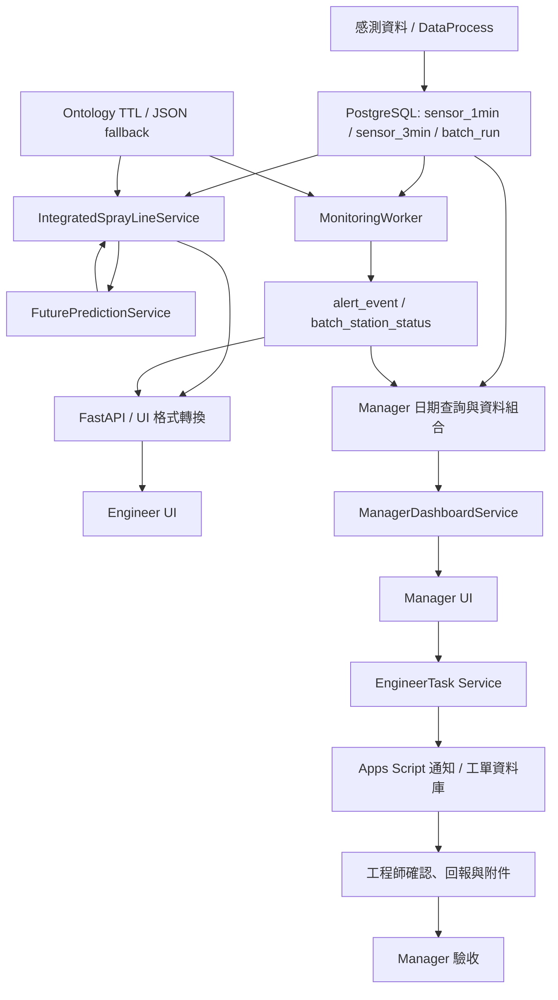
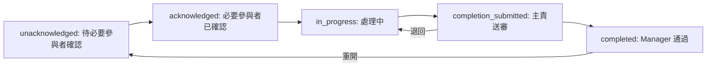

# 噴塗產線系統 Service 說明書

| 項目 | 說明 |
| --- | --- |
| 對應版本 | `final_version_0718_v3` |
| 程式來源 | 使用者提供的 `final_version_0718_v3.zip` |
| 文件日期 | 2026-10-14 |
| 適用對象 | 後端開發、Manager UI / Engineer UI 開發、系統整合同學 |
| 文件範圍 | 核心 Service、UI 資料整理 Service、工單 Service、API 串接及資料庫回寫 |
| 說明原則 | 描述此版本實際程式行為；改善建議另外標示，不代表已完成修改 |

> 本版本的 Quality Score 是製程條件分數，估算 Qc 是製程異常比例或風險代理值。兩者都不能直接當作現場 QC 檢驗良率。預測目前使用線性趨勢外推，尚未完成真實產線資料的準確度驗證。

## 1. Service 在系統中的位置

Service 負責資料查詢、指標計算、規則判斷、預測及工作流程。API 接收 UI 的請求，呼叫 Service，再把結果整理成 UI 可使用的資料。

系統可分成三條主要流程：

1. **畫面查詢**：資料庫 → Service 計算 → API → Manager / Engineer UI。
2. **背景監控**：感測資料 → Worker 規則判斷 → 告警與站點狀態回寫。
3. **異常處理**：Manager 派工 → 通知工程師 → 確認與回報 → Manager 驗收。



圖中的 Service 名稱表示職責，不代表每一個都是獨立伺服器。多數核心 Service 是 Python 模組，由 API 呼叫；MonitoringWorker 則可獨立常駐執行。

## 2. Service 清單與職責

### 2.1 核心 Service

| Service / 模組 | 主要檔案 | 功能 | 是否會寫入資料 |
| --- | --- | --- | --- |
| IntegratedSprayLineService | `services/integrated_service/sprayline_integrated_service.py` | 統一過去、現在、未來與批次查詢，計算製程指標和元件狀態 | 查詢預設不寫入；明確啟用 write-back 時會寫入 |
| Quality Score 共用計算 | `services/integrated_service/quality_score_common.py` | 依流量、空壓、噴幅與路徑誤差計算品質分數，供 Manager 資料組合使用 | 否 |
| FuturePredictionService | `services/future_service/future_service.py` | 預測原始感測值，建立預測 payload，提供儲存函式 | 儲存函式會寫入 |
| EventRuleService / RuntimeRuleClassifier | `services/event_rule_service/` | 使用 Ontology 規則判斷 normal / warning / fault，提供原因與處置 | 分類不寫入；事件評估函式可寫告警 |
| MonitoringWorker | `services/monitoring_worker/` | 讀取感測資料、偵測異常、抑制重複告警、更新批次站點狀態 | 是 |
| TroubleshootingService | `services/troubleshooting_service/troubleshooting_service.py` | 查詢異常類型對應的原因處理知識與解方 | 否 |
| Database 整合 Adapter | `services/integration_adapter/database_versionb_adapter.py` | 尋找並呼叫資料庫 Python 函式，集中處理匯入路徑 | 依呼叫的 DB 函式而定 |

### 2.2 API 與 UI 旁的 Service

| Service / 模組 | 主要檔案 | 功能 |
| --- | --- | --- |
| ServiceOrchestrationAdapter | `api/service_orchestration_adapter.py` | 串接核心 Service，整理成功、錯誤與 HTTP 狀態 |
| ManagerDateService | `api/manager_date_service.py` | 查詢可用日期與小時，定位管理者選取的正式資料 |
| ManagerDashboardService | `api/manager_dashboard_service.py` | 整理產線摘要、站點比較、趨勢、風險理由與建議 |
| UI Bridge | `api/shaoyu_ui_bridge.py` | 將 IntegratedService 結果轉成 summary、station-detail、component-detail 格式 |
| Engineer DashboardService | `ui/engineer/app/services/dashboard_service.py` | 將 API 回傳結果整理為工程師畫面資料，管理快取與趨勢 |
| Engineer WebservicesClient | `ui/engineer/app/services/webservices_client.py` | 呼叫核心 API，換算 UI 時間滑桿單位，處理連線錯誤 |
| Engineer RulesService | `ui/engineer/app/services/rules_service.py` | 讀取工程師端 JSON 門檻、mapping 與圖表參考範圍 |
| Engineer DiagnosisService | `ui/engineer/app/services/diagnosis_service.py` | 整理元件診斷詳細資訊與建議 |
| EngineerTaskService | `api/engineer_task_service.py` | 相容單一工程師工單，透過 Apps Script 寄送通知與同步 ACK |
| EngineerTaskWorkflowService | `api/engineer_task_workflow_service.py` | 多人派工、token 存取、回報、附件、完工送審、驗收與重寄 |

`api/time_series_service.py` 仍保留舊的計算實作；此版本正式 `/api/time-series` 與三個 UI 查詢入口強制使用 integrated 流程。不要只因舊檔仍存在，就把它當成目前正式查詢使用的算法。

## 3. 資料來源與重要欄位

| 資料表 / 設定 | 主要內容 | Service 用途 |
| --- | --- | --- |
| `sensor_1min` | 站點、批次、時間、流量、濾網壓差、空壓、噴幅、伺服負載、路徑誤差等 | 製程計算、監控、預測 |
| `sensor_3min` | 站點、批次、時間、溫度與濕度等 | 環境判斷、預測 |
| `batch_run` | 批次 ID、開始時間、結束時間、狀態 | 批次查詢與追溯 |
| `alert_event` | 異常事件、感測值、嚴重度、原因、時間與確認資訊 | 告警列表、追蹤與去重 |
| `alert_cause_link` / `alert_response_link` | 告警對應的原因與處置關聯 | 異常追溯 |
| `batch_station_status` | 各批次站點的六類元件狀態、處置與製程指標 | 狀態保存與後續查詢 |
| `future_prediction_result` | 預測分數、NG 估算、風險、方法、規則證據、原因與處置 | 保存預測結果 |
| 工單相關表 | 任務、參與人員、回報、附件、時間軸、通知決策 | 派工與驗收 |
| `ontology/sprayline_threshold.ttl` | 正式執行門檻、元件、原因與處置定義 | 後端規則分類 |
| `rules/sensor_thresholds.json` | 備援門檻 | Ontology 無規則或出錯時 fallback |
| `rules/sensor_event_mapping.json` | 感測器對應 issue、cause、response 與狀態欄位 | Worker 告警與狀態回寫 |

### 3.1 時間與資料品質

- `ts` 是感測資料時間；`generated_at` 是 API 回應建立時間，兩者用途不同。
- Manager 日期與小時選擇使用 `Asia/Taipei`。
- IntegratedService 的現在時間主要以所選站點最新 `sensor_1min` 資料時間為基準；多站點查詢取其中最新時間。
- `data_quality_flag=normal` 表示一般資料，`interpolated` 表示插補資料。
- Worker 與預測模型會跳過插補資料，但目前快照與視窗彙總沒有採用相同排除政策。

### 3.2 站點識別

| 正式 station_id | API line_id | Engineer UI ID | IntegratedService 名稱 |
| --- | --- | --- | --- |
| `Station_1` | `line_1` | `M1` | 底漆站 / Primer Station |
| `Station_2` | `line_2` | `M2` | 面漆站 / Topcoat Station |
| `Station_3` | `line_3` | `M3` | 金漆站 / Gold Paint Station |

Manager 目前把第三站 process layer 標成 Clearcoat；Integrated / Engineer 使用金漆站。正式名稱需要統一確認。

## 4. IntegratedSprayLineService

### 4.1 功能與呼叫順序

主要類別：`IntegratedSprayLineService`。

```text
build_ui_time_series_response()
  → 決定站點與時間 / 批次範圍
  → build_station_output()
      → fetch_sensor_window()
      → build_current_snapshot()
      → derive_formal_metrics()
      → build_window_summary()
      → build_ui_series_points()
      → future 模式另呼叫 estimate_future_from_history()
```

核心輸出包含 `viewer_state`、`stations`、資料來源及建立時間。每一站包含時間序列、目前快照、視窗摘要、元件狀態、環境快照與批次資訊；未來模式另外包含 `future_prediction_payload`。

### 4.2 時間模式

直接呼叫核心 Service 時，`slider_value` 的單位是分鐘。

| slider_value | 模式 | 查詢 / 預測行為 |
| --- | --- | --- |
| `-60` | 過去 | 以資料基準時間前 60 分鐘為 anchor，再回查一個 window |
| `0` | 現在 | 查詢資料基準時間之前的 window |
| `30` | 未來 | 使用目前資料與歷史，預測基準時間後 30 分鐘 |

`window_minutes` 預設為 30。未來模型會另外查詢 anchor 之前 60 分鐘的歷史，不只使用畫面 window。

Engineer WebservicesClient 會把 UI 滑桿換成 Service 單位：過去每格 60 分鐘，未來每格 30 分鐘；批次模式保持批次偏移值。直接呼叫 API 時需注意自己使用的是哪一層單位。

### 4.3 批次模式

- `mode=batch`、`slider_value=0`：各站最近有資料的批次。
- `slider_value=-1`：前一批；`-2`：前兩批。
- `batch_id`：直接指定批次。
- `anchor_batch_id`：固定批次基準，避免新資料進來後滑桿跳動。
- 正值表示未來批次槽位，仍使用基準批次資料作模型輸入。
- 目前未來批次預測時間為 `anchor + window_minutes × 未來批次偏移`，不是已確認的真實批次週期模型。
- 超出可用批次範圍時會選最舊可用批次，並提供 `batch_offset_out_of_range`；前端應檢查此欄位。

### 4.4 資料選取與補查

目前快照取最後一筆 `sensor_1min`，再補入最後一筆 `sensor_3min` 的溫度與濕度。它不是把整個 window 的感測值全部平均後當成快照。

一般時間模式若 window 查不到資料，會找 anchor 之前最近的一筆正式資料。批次模式若沒有對應環境資料，會找 anchor 前後 3 分鐘內鄰近資料，優先使用較早的資料。

這些補查沒有生成新感測值，但可能使用不同時間或不同批次的環境讀值；使用者應確認資料時間，不能只看 API 建立時間。

### 4.5 原始感測欄位

| 欄位 | 單位 | 用途 |
| --- | --- | --- |
| `paint_flow_ml_min` | ml/min | 噴嘴流量與品質計算 |
| `filter_diff_pressure_bar` | bar | 濾網狀態與堵塞指標 |
| `air_pressure_bar` | bar | 空壓偏差與品質計算 |
| `spray_width_mm` | mm | 噴幅偏差與品質計算 |
| `servo_torque_load_pct` | % | 機械手臂負載 |
| `path_error_mm` | mm | 路徑誤差與品質計算 |
| `temperature_c` | °C | 環境判斷 |
| `humidity_rh` | %RH | 環境判斷 |

### 4.6 現有目標設定

| 設定 | 目前值 |
| --- | --- |
| 目標流量 | 115 ml/min |
| 目標空壓 | 3.2 bar |
| 估計膜厚基準 | 15 µm |
| Station_1 目標噴幅 | 120 mm |
| Station_2 目標噴幅 | 100 mm |
| Station_3 目標噴幅 | 82 mm |
| 濾網健康壓差基準 | 0.1 bar |
| 濾網堵塞指標上限基準 | 0.7 bar |

這些是程式現有常數，並未依每個 recipe 動態載入，也不等於所有 Ontology normal / warning / fault 門檻。正式目標與適用產品需由廠商確認。

### 4.7 衍生指標公式

下列 `clamp(x, 0, 100)` 表示把數值限制在 0～100。

```text
流量偏差率 = abs(流量 - 115) / 115 × 100
噴嘴流量損失率 = max(0, (115 - 流量) / 115 × 100)
濾網堵塞指標 = clamp((濾網壓差 - 0.1) / (0.7 - 0.1) × 100, 0, 100)
空壓偏差 = 空壓 - 3.2
空壓偏差率 = abs(空壓 - 3.2) / 3.2 × 100
噴幅偏差 = 噴幅 - 該站目標噴幅
噴幅偏差率 = abs(噴幅偏差) / 該站目標噴幅 × 100
噴幅分數 = max(0, 100 - 噴幅偏差率)
估計膜厚 = 15 × (流量 / 115) × (該站目標噴幅 / 噴幅)
```

估計膜厚需要有效流量與正的噴幅。此公式沒有完整納入走速、塗料性質、轉移效率等因素；輸出 `estimated_film_thickness_um` 是估算值。

### 4.8 單筆 Quality Score

```text
流量扣分 = min(30, 流量偏差率 × 2)
空壓扣分 = min(25, 空壓偏差率 × 2)
噴幅扣分 = min(30, 噴幅偏差率 × 2)
路徑扣分 = min(20, 路徑誤差 / 0.15 × 20)
Quality Score = clamp(100 - 四項扣分合計, 0, 100)
```

例如 Station_1 流量 115、空壓 3.2、噴幅 120、路徑誤差 0.05 時，單筆分數約 93.33。這是製程條件分數，不是 93.33% 的產品通過實際 QC。

現有程式缺哪個欄位，就不扣該項分數；只有四項全缺時才回傳無分數。因此部分資料缺少時仍可能得到過高分數。

### 4.9 元件狀態與 Qc

| 狀態欄位 | 判定來源 |
| --- | --- |
| `nozzle_state` | 流量規則 |
| `filter_state` | 濾網壓差規則 |
| `compressor_state` | 空壓規則 |
| `spray_width_state` | 噴幅規則 |
| `robot_arm_state` | 伺服負載與路徑誤差，取較嚴重者 |
| `environment_state` | 溫度與濕度，取較嚴重者 |
| `quality_state` | 流量、空壓、噴幅、路徑誤差，取較嚴重者 |
| `station_state` | 各元件與環境狀態，取較嚴重者 |

後端狀態包括 `normal`、`warning`、`fault`、`no_data`。資料庫狀態欄位使用 `ok` 代表正常。

目前單筆 `quality_state` 為 warning / fault 時，`ng_sample_flag=1`、`qc_pct=100`；其他狀態為 0。視窗彙總則使用：

```text
彙總 Qc = 異常品質樣本數 / 有效品質樣本數 × 100
彙總 quality_score_pct = 100 - 彙總 Qc
```

所以單筆 Quality Score 和彙總 `quality_score_pct` 目前是兩種算法。前述 93.33 的樣本若規則皆正常，單筆視窗彙總會是 100。資料庫指標回寫優先採用彙總值。

### 4.10 查詢與 write-back

`run_integrated_once(..., write_back=False)` 只建立查詢結果。

`write_back=True` 會依各站執行：

1. 呼叫舊版 `run_monitoring_once()`，使用電腦目前時間與 lookback 讀取資料。
2. 寫入整合結果的 `batch_station_status` 元件狀態及品質指標。
3. 若存在 future payload，再寫入 `future_prediction_result`。
4. 依上層 `commit` 參數提交整合結果。

監控步驟會建立自己的連線並各自提交；它不是完全沿用此次歷史或批次查詢的 window。整個 write-back 流程目前不是一筆統一交易。

## 5. FuturePredictionService

### 5.1 模型與輸入

模型名稱：`linear_trend_v1`。

- 使用六個 1 分鐘感測欄位：流量、濾網壓差、伺服負載、空壓、噴幅、路徑誤差。
- 使用兩個 3 分鐘環境欄位：溫度、濕度。
- IntegratedService 預設提供最近 60 分鐘歷史。
- 每個欄位獨立排除插補、無效時間與非有限數值，並依 timestamp 去重。
- 至少 5 筆有效樣本才計算線性趨勢；不足時保留最後有效值。
- 完全沒有有效樣本時可使用 snapshot fallback，否則回傳 `no_data` 診斷。

### 5.2 計算方式

模型以時間與感測值做線性迴歸，取得斜率，再由最後一筆觀測值向未來外推：

```text
預測值 = 最後有效感測值 + 限幅後斜率 × 預測距離（分鐘）
```

此實作以最後觀測值為外推起點，並未直接使用迴歸線在目標時間的估計值。

| 感測值 | 輸出上下限 | 每分鐘最大絕對變化 |
| --- | --- | --- |
| 流量 | 0～250 ml/min | 15 |
| 濾網壓差 | 0～2 bar | 0.15 |
| 伺服負載 | 0～100% | 15 |
| 空壓 | 0～10 bar | 0.15 |
| 噴幅 | 0～250 mm | 8 |
| 路徑誤差 | 0～2 mm | 0.05 |
| 溫度 | -20～80 °C | 0.20 |
| 濕度 | 0～100%RH | 0.50 |

以上是避免外推數值失控的程式限制，不是產品驗收門檻。

### 5.3 預測後的品質與風險

預測原始感測值後，IntegratedService 再使用第 4 節的公式和規則計算預測指標與元件狀態。

```text
predicted_ok_rate = 預測製程 Quality Score（舊欄位相容）
estimated_defect_rate_pct = 100 - 預測 Quality Score
qc_pct = estimated_defect_rate_pct
predicted_ng_count = round(estimated_defect_rate_pct / 2.5)
```

`predicted_ng_count` 沒有使用實際批次件數，不能作為正式預測 NG 件數。

| risk_level | 現有判定 |
| --- | --- |
| `high` | 品質分數 < 84，或 NG 估算數 >= 35 |
| `medium` | 品質分數 < 90，或 NG 估算數 >= 20 |
| `low` | 其餘可判定情況 |

此風險是品質代理值風險，不是所有設備故障狀態的總風險。例如濾網已被規則判為 fault，品質代理分數仍可能較高。

### 5.4 信心與診斷

| confidence | 現有條件 |
| --- | --- |
| `high` | 至少 20 筆、時間跨度至少 20 分鐘、R² >= 0.45 |
| `medium` | 至少 8 筆、時間跨度至少 5 分鐘，且未達 high |
| `low` | 其他情況或最後值 fallback |

整體信心取有預測值欄位中的最低等級。信心尚未考慮預測距離、感測資料新鮮度與必要欄位完整性，不能解讀成已驗證的預測準確率。

重要輸出欄位：

| 欄位 | 說明 |
| --- | --- |
| `predicted_metrics` | 預測感測值與衍生指標 |
| `predicted_components` | 預測元件與站點狀態 |
| `input_window` | 模型輸入範圍、樣本數與排除插補數 |
| `confidence` | 整體與各指標信心 |
| `metric_diagnostics` | 各指標樣本數、斜率、R²、fallback 原因 |
| `rule_evaluations` | 規則、狀態、門檻、原因與處置證據 |
| `cause_ids` / `response_ids` | 異常對應原因與處置 |
| `quality_score_semantics` | 指明是製程分數而非檢驗良率 |

### 5.5 預測保存

`build_future_prediction_payload()` 建立資料格式；`save_future_prediction_result()` 才寫入資料庫。單純呼叫 future payload API 不會自行訓練模型或從資料庫預測。

資料庫依「批次、站點、預測時間、預測方法」建立冪等 key；相同邏輯預測再次保存會更新同一筆結果。

目前保存分數、風險、方法、規則證據、原因與處置等欄位；`predicted_metrics`、`predicted_components`、`confidence`、`metric_diagnostics` 和 `input_window` 並未由現有 DB insert 全量保存。API 回傳內容不等於資料庫完整保存內容。

## 6. EventRuleService 與規則分類

### 6.1 規則來源順序

```text
classify_sensor_value(metric, value)
  → ontology.rule_inference.infer_state()
  → Ontology 有定義且可判定：使用 Ontology 結果
  → Ontology 有規則但值落在未定義區間：保留 unknown
  → Ontology 無此 metric 或執行出錯：使用 JSON fallback
```

回傳包含 `state`、`level`、`threshold`、`cause_id`、`response_ids`、`rule_source`、`rule_engine`、`fallback_reason` 等。正常值通常沒有異常原因與處置。

`classify_value()` 是只回傳狀態的相容包裝；`evaluate_event_rules()` 可對一組 sensor payload 建立異常告警，並跳過插補資料。它與 Worker 的站點狀態回寫流程不同，不能假設呼叫它就一定更新 `batch_station_status`。

### 6.2 嚴重度與異常類型

| 概念 | 例子 | 用途 |
| --- | --- | --- |
| 嚴重度 state | `warning`、`fault` | 顯示異常程度 |
| issue_state / issue_id | `FILTER_CLOG`、`PATH_ERROR_HIGH` | 表示具體異常，用於解方查詢 |
| cause_id | `FILTER_CLOG`、`SERVO_WEAR` | 原因 catalog 識別 |
| response_id | `REPLACE_FILTER`、`RECALIBRATE_TCP` | 處置 catalog 識別 |

不能把 `fault` 當作所有 Troubleshooting 查詢的異常類型。API 雖命名為 `{state}`，查詢條件實際比對的是 `issue_catalog.issue_id`。

## 7. MonitoringWorker

### 7.1 單筆處理

```text
process_row()
  → 插補資料直接跳過
  → extract_sensor_payload()
  → evaluate_sensor_payload()
  → 每個 warning / fault
      → write_alert_event()
      → upsert_batch_station_status()
```

告警會包含批次、站點、感測器、量測值、嚴重度、原因、訊息與感測時間；依 mapping 建立 cause / response 關聯。缺少批次或站點時，該異常回傳 skipped。

Worker 判斷原始 sensor 欄位，不會自動先呼叫 IntegratedService 計算所有品質衍生指標。JSON 中有品質指標 mapping，也不代表 Worker 已經會產生那些衍生值。

### 7.2 兩種執行入口

| 入口 | 時間基準與資料範圍 | 目前使用位置 |
| --- | --- | --- |
| `monitoring_worker.run_monitoring_once()` | 電腦現在時間之前的固定 lookback，重複掃描範圍；有保存 checkpoint，但沒有讀取它作增量邊界 | monitoring API、Integrated write-back |
| `anchored_worker.run_anchored_once()` | 依各站各表 checkpoint 讀取新資料，可用資料最新時間或電腦時間作 anchor | Docker 背景 Worker |

Docker 執行 `monitoring_worker.anchored_worker`。預設增量條件為 `checkpoint < ts <= anchor`，全部列處理完成後才更新該站該表進度。若 checkpoint 比資料最新時間更晚，會重新建立 lookback 範圍。

### 7.3 去重與狀態更新

- 同站點、感測器、嚴重度、原因且在抑制時間內未確認的告警，可視為重複。
- 預設抑制時間為 5 分鐘。
- 批次 ID 刻意沒有納入去重條件，因此可能跨批次抑制。
- warning 升級 fault 可建立新告警。
- Worker 寫入站點狀態時保留六類狀態與處置，狀態取既有與新異常中的較嚴重者。
- 正常資料不產生 detected，因此 Worker 不會自行將既有 fault 恢復為 ok。

目前此狀態較接近「批次累積最嚴重狀態」；若畫面要表示當下設備狀態，需要另確認恢復邏輯。

### 7.4 回寫與 checkpoint 限制

告警 writer、狀態 writer 各自 commit，checkpoint 是本地 JSON。資料庫事件與 checkpoint 沒有共同交易，也沒有 JSON 並行更新保護。

目前狀態 writer 未保留既有品質指標，而 DB upsert 會同時覆蓋這些欄位。異常回寫可能將既有 Quality Score、Qc、估計膜厚清成空值。

## 8. TroubleshootingService

| 函式 | 功能 | 輸出 |
| --- | --- | --- |
| `get_troubleshooting_matrix(conn, asset_type, state)` | 查詢指定元件 / 異常類型的解方矩陣 | `total`、`rows` |
| `get_state_recommendations(conn, state, station)` | 查詢一個 issue_id 的解方 | 異常說明、站點標示、recommendations |
| `get_issue_recommendations(...)` | 舊名稱相容包裝 | 同 state recommendations |

查詢使用 `component_catalog`、`issue_catalog`、`solution_catalog`、`component_issue_solution_map`，解方可包含技能需求、停機時間估計、相關性排序與有效性比例。

`state` 此處是具體 issue_id，例如 `FILTER_CLOG`。`station` 目前主要回傳為站點標示，沒有額外依站點篩選 SQL。此 Service 提供建議，不會自行執行維修或建立工單。

## 9. Manager UI 後端流程

```text
Manager UI 選日期 / 小時 / 批次
  → /api/manager/dashboard
  → ManagerDateService 定位正式資料
  → api_server.py 組合感測、診斷、告警與指標
  → ManagerDashboardService
  → managerView / managerSummary / 趨勢與比較資料
  → Manager UI 顯示
```

### 9.1 ManagerDateService

- 從 `sensor_1min` 查詢台北時間可用日期與小時。
- 未指定日期 / 小時時，選最新有資料的日期及小時。
- 指定不存在的日期或小時會回傳錯誤，不直接假裝有資料。
- 提供選取小時的各站讀值、整日感測資料、整日批次數與小時彙總。

### 9.2 ManagerDashboardService

輸出站點 telemetry、比較、風險理由、建議、派工資訊、趨勢、產量估算與品質驗證摘要。

目前幾項計算的實際意義：

| 顯示 / 欄位 | 現有計算 | 使用限制 |
| --- | --- | --- |
| 每小時稼動率 | 該小時感測列數 / 60 × 100，最多 100 | 更接近資料覆蓋率，不是設備運轉時間量測 |
| 批次產量估算 | 批次數 × 264 件 | 264 是固定設定，沒有接 MES 實際件數 |
| 估計 OK / NG 件數 | 估計產量 × 製程分數比例 | 使用製程代理值，不是實際 QC 結果 |
| 風險分數 | 品質、堵塞、稼動、週期、噴幅、流量、空壓的加權計算 | 權重及基準目前寫在程式內 |
| 昨天 / 上週 / 月比較 | 部分值由目前指標加減常數推估 | 不能直接解讀為真實歷史統計 |
| qualityHistory | 由估算值組合工單、件數與瑕疵描述 | 不是正式 QC 檢驗結果表 |

取得 MES、QC、OEE / 運轉事件資料後，才能讓這些管理數字完全對應現場事實。

## 10. Engineer UI 後端流程

```text
Engineer UI
  → Engineer 本地 Router
  → DashboardService
  → WebservicesClient
  → /api/time-series/ui/summary 或 station-detail 或 component-detail
  → IntegratedSprayLineService
  → UI Bridge
  → DashboardService 整理卡片 / 詳細資訊 / 趨勢
```

- `WebservicesClient` 負責 HTTP 呼叫、時間滑桿換算與錯誤。
- `DashboardService` 管理約 15 秒的畫面 snapshot 分組及站點、元件、趨勢快取。
- `RulesService` 讀取 `ui/engineer/config/` 的 JSON 規則。
- `DiagnosisService` 整理診斷詳細資訊。
- `api_data_service.py`、`local_data_service.py` 仍保留在專案中，但目前 `dependencies.py` 主要組裝的是上述 WebservicesClient / DashboardService 路徑。

現有 DashboardService 會以工程師端規則重新判定元件，不完全採用後端結果。例如機械手臂卡片只使用伺服負載重新分類，可能忽略後端已判為 fault 的路徑誤差。這是待統一的邏輯。

UI Bridge 為相容品質卡片，會把 `estimated_film_thickness_um` 暴露為 `film_thickness_um`。名稱雖像量測膜厚，實際值仍是估算；前端文字應標明來源。

## 11. 工程師工單與通知 Service

### 11.1 相容舊流程

`EngineerTaskService` 處理單一工程師工單，建立 DB 任務後呼叫 Apps Script 寄送通知，並提供 `sync_engineer_task_ack()` 查詢外部確認狀態。

### 11.2 多人工作流程

`EngineerTaskWorkflowService` 提供建立任務、多人指派、主責人、必要參與者、通知去重、ACK、處理回報、附件、完工送審、Manager 驗收、退回、重開及補件。



寄送狀態與工作流程狀態分開：寄送成功不代表工程師已確認，工程師提交完工也不代表 Manager 已驗收。

### 11.3 存取與附件

- 每位工程師使用自己的隨機 token；DB 保存 SHA-256 hash。
- 存取檢查包含 token 有效性、有效期限、是否撤銷、是否仍為 active 參與者。
- 目前 token 建立期限約 10 年；已完成任務另有完成後 7 天存取限制。
- 主責人才能提交完工，必要參與者須先完成 ACK。
- 附件支援 JPEG、PNG、WEBP，每張最多 5 MB，每份回報最多 5 張，每件任務最多 30 張。
- 圖片內容經驗證後寫入附件目錄，DB 保存 metadata 與 hash。
- 完成任務原則上唯讀；Manager 開啟補件後依授權新增資料。

重寄會換發 token。此版本重寄失敗仍可能提交新 token，造成原有連結失效，後續需調整失敗恢復流程。

通知決策評估 API 會記錄決策及抑制資訊，並不等於它本身已執行寄信或建立完整工單；實際建立與寄送由對應工單流程完成。

## 12. API 串接清單

Docker 對主機暴露的 API 位址為 `http://localhost:8011`；容器內 Engineer 呼叫 `http://api:8000`。下列路徑以主機 API base 為例。

### 12.1 正式 UI 與管理者查詢

| 方法 | 路徑 | 功能 | 寫入 |
| --- | --- | --- | --- |
| POST | `/api/time-series` | 正式整合時間 / 批次查詢 | 否 |
| POST | `/api/time-series/ui/summary` | Engineer 概覽格式 | 否 |
| POST | `/api/time-series/ui/station-detail` | 指定站點詳細格式 | 否 |
| POST | `/api/time-series/ui/component-detail` | 指定元件詳細格式 | 否 |
| GET | `/api/manager/available-dates` | 可用日期與小時 | 否 |
| GET | `/api/manager/dashboard` | 管理者儀表板 | 否 |
| GET | `/api/database/status` | 資料庫狀態 | 否 |
| GET | `/api/service-orchestration/status` | Service 模組與整合狀態 | 否 |

### 12.2 Service 操作與告警

| 方法 | 路徑 | 功能 | 寫入 |
| --- | --- | --- | --- |
| POST | `/api/service-orchestration/integrated/query` | 核心整合查詢，接受 `write_back` | 預設否；true 時會寫入 |
| POST | `/api/service-orchestration/integrated/run-once` | 強制執行整合 write-back | 是 |
| POST | `/api/service-orchestration/future/payload` | 依輸入欄位建立 future payload | 否 |
| POST | `/api/service-orchestration/future/save` | 建立並儲存 future payload | 預設提交 |
| POST | `/api/service-orchestration/monitoring/run` | 固定 lookback 監控一次 | 是 |
| GET | `/api/service-orchestration/troubleshooting/matrix` | 解方矩陣 | 否 |
| GET | `/api/service-orchestration/troubleshooting/states/{state}/recommendations` | 指定 issue_id 解方 | 否 |
| GET | `/api/alerts` | 告警列表 | 否 |
| GET | `/api/alerts/unacknowledged/{station_id}` | 未確認告警 | 否 |
| GET | `/api/alerts/{event_id}` | 告警詳細資訊 | 否 |
| PATCH | `/api/alerts/{event_id}/acknowledge` | 確認告警 | 是 |

### 12.3 工單 API

| 方法 | 路徑 | 功能 |
| --- | --- | --- |
| POST / GET | `/api/manager/engineer-tasks` | 建立 / 查詢工單 |
| GET | `/api/manager/engineer-tasks/{task_id}` | 工單詳細資訊 |
| POST | `/api/manager/engineer-tasks/{task_id}/sync-ack` | 相容舊 Apps Script ACK 同步 |
| GET | `/api/manager/engineer-tasks/{task_id}/timeline` | 時間軸 |
| POST | `/api/manager/engineer-tasks/{task_id}/resend` | 重寄 |
| PATCH | `/api/manager/engineer-tasks/{task_id}/assignees` | 修改參與者 |
| POST | `/api/manager/engineer-tasks/{task_id}/review` | Manager 通過 / 退回 |
| POST | `/api/manager/engineer-tasks/{task_id}/reopen` | 重開工單 |
| POST | `/api/manager/engineer-tasks/{task_id}/supplementation/open` | 開啟補件 |
| POST | `/api/manager/engineer-tasks/{task_id}/supplementation/close` | 關閉補件 |
| GET / POST | `/api/manager/station-engineer-assignments` | 查詢 / 建立站點工程師分配 |
| PATCH | `/api/manager/station-engineer-assignments/{assignment_id}` | 修改站點工程師分配 |
| GET | `/api/manager/notification-decisions` | 通知決策紀錄 |
| POST | `/api/manager/notification-decisions/evaluate` | 評估通知與抑制 |

工程師 token 操作如下，各操作需依 Router 的 token 與 request model 格式呼叫：

| 方法 | 路徑 | 功能 |
| --- | --- | --- |
| GET | `/api/engineer-task-access/task` | token 對應任務、參與者與時間軸 |
| POST | `/api/engineer-task-access/ack` | 確認任務 |
| POST | `/api/engineer-task-access/start` | 開始處理 |
| POST | `/api/engineer-task-access/reports` | 新增回報 |
| POST | `/api/engineer-task-access/completion-submit` | 主責提交完工 |
| POST | `/api/engineer-task-access/reports/{report_id}/attachments` | 上傳回報圖片 |
| GET | `/api/engineer-task-access/attachments/{attachment_id}` | 工程師下載圖片 |
| GET | `/api/manager/engineer-task-attachments/{attachment_id}` | Manager 下載圖片 |

### 12.4 查詢範例

以下 JSON 是核心 integrated query 的 request body；時間單位為分鐘。

現在查詢：

```json
{
  "request_id": "manual-current-001",
  "mode": "time",
  "slider_value": 0,
  "window_minutes": 30,
  "station_scope": "all",
  "write_back": false
}
```

未來 30 分鐘：

```json
{
  "request_id": "manual-future-001",
  "mode": "time",
  "slider_value": 30,
  "window_minutes": 30,
  "station_scope": "Station_1",
  "write_back": false
}
```

前一批查詢，固定批次基準：

```json
{
  "mode": "batch",
  "slider_value": -1,
  "anchor_batch_id": "REPLACE_WITH_REAL_BATCH_ID",
  "station_scope": "Station_1",
  "write_back": false
}
```

Engineer 元件查詢的核心 API request 範例：

```json
{
  "line_id": "line_1",
  "component_name": "filter_mesh",
  "mode": "time",
  "slider_value": 0,
  "window_minutes": 30
}
```

元件名稱可使用 `robot_arm`、`nozzle`、`air_compressor`、`spray_width`、`filter_mesh`、`quality_module`。範例 batch ID 是 placeholder，需換成資料庫實際值。

### 12.5 成功與錯誤格式

Orchestration 查詢成功常見外層格式：

```json
{
  "success": true,
  "output_type": "integrated_service_result",
  "write_back_requested": false,
  "data": {
    "service_name": "IntegratedSprayLineService",
    "output_type": "ui_time_series",
    "viewer_state": {},
    "stations": []
  }
}
```

此為結構示意，並非一份實際查詢紀錄。UI endpoints 另有專用格式，不能假設所有 API 都有相同外層。

| HTTP 狀態 | Orchestration error_code | 說明 |
| --- | --- | --- |
| 422 | `invalid_request` | 輸入型別或數值不適用 |
| 403 | `forbidden` | 權限錯誤 |
| 504 | `upstream_timeout` | timeout |
| 503 | `database_unavailable` | DB 連線不可用 |
| 409 | `database_conflict` | 唯一鍵、外鍵或 check 衝突 |
| 500 | `database_schema_error` / `internal_error` | schema 或其他內部錯誤 |

`_http_status` 是 adapter 內部傳遞狀態；API response helper 會使用它設定 HTTP code。完整 traceback 寫入 API log，不放在此 adapter 的正常錯誤 body。

## 13. 啟動與設定

### 13.1 執行環境

- 核心依賴以專案 `requirements.txt` 為準，包含 FastAPI、Uvicorn、psycopg2-binary、NumPy、HTTPX、Pillow 等。
- API 通常由 Docker 啟動，不需要為每個 Service 各開 HTTP server。
- 資料庫需要完成 schema migration，才能使用品質回寫、預測規則證據及工單欄位。
- Compose 使用既有外部 volume `final_version_0627_sprayline_pgdata`，不是全新資料庫一鍵初始化設定。

在專案根目錄、既有 DB volume 與資料已準備好的情況下：

```powershell
docker compose up -d api frontend engineer
docker compose --profile monitor up -d monitoring_worker
```

API 會等待 `db-migrate` 成功。Worker 目前僅等待 DB healthy，沒有相同 migration 成功依賴；應確認 migration 已完成後再啟動 Worker。

`dataprocess` 是此版本的感測資料產生器，需以 `data` profile 額外啟動；啟動它不代表已串接現場感測設備。

### 13.2 主要環境變數

| 變數 | 功能 / 本版 Compose 設定 |
| --- | --- |
| `DB_HOST` / `DB_PORT` / `DB_NAME` / `DB_USER` / `DB_PASSWORD` | PostgreSQL 連線；容器內 DB host 為 `db`，port 5432 |
| `SPRAYLINE_DB_FUNCTION_PATH` | DB Python 模組位置；Compose 為 `/app/database` |
| `PYTHONPATH` | API / services / database 的匯入路徑 |
| `SPRAYLINE_MONITOR_TIME_MODE` | `data_anchor` 或 `wall_clock`；Compose 使用 data_anchor |
| `SPRAYLINE_MONITOR_RUN_MODE` | `once` 或 `forever`；Compose 使用 forever |
| `SPRAYLINE_MONITOR_INTERVAL_SECONDS` | 程式預設 60 秒；Compose 設為 10 秒 |
| `SPRAYLINE_MONITOR_LOOKBACK_MINUTES` | 程式預設與 Compose 為 10 分鐘 |
| `SPRAYLINE_MONITOR_STATIONS` | 預設 Station_1、Station_2、Station_3 |
| `SPRAYLINE_MONITOR_CHECKPOINT_FILE` | 增量處理進度 JSON；Compose 為 `/app/runtime/monitoring_checkpoint.json` |
| `SPRAYLINE_DUPLICATE_ALERT_SUPPRESSION_MINUTES` | 預設與 Compose 為 5 分鐘 |
| `WEBSERVICES_URL` | Engineer 核心 API base；Compose 為 `http://api:8000` |
| `WEBSERVICES_SOURCE_MODE` | Engineer 請求來源模式；Compose 為 integrated，正式 API 仍強制 integrated |
| `WEBSERVICES_TIMEOUT_SEC` | 程式預設 20 秒；Compose 為 45 秒 |
| `ENGINEER_TASK_APP_SCRIPT_URL` | 工單通知外部服務位址 |
| `ENGINEER_TASK_BASE_URL` | 通知中工程師工單頁面的 base URL |
| `ENGINEER_TASK_ATTACHMENT_ROOT` | 工單附件保存目錄；Compose 為 `/data/engineer-task-attachments` |

主機映射埠：API 8011、Manager UI 8012、Engineer UI 8013、PostgreSQL 5433。程式不經 Compose 啟動時，應自行設定一致的 DB 路徑與 API base，避免沿用不同的本機預設埠。

## 14. 目前限制與改善方向

下表是程式檢查確認的現況與建議，尚未在本文件製作時修改。

| 優先度 | 現況 | 改善方向 |
| --- | --- | --- |
| 高 | Worker 異常更新可能清空既有品質指標 | 狀態更新保留未修改欄位，或分開狀態與指標 update |
| 高 | 部分缺值仍可得高分；完全無歷史仍可能輸出 100 分低風險 | 必要欄位完整度、有效樣本與可預測條件檢查 |
| 高 | NaN 可被規則誤判 normal | 統一非有限數值與型別檢查 |
| 高 | Engineer 本地規則可能覆蓋後端異常 | 統一分類來源與狀態證據，補路徑誤差等判斷 |
| 高 | Manager 部分 actual / 歷史比較仍為估算 | 明確分開估算與實測，串接正式 MES / QC / OEE |
| 中 | 單筆與彙總 Quality Score 意義不同 | 分離製程分數、異常樣本率、實際 QC 良率 |
| 中 | 插補資料政策不同 | 統一排除或加權規則，公開有效樣本與插補比例 |
| 中 | window 無資料時可使用很舊的資料 | 補新鮮度、最大容許間隔與 stale 狀態 |
| 中 | 告警、狀態、checkpoint 分開提交 | 交易一致性、原子 checkpoint 與冪等寫入 |
| 需確認 | 去重不分批次，Worker 狀態只累積較嚴重值 | 明確定義逐批告警、持續異常與恢復語意 |
| 中 | 預測 NG 件數未使用產量，信心未考慮 horizon | 限制預測範圍，接產量與實際 QC 校正 |
| 中 | 共用品質公式仍有重複實作，設定與規則分散 | 共用計算、設定來源與規則版本 |
| 中 | 寄信失敗仍可能換掉舊 token | 調整重寄失敗恢復與通知交易流程 |
| 中 | 詳細預測診斷未全量保存 | 若需追溯模型輸入與結果，補對應 schema 與寫入 |

### 14.1 需要廠商或現場資料補足的內容

1. 各站、產品與 recipe 的流量、空壓、噴幅、膜厚與門檻。
2. MES 實際產出數量、計畫數量、批次及工單關聯。
3. QC 檢驗結果、抽樣方式、OK / NG 件數、瑕疵類型及檢驗時間。
4. OEE / 運轉紀錄、停機起訖、標準週期與實際加工週期。
5. 正式批次定義、跨站追蹤方式與異常恢復規則。
6. 原因與處置 catalog、第三站名稱、工程師角色及部署條件。

## 15. 程式閱讀索引與驗證範圍

下列位置相對於 `final_version_0718_v3` 根目錄：

| 要了解的功能 | 建議閱讀位置 |
| --- | --- |
| 過去 / 現在 / 未來主流程 | `services/integrated_service/sprayline_integrated_service.py` |
| 製程 Quality Score | `services/integrated_service/quality_score_common.py` 與 IntegratedService 同名計算 |
| 線性預測與 payload | `services/future_service/future_service.py` |
| 正式分類與 fallback | `services/event_rule_service/runtime_rule_classifier.py` |
| Ontology 門檻解析 | `ontology/rule_inference.py`、`ontology/sprayline_threshold.ttl` |
| 感測值與狀態 mapping | `rules/sensor_event_mapping.json`、`services/monitoring_worker/detection_mapping.py` |
| 背景增量監控 | `services/monitoring_worker/anchored_worker.py` |
| 告警 / 狀態寫入 | `services/monitoring_worker/alert_event_writer.py`、`batch_station_status_writer.py` |
| DB 品質欄位更新 | `database/db_status.py` |
| 預測保存與冪等 | `database/db_future.py`、`database/migrate_0718_v3_backend.sql` |
| API 入口 | `api/api_server.py`、`api/service_orchestration_adapter.py` |
| Manager 日期與畫面 | `api/manager_date_service.py`、`api/manager_dashboard_service.py` |
| Engineer 組裝入口 | `ui/engineer/app/dependencies.py` 與 `app/services/` |
| 工單流程 | `api/engineer_task_service.py`、`api/engineer_task_workflow_service.py`、對應 Router |
| 工單 DB 操作 | `database/db_engineer_task.py`、`database/db_engineer_task_workflow.py` |
| 部署設定 | `docker-compose.yml`、`requirements.txt` |

本文件依上述程式與設定整理，不把 zip 內的修改日誌或註解當成已驗證功能的唯一依據。2026-10-13 的檢查已通過既有 6 項 Ontology 單元測試，並以不連線資料庫的小測試重現缺資料分數、快照與彙總差異、跨批次告警抑制及後端 / Engineer 狀態差異。

完整後端測試當時因環境缺少 `psycopg2` 未能執行；實際 PostgreSQL 回寫、Docker 部署、Apps Script 寄信及真實產線準確度，並未由本文件製作流程重新驗證。
